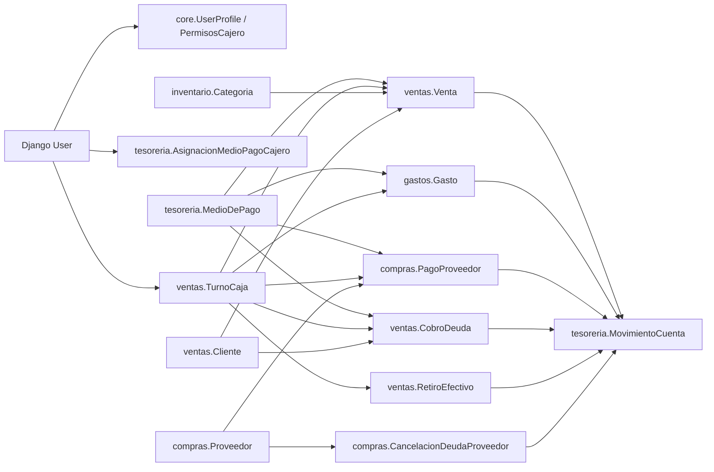

# README Arquitectura - Gestion de Carnicerias

Gestion de Carnicerias es una aplicacion Django pensada para registrar movimientos operativos de dinero: ventas, gastos, retiros, pagos a proveedores, cuentas corrientes de clientes y de proveedores, y cierres de caja por cajero. No esta enfocada en seguimiento estricto de stock; la app de inventario funciona principalmente como catalogo de categorias para clasificar ventas.

El objetivo tecnico del sistema es mantener una terminal POS simple para el trabajo diario y un Django Admin para configuracion, auditoria operativa, reportes y exportaciones.

## 1. Stack tecnico

```text
Python 3.13
Django 5.2
SQLite
django-jazzmin
django-import-export
django-solo
python-dotenv
ReportLab
openpyxl
```

La base de datos por defecto es SQLite mediante el archivo `db.sqlite3`. La configuracion se carga desde `.env` con `python-dotenv` y la configuracion principal vive en `gestion_de_carnicerias/settings.py`.

## 2. Estructura general del proyecto

```text
gestion_de_carnicerias/      Configuracion global, URLs, admin custom, exportaciones y reportes PDF/Excel.
core/            Configuracion del negocio, perfiles de usuario y permisos POS por cajero.
tesoreria/       Medios de pago, asignaciones de medios por cajero y ledger de movimientos.
inventario/      Categorias para clasificar ventas.
ventas/          Turnos de caja, ventas, pagos de venta, clientes, cobros y retiros.
compras/         Proveedores, pagos/deudas a proveedores y cancelacion de deudas.
gastos/          Categorias de gasto y gastos operativos.
pos/             Terminal POS y APIs JSON para la operacion diaria.
dashboard/       Calculo de metricas financieras y dashboard de superadministrador.
templates/       Overrides de admin, login y plantillas globales.
static/          CSS, JS e imagenes.
locale/          Traducciones gettext.
media/           Archivos subidos, por ejemplo logos.
```

## 3. Arquitectura por capas

La aplicacion se puede entender en seis capas:

1. **Configuracion global**: `gestion_de_carnicerias/settings.py`, `gestion_de_carnicerias/urls.py`, middleware, apps instaladas, idioma, rutas estaticas, login y Jazzmin.
2. **Dominio**: modelos Django en `core`, `tesoreria`, `ventas`, `compras`, `gastos` e `inventario`.
3. **Ledger o libro de movimientos**: `tesoreria.MovimientoCuenta`, generado por signals a partir de operaciones reales.
4. **Operacion POS**: `pos/views.py` y `pos/templates/pos/terminal.html`, con endpoints JSON protegidos por login, permisos y turno abierto.
5. **Administracion**: registros en `admin.py`, Django Admin con Jazzmin, import/export y permisos internos.
6. **Reportes**: `dashboard/services.py` concentra el calculo de todas las metricas financieras y es la unica fuente de verdad; encima se apoyan el dashboard del Django Admin, el dashboard de superadministrador (`/dash/`), las exportaciones Excel/PDF y los PDFs de cierre/estado de cuenta.

## 4. Flujo principal del sistema

```text
Usuario Django
  -> login en /accounts/login/
  -> entra a /pos/
  -> abre TurnoCaja con saldo inicial
  -> registra operaciones del turno
       - Venta
       - Gasto
       - Pago/deuda proveedor
       - Cobro deuda cliente
       - Pago cuenta proveedor
       - Retiro efectivo
  -> cada operacion crea/actualiza objetos de dominio
  -> signals regeneran MovimientoCuenta cuando hay flujo real de dinero
  -> cierre de TurnoCaja con saldo final
  -> PDF de cierre y conciliacion por medios
```

Los superusuarios pueden ver mas informacion administrativa, pero para operar en POS tambien necesitan abrir su propio turno, igual que un cajero.

## 5. Aplicaciones y responsabilidades

| App | Responsabilidad |
| --- | --- |
| `core` | Datos del negocio, perfil extendido de usuario y permisos POS por cajero. |
| `tesoreria` | Catalogo de medios de pago, asignacion de medios por cajero y ledger monetario. |
| `inventario` | Categorias de venta; no implementa control de stock detallado. |
| `ventas` | Turnos, ventas, multipago, clientes, cuentas corrientes de clientes, cobros y retiros. |
| `compras` | Proveedores, pagos/deudas a proveedores y cancelaciones de cuenta proveedor. |
| `gastos` | Categorias de gasto y egresos operativos. |
| `pos` | Interfaz POS y APIs JSON para las operaciones diarias. |
| `dashboard` | Calculo de metricas financieras (unica fuente de verdad) y dashboard de superadministrador en `/dash/`, con exportacion PDF/Excel. No tiene modelos propios. |
| `gestion_de_carnicerias` | Configuracion, URLs, dashboard admin, reportes PDF/Excel. |

## 6. Dependencias de dominio



## 7. Modelos de `core`

### `Configuracion`

Modelo para datos generales del negocio.

Campos principales:

- `nombre`: nombre comercial o razon social.
- `direccion`: direccion del negocio.
- `telefono`: telefono de contacto.
- `instagram`, `facebook`, `whatsapp`, `sitio_web`: datos comerciales y redes.
- `descripcion`: descripcion libre.

Metodos:

- `clean()`: punto de validacion, actualmente delega en `super()`.
- `__str__()`: devuelve `nombre` o "Unnamed configuration".

Admin:

- Registrado con `SingletonModelAdmin`, por lo que conceptualmente se usa como una configuracion unica del sistema.

### `UserProfile`

Extension uno a uno del usuario nativo de Django.

Campos:

- `user`: `OneToOneField` a `auth.User`.
- `telefono`: telefono opcional.
- `nombre_completo`: nombre visible opcional.

Signals:

- Se crea automaticamente cuando se crea un usuario.
- Si un usuario no tiene perfil, el signal intenta recrearlo al guardar.

### `PermisosCajero`

Define permisos granulares de POS para cada cajero.

Relacion:

- `user`: `OneToOneField` a `auth.User`, `related_name='permisos_cajero'`.

Permisos operativos:

- `puede_registrar_venta`
- `puede_registrar_gasto`
- `puede_pagar_proveedor`
- `puede_registrar_retiro`
- `puede_cobrar_deuda_cliente`
- `puede_abrir_cerrar_caja`

Permisos de administracion desde POS:

- `puede_crear_editar_cliente`
- `puede_crear_editar_proveedor`
- `puede_crear_categoria_venta`

Signals:

- Al crear un usuario, se crea tambien `PermisosCajero` con valores por defecto del modelo.

Admin:

- Puede editarse desde `Core -> Cashier permissions`.
- Tambien aparece inline dentro del admin de usuarios.

## 8. Modelos de `tesoreria`

### `MedioDePago`

Catalogo de medios de pago disponibles para ventas, gastos, pagos y cobros.

Campos:

- `nombre`: etiqueta visible, por ejemplo `Efectivo`, `Mercado Pago`, `Fiado`.
- `categoria`: categoria funcional.

Categorias disponibles:

- `Efectivo`
- `Cuenta Corriente`
- `Tarjeta de Crédito`
- `Tarjeta de Débito`
- `Transferencia Bancaria`
- `Otro`

Detalle importante:

- Aunque el modelo vive en `tesoreria`, su tabla fisica es `core_mediodepago` para conservar compatibilidad con migraciones anteriores.

### `AsignacionMedioPagoCajero`

Relacion entre un usuario y los medios de pago que puede operar.

Campos:

- `user`: cajero.
- `medio_de_pago`: medio asignado.
- `activo`: permite revocar el medio sin borrar la asignacion.
- `creado_en`: fecha de creacion.

Regla clave:

- Superusuarios ven todos los medios.
- Si un cajero no tiene asignaciones, ve todos los medios por compatibilidad.
- Si un cajero tiene al menos una asignacion, solo ve las asignaciones activas.

Helper:

- `medios_permitidos_para(user)`: centraliza esta regla y se usa tanto al renderizar el POS como al validar operaciones.

### `MovimientoCuenta`

Ledger contable-operativo de ingresos y egresos.

Campos principales:

- `fecha`: fecha/hora del movimiento.
- `medio_de_pago`: medio afectado.
- `tipo`: origen funcional del movimiento.
- `signo`: `ingreso` o `egreso`.
- `monto`: siempre positivo; el signo se interpreta aparte.
- `usuario`: usuario que genero la operacion.
- `turno`: turno de caja relacionado.
- `descripcion`: texto corto.
- `content_type` + `object_id` + `origen`: `GenericForeignKey` hacia el objeto fuente.

Tipos:

- `venta`
- `venta_pago`
- `gasto`
- `pago_proveedor`
- `cobro_deuda`
- `cancelacion_proveedor`
- `retiro`
- `apertura_caja`
- `ajuste`

Metodo:

- `monto_signed`: devuelve `monto` positivo si es ingreso y negativo si es egreso.

Indices:

- `content_type, object_id`
- `medio_de_pago, fecha`
- `turno, medio_de_pago`

Regla de negocio:

- Una operacion en `Cuenta Corriente` representa deuda, no movimiento real de dinero. Por eso ventas fiadas y deudas a proveedor no generan movimiento de caja hasta que se cobran o cancelan con un medio real.

## 9. Modelos de `inventario`

### `Categoria`

Categoria simple usada para clasificar ventas.

Campos:

- `nombre`: unico.

Uso:

- Aparece en el modal de venta del POS.
- Puede crearse desde el POS si el usuario tiene `puede_crear_categoria_venta`.
- Tambien puede administrarse desde Django Admin.

No hay, en esta version, movimientos de stock, productos, cantidades, entradas o salidas de inventario.

## 10. Modelos de `ventas`

### `TurnoCaja`

Representa una caja abierta o cerrada por usuario.

Campos:

- `usuario`: usuario que abre el turno.
- `fecha`: fecha operativa.
- `abierto`: estado del turno.
- `saldo_inicial`: efectivo declarado al abrir.
- `saldo_inicial_mercado_pago`: saldo operativo de Mercado Pago declarado al abrir.
- `saldo_final`: efectivo declarado al cerrar.
- `cerrado_en`: timestamp de cierre.

Relaciones inversas:

- `ventas`
- `retiros`
- `cobros_deuda`
- `gastos`
- `pagos_proveedor`
- `cancelaciones_deuda_proveedor`
- `movimientos_cuenta`

Regla de POS:

- Cada usuario opera con su propio turno.
- Si tiene un turno abierto del dia anterior, el POS queda bloqueado hasta cerrarlo.

### `Cliente`

Catalogo de clientes.

Campos:

- `nombre`
- `telefono`
- `notas`
- `activo`

Uso:

- Se requiere cliente para ventas en `Cuenta Corriente`.
- Puede crearse/editarse desde POS con permiso.
- En admin muestra total comprado y saldo de cuenta corriente.

### `Venta`

Operacion de venta.

Campos:

- `turno`: turno abierto donde se registro.
- `fecha`: fecha/hora.
- `importe`: total de la venta.
- `categoria`: categoria opcional.
- `cliente`: cliente opcional, obligatorio si el medio es cuenta corriente.
- `medio_de_pago`: medio principal.
- `descripcion`: texto libre.
- `numero_ticket`: correlativo dentro del turno.
- `usuario`: cajero que registro la venta.

Metodos y propiedades:

- `save()`: si la venta es nueva, asigna `numero_ticket` secuencial dentro del turno.
- `monto_cobrado`: suma de `CobroDeudaDetalle.monto` aplicado a la venta.
- `saldo_pendiente`: `importe - monto_cobrado`, nunca negativo.
- `es_cuenta_corriente`: verdadero si el medio principal es `Cuenta Corriente`.

### `VentaPago`

Linea de pago para soportar multipago.

Campos:

- `venta`
- `medio_de_pago`
- `importe`

Uso:

- Una venta puede pagarse con varios medios.
- El medio principal de la venta se define como el de mayor importe.
- Cada linea no corriente genera un movimiento `venta_pago`.

### `RetiroEfectivo`

Registro de retiro de efectivo de la caja.

Campos:

- `turno`
- `fecha`
- `importe`
- `descripcion`
- `usuario`

Ledger:

- Genera un `MovimientoCuenta` de egreso sobre el primer medio con categoria `Efectivo`.

### `CobroDeuda`

Cabecera de cobro de deuda de un cliente.

Campos:

- `turno`
- `cliente`
- `fecha`
- `total`
- `medio_de_pago`
- `descripcion`
- `usuario`

Regla:

- El medio usado para cobrar deuda no puede ser `Cuenta Corriente`.

### `CobroDeudaDetalle`

Detalle de las ventas fiadas canceladas por un cobro.

Campos:

- `cobro`
- `venta`
- `monto`

Uso:

- Permite aplicar un cobro a una o varias ventas en cuenta corriente.

## 11. Modelos de `compras`

### `Proveedor`

Catalogo de proveedores.

Campos:

- `nombre`
- `telefono`
- `notas`
- `activo`

Uso:

- Se selecciona en pagos/deudas a proveedor.
- En admin muestra total comprado, saldo y boton PDF de estado de cuenta.

### `PagoProveedor`

Operacion de pago o generacion de deuda con proveedor.

Campos:

- `turno`
- `fecha`
- `proveedor`: snapshot del nombre historico.
- `proveedor_ref`: FK al proveedor registrado.
- `importe`
- `medio_de_pago`
- `descripcion`
- `usuario`

Propiedades:

- `monto_cancelado`: suma de cancelaciones aplicadas.
- `saldo_pendiente`: importe pendiente, nunca negativo.

Regla:

- Si el medio es `Cuenta Corriente`, se registra deuda a proveedor y no hay egreso de dinero todavia.
- Si el medio no es cuenta corriente, se registra egreso real.

### `CancelacionDeudaProveedor`

Cabecera de pago/cancelacion de deuda previamente generada a proveedor.

Campos:

- `turno`
- `proveedor`
- `fecha`
- `total`
- `medio_de_pago`
- `descripcion`
- `usuario`

Regla:

- El medio de cancelacion no puede ser `Cuenta Corriente`.

### `CancelacionDeudaProveedorDetalle`

Detalle de las deudas canceladas.

Campos:

- `cancelacion`
- `deuda`: `PagoProveedor` original.
- `monto`

## 12. Modelos de `gastos`

### `CategoriaGasto`

Catalogo de categorias de gasto.

Campos:

- `nombre`: unico.

Valores iniciales creados por `init_system`:

- `Luz`
- `Alquiler`
- `Sueldos`
- `Gastos Generales`

### `Gasto`

Egreso operativo.

Campos:

- `turno`
- `fecha`
- `descripcion`
- `categoria`
- `importe`
- `medio_de_pago`
- `usuario`

Validacion:

- `clean()` impide registrar gastos con medio de categoria `Cuenta Corriente`.
- `save()` llama a `full_clean()` antes de guardar.

Ledger:

- Genera un `MovimientoCuenta` de tipo `gasto` y signo `egreso` si el medio no es cuenta corriente.

## 13. Signals y generacion del ledger

La app `tesoreria` importa `tesoreria.signals` en `TesoreriaConfig.ready()`.

El patron usado es:

1. Cuando se guarda o borra una operacion, se localizan movimientos previos por `content_type` y `object_id`.
2. Se eliminan esos movimientos.
3. Se recrean desde el estado actual del objeto.

Esto hace que la generacion sea idempotente y evita duplicados cuando se edita una operacion desde admin.

Objetos que generan movimientos:

- `Venta`
- `VentaPago`
- `Gasto`
- `PagoProveedor`
- `CancelacionDeudaProveedor`
- `CobroDeuda`
- `RetiroEfectivo`
- `TurnoCaja` por saldo inicial de apertura

Reglas principales:

- Venta simple con medio no corriente: movimiento `venta`, ingreso.
- Venta multipago: movimiento `venta_pago` por cada linea no corriente.
- Venta o linea en cuenta corriente: no genera movimiento monetario.
- Gasto: movimiento `gasto`, egreso.
- Pago proveedor no corriente: movimiento `pago_proveedor`, egreso.
- Deuda proveedor en cuenta corriente: no genera movimiento hasta cancelacion.
- Cancelacion proveedor no corriente: movimiento `cancelacion_proveedor`, egreso.
- Cobro de deuda cliente no corriente: movimiento `cobro_deuda`, ingreso.
- Retiro: movimiento `retiro`, egreso en efectivo.
- Apertura con saldo inicial positivo: movimiento `apertura_caja`, ingreso en efectivo.

## 14. POS: rutas y endpoints

La app `pos` esta montada en `/pos/`.

Todos los endpoints requieren login. Las operaciones que modifican caja requieren turno abierto valido y permisos especificos.

| Metodo | Ruta | Permiso principal | Descripcion |
| --- | --- | --- | --- |
| GET | `/pos/` | login | Terminal POS principal. |
| GET | `/pos/api/turno/estado/` | login | Estado del turno del usuario. |
| POST | `/pos/api/turno/abrir/` | `puede_abrir_cerrar_caja` | Abre caja con saldo inicial. |
| POST | `/pos/api/turno/cerrar/` | `puede_abrir_cerrar_caja` | Cierra caja con saldo final. |
| GET | `/pos/api/turno/<id>/pdf/` | login | Descarga PDF de cierre. |
| POST | `/pos/api/venta/` | `puede_registrar_venta` | Registra venta simple o multipago. |
| POST | `/pos/api/gasto/` | `puede_registrar_gasto` | Registra gasto operativo. |
| POST | `/pos/api/proveedor/` | `puede_pagar_proveedor` | Registra pago o deuda a proveedor. |
| POST | `/pos/api/retiro/` | `puede_registrar_retiro` | Registra retiro de efectivo. |
| GET | `/pos/api/clientes/deudas/` | login | Lista deudas de cliente. |
| POST | `/pos/api/cobro-deuda/` | `puede_cobrar_deuda_cliente` | Cobra deuda de cliente. |
| GET | `/pos/api/proveedores/deudas/` | login | Lista deudas de proveedor. |
| POST | `/pos/api/proveedores/cancelar-deuda/` | `puede_pagar_proveedor` | Cancela deudas de proveedor. |
| GET | `/pos/api/clientes/` | login | Lista clientes activos. |
| POST | `/pos/api/clientes/crear/` | `puede_crear_editar_cliente` | Crea cliente desde POS. |
| POST | `/pos/api/clientes/<id>/editar/` | `puede_crear_editar_cliente` | Edita cliente desde POS. |
| GET | `/pos/api/proveedores/` | login | Lista proveedores activos. |
| POST | `/pos/api/proveedores/crear/` | `puede_crear_editar_proveedor` | Crea proveedor desde POS. |
| POST | `/pos/api/proveedores/<id>/editar/` | `puede_crear_editar_proveedor` | Edita proveedor desde POS. |
| POST | `/pos/api/categorias/crear/` | `puede_crear_categoria_venta` | Crea categoria de venta. |
| GET | `/pos/api/operaciones/` | login | Ultimas operaciones y totales del turno/dia. |
| GET | `/pos/api/operacion/<tipo>/<id>/` | login | Detalle imprimible o consultable. |

## 15. Decoradores y helpers del POS

`pos/views.py` implementa helpers internos para mantener consistente la operacion:

- `_get_permisos(user)`: devuelve un diccionario con los permisos del usuario. Superusuarios tienen todo en `True`; si falta `PermisosCajero`, se asume `True` por compatibilidad.
- `_medio_permitido(user, medio)`: valida si un medio puede ser usado por el cajero.
- `_check_medio(user, medio)`: devuelve error JSON `403` si el medio no esta asignado.
- `_require_permiso(campo)`: decorador por permiso.
- `_get_turno_activo(user)`: devuelve `(turno, estado)` donde estado puede ser `ok`, `none` o `stale`.
- `_require_turno_ok`: decorador que exige turno abierto del dia.
- `_totales_turno(turno)`: calcula ventas, cobros, gastos, pagos, retiros, saldo esperado y diferencia.
- `_build_cierre_pdf(turno)`: arma el PDF de cierre con ReportLab.

## 16. Permisos y roles

El sistema no usa grupos custom de Django para el POS. Usa dos capas:

1. `auth.User` para autenticacion, staff y superusuario.
2. `PermisosCajero` para acciones especificas del POS.
3. `AsignacionMedioPagoCajero` para limitar medios de pago disponibles.

### Superadmin

Un superadmin tiene:

- `is_staff=True`
- `is_superuser=True`
- Acceso a Django Admin.
- Todos los permisos POS activos.
- Acceso a todos los medios de pago.
- Capacidad de ver turnos y datos globales en admin.

Debe abrir su propio turno para operar desde POS.

### Cajero

Un cajero tipico tiene:

- `is_staff=False`
- `is_superuser=False`
- Acceso a `/pos/`.
- Permisos definidos por `PermisosCajero`.
- Medios definidos por `AsignacionMedioPagoCajero`.

Al no ser staff, no entra a Django Admin.

## 17. Bootstrap con `init_system`

El comando `core/management/commands/init_system.py` deja el sistema listo para operar.

Uso:

```powershell
python manage.py init_system
python manage.py init_system --skip-migrate
python manage.py init_system --reset
```

Por defecto ejecuta migraciones y crea:

- Medios de pago:
  - `Efectivo` (`Efectivo`)
  - `Mercado Pago` (`Transferencia Bancaria`)
  - `Fiado` (`Cuenta Corriente`)
- Superadmin:
  - usuario: `ADEMASISTEMAS`
  - clave: `Adema123`
  - email: `admin@ademasistemas.local`
- Cajeros:
  - `cajero1` / `Cajero1234`
  - `cajero2` / `Cajero1234`
- Categorias de gasto:
  - `Luz`
  - `Alquiler`
  - `Sueldos`
  - `Gastos Generales`

Permisos iniciales de cajeros:

| Permiso | Valor inicial |
| --- | --- |
| `puede_registrar_venta` | True |
| `puede_registrar_gasto` | True |
| `puede_pagar_proveedor` | True |
| `puede_registrar_retiro` | True |
| `puede_cobrar_deuda_cliente` | True |
| `puede_abrir_cerrar_caja` | True |
| `puede_crear_editar_cliente` | False |
| `puede_crear_editar_proveedor` | False |
| `puede_crear_categoria_venta` | False |

Tambien asigna los tres medios de pago a cada cajero.

## 18. Django Admin y reportes

El admin usa Jazzmin y se personaliza en `gestion_de_carnicerias/settings.py` y `gestion_de_carnicerias/admin_override.py`.

Funciones principales:

- Dashboard en el index del admin.
- Filtros por rango de fechas y cajero.
- KPIs de ventas, gastos, cobros, pagos, deudas y balance.
- Graficos por dia, por cajero, por medio de pago y por categoria.
- Exportacion a Excel: `/admin/dashboard/export/excel/`.
- Exportacion a PDF: `/admin/dashboard/export/pdf/`.
- PDF de estado de cuenta de proveedor.
- PDF de estado de cuenta de cliente.
- PDF de cierre de turno desde POS o accion del admin.

Modelos con import/export:

- `MedioDePago`
- `Categoria`
- `CategoriaGasto`
- `Gasto`
- `Venta`
- `PagoProveedor`

`MovimientoCuenta` es de solo lectura en admin para altas y ediciones. Solo superusuarios pueden borrar movimientos si necesitan limpiar datos incorrectos.

## 19. Internacionalizacion

Configuracion principal:

```python
LANGUAGE_CODE = 'es'
LANGUAGES = [
    ('es', _('Spanish')),
    ('en', _('English')),
    ('pt', _('Portuguese')),
    ('zh-hans', _('Chinese')),
]
LOCALE_PATHS = [BASE_DIR / 'locale']
```

`LocaleMiddleware` esta activo y la ruta `/i18n/` permite cambiar idioma usando las vistas estandar de Django.

Los modelos usan `gettext_lazy` para `verbose_name`, `verbose_name_plural` y `help_text`.

## 20. Reglas de negocio importantes

### Turnos

- Para operar se necesita turno abierto.
- Un usuario no puede abrir otro turno si ya tiene uno abierto.
- Si el turno abierto es de un dia anterior, el estado es `stale` y debe cerrarse.
- El saldo inicial solo impacta en efectivo.
- El saldo final declarado se compara contra el efectivo esperado.

### Cuenta corriente

- Venta en cuenta corriente exige cliente.
- Cobro de deuda no puede realizarse con cuenta corriente.
- Pago/deuda a proveedor puede registrarse en cuenta corriente para dejar deuda pendiente.
- Cancelacion de deuda proveedor no puede pagarse con cuenta corriente.
- Gasto no puede pagarse con cuenta corriente.

### Medios de pago

- Se filtran por cajero.
- Las APIs validan que el medio elegido este permitido.
- Si un cajero no tiene asignaciones, ve todos los medios por compatibilidad.

### Inventario

- `inventario.Categoria` clasifica ventas.
- No hay control de productos, cantidades ni stock.
- El sistema esta orientado a control interno de movimientos de dinero.

## 21. Diagrama entidad-relacion simplificado

```text
User 1----N TurnoCaja
User 1----1 UserProfile
User 1----1 PermisosCajero
User 1----N AsignacionMedioPagoCajero N----1 MedioDePago

TurnoCaja 1----N Venta N----1 MedioDePago
Venta 1----N VentaPago N----1 MedioDePago
Venta N----1 Cliente
Venta N----1 Categoria

TurnoCaja 1----N Gasto N----1 CategoriaGasto
Gasto N----1 MedioDePago

TurnoCaja 1----N PagoProveedor N----1 Proveedor
PagoProveedor N----1 MedioDePago
CancelacionDeudaProveedor 1----N CancelacionDeudaProveedorDetalle N----1 PagoProveedor

TurnoCaja 1----N CobroDeuda 1----N CobroDeudaDetalle N----1 Venta
CobroDeuda N----1 Cliente
CobroDeuda N----1 MedioDePago

TurnoCaja 1----N RetiroEfectivo

MovimientoCuenta N----1 MedioDePago
MovimientoCuenta N----1 TurnoCaja
MovimientoCuenta N----1 User
MovimientoCuenta ---- GenericForeignKey ---- objeto origen
```

## 22. Consideraciones de despliegue y mantenimiento

- Cambiar las claves iniciales creadas por `init_system` antes de usar en produccion.
- Definir `SECRET_KEY`, `DEBUG`, `ALLOWED_HOSTS` y `CSRF_TRUSTED_ORIGINS` en `.env`.
- Respaldar periodicamente `db.sqlite3` si se usa SQLite.
- Evitar que cajeros sean `is_staff=True` salvo que realmente deban entrar al admin.
- Revisar turnos abiertos al final del dia.
- Mantener medios de pago y asignaciones por cajero actualizados.
- Usar `activo=False` para clientes/proveedores que no se usen mas, en lugar de borrarlos si ya tienen movimientos.
- Revisar `MovimientoCuenta` desde admin para auditar ingresos y egresos reales.

## 23. Resumen tecnico

Gestion de Carnicerias esta construido alrededor de `TurnoCaja` y `MovimientoCuenta`.

`TurnoCaja` separa la responsabilidad diaria de cada cajero. `MovimientoCuenta` centraliza el efecto monetario real de cada operacion y permite calcular saldos, conciliacion por medio de pago, reportes y cierres.

Las apps de ventas, compras y gastos registran el hecho operativo. La app `tesoreria` interpreta esos hechos como ingresos o egresos reales. El POS limita las acciones segun permisos y medios asignados. El admin permite configurar, consultar y exportar la informacion.