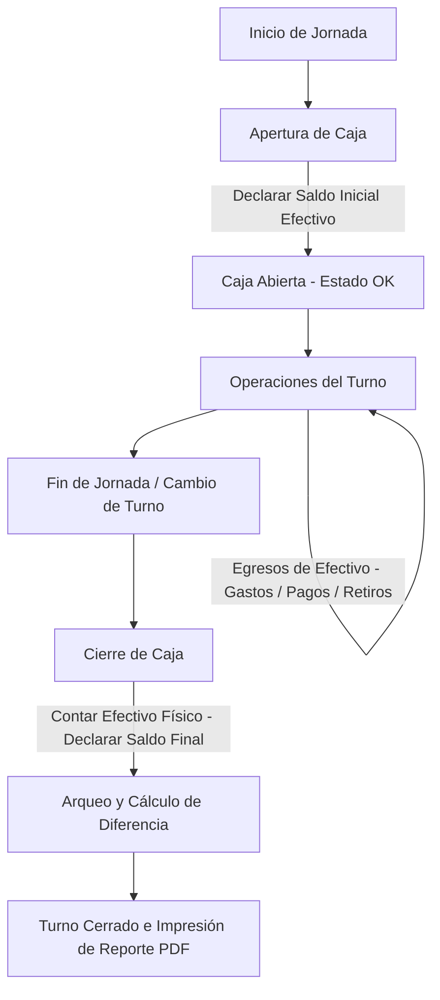

# Gestión y Cierre de Cajas por Cajero (Turnos de Caja)

Este documento detalla el funcionamiento, la arquitectura lógica, la recolección de movimientos y el proceso paso a paso de los **Cierres de Caja (Turnos de Caja)** en Gestion de Carnicerias.

El sistema implementa un modelo de **caja por cajero independiente**, lo que garantiza que cada usuario que opera el punto de venta sea plenamente responsable de los valores físicos que ingresan y egresan durante su turno.

---

## 1. Concepto y Filosofía de los Turnos

En Gestion de Carnicerias, la caja no pertenece a una estación física o a la tienda en general; **pertenece al usuario (cajero) que la opera**. 
- **Responsabilidad Individual**: Cada cajero tiene su propia caja y su propio turno independiente (`TurnoCaja`).
- **Seguridad**: Para abrir, cerrar o realizar operaciones dentro de un turno, el usuario requiere el permiso específico del sistema: `puede_abrir_cerrar_caja`.
- **Restricción de un Turno Activo**: Un cajero solo puede tener un único turno de caja abierto a la vez.

### Estados del Turno de Caja
Cuando un usuario interactúa con el punto de venta (POS), el sistema evalúa su estado mediante la función `_get_turno_activo` en [pos/views.py](pos/views.py#L869):

1. **Abierto (`ok`)**: El cajero tiene un turno activo creado en el día de negocio actual y puede registrar ventas y transacciones libremente.
2. **Cerrado / Sin Turno (`none`)**: El cajero no tiene un turno abierto. El POS bloqueará cualquier operación comercial exigiendo la apertura de caja mediante la declaración del saldo inicial.
3. **Pendiente / Vencido (`stale`)**: El cajero tiene un turno abierto del día anterior sin cerrar. El sistema lo obliga a realizar el arqueo y cierre del turno vencido antes de poder abrir uno nuevo para el día de hoy, salvo que esté activada la opción de permitir turnos multidía en la configuración de la tienda.

---

## 2. Flujo de Trabajo Paso a Paso

El ciclo de vida del turno de caja del cajero consta de tres fases bien claras:

### Paso 1: Apertura de Caja
Al iniciar su jornada, si el cajero no tiene un turno activo, el punto de venta le mostrará un formulario interactivo requiriendo la **Apertura de Caja**.
- **Acción**: El cajero debe contar físicamente el dinero en efectivo que se le entrega como cambio base y declararlo como **Saldo Inicial** (`saldo_inicial` en [ventas/models.py](ventas/models.py#L22)).
- **Mercado Pago**: Puede declarar además un saldo operativo inicial de **Mercado Pago** (`saldo_inicial_mercado_pago` en [ventas/models.py](ventas/models.py#L25)) para que el cierre informe el saldo esperado de ese medio sin solicitar arqueo final.
- **Efecto**: El sistema registra el inicio de las actividades, guarda el timestamp y activa el estado de operaciones de caja asociando el `turno_id` de forma automática en cada movimiento en la base de datos.

### Paso 2: Operaciones durante el Turno
Con la caja abierta, toda operación comercial efectuada por el cajero queda asociada a su turno activo actual:
- **Ventas comerciales** que pueden cobrarse con un único medio o mediante pagos compuestos (efectivo, tarjetas, transferencias, cuentas corrientes comerciales).
- **Cobros de Deudas** de clientes que amortizan saldos pendientes.
- **Cobro de Adelantos** de clientes que dejan dinero a favor.
- **Salidas / Gastos** varios de caja.
- **Pagos directos a proveedores** o **Cancelaciones de cuentas corrientes** con proveedores externos.
- **Entregas de adelantos** a proveedores.
- **Retiros de efectivo de caja** ordenados (por ejemplo, remesas del propietario o transferencias a la caja de seguridad para reducir efectivo en mostrador).

### Paso 3: Cierre de Caja (Arqueo)
Al terminar la jornada o su turno de trabajo, el cajero procede al **Cierre de Caja** en la interfaz del punto de venta.
- **Acción**: El cajero realiza un balance físico del dinero de su gaveta y debe ingresar la cantidad real de efectivo bajo el concepto de **Saldo Final** comercial (`saldo_final` en [ventas/models.py](ventas/models.py#L25)).
- **Cálculo automático**: El backend de Gestion de Carnicerias efectúa el balance aritmético de los ingresos y egresos registrados durante el turno y determina qué saldo debería existir de forma matemática (*Saldo Efectivo Esperado*).
- **Arqueo y Discrepancia**: El sistema compara el efectivo real físico frente al calculado, generando una diferencia (faltante o sobrante).
- **Pasaje a Cerrado**: El turno se marca como `abierto = False`, se guarda la fecha y hora final en `cerrado_en`, y se genera el archivo PDF automatizado de cierre.

---

## 3. ¿Qué Información Trae y Cómo se Calcula?

La función analítica central para calcular los totales de un cierre es `_totales_turno` en [pos/views.py](pos/views.py#L1347). A continuación se explica en detalle cómo se calculan las sumatorias:

### A. Movimientos Brutos Totales de la Caja
El sistema totaliza de forma independiente todas las operaciones asociadas al turno, sin discriminar inicialmente el método de cobro:

1. **Total de Ventas** ($\text{total\_ventas}$): Sumatoria de los importes brutos de las ventas.
2. **Total de Cobros de Deudas** ($\text{total\_cobros}$): Amortizaciones recibidas de deudores.
3. **Total de Adelantos de Clientes** ($\text{total\_adelantos}$): Depósitos recibidos a cuenta.
4. **Total de Gastos** ($\text{total\_gastos}$): Egresos internos y gastos operativos debidamente asentados.
5. **Total de Pagos a Proveedores** ($\text{total\_pagos}$): Pagos directos de compras (excluyendo lo cargado en Cuentas Corrientes).
6. **Total de Cancelaciones de Deuda de Proveedores** ($\text{total\_cancelaciones}$): Liquidación de saldos de cuentas corrientes de proveedores.
7. **Total de Adelantos a Proveedores** ($\text{total\_adelantos\_proveedor}$): Entregas de fondos a cuenta a los proveedores.
8. **Total de Retiros de Efectivo** ($\text{total\_retiros}$): Extracciones físicas parciales de efectivo efectuadas durante el día.

$$\text{Ingresos Brutos} = \text{total\_ventas} + \text{total\_cobros} + \text{total\_adelantos}$$
$$\text{Egresos Brutos} = \text{total\_gastos} + \text{total\_pagos} + \text{total\_cancelaciones} + \text{total\_adelantos\_proveedor} + \text{total\_retiros}$$

---

### B. El Balance y la Reconciliación de Efectivo (Caja Fuerte / Gaveta)
Para proyectar el dinero físico exacto que el cajero debe entregar, el sistema discrimina selectivamente las transacciones filtrando exclusivamente aquellas realizadas con el medio de pago clasificado como **"Efectivo"**.

#### Ingresos de Efectivo:
- **Efectivo por Ventas**: 
  - Si la venta posee cobro compuesto (`VentaPago`), suma los montos cobrados en efectivo de dicha venta.
  - Si la venta posee cobro directo, suma el total de la venta solo si el medio de pago principal está clasificado como categoría "Efectivo".
- **Efectivo por Cobros de Deuda**: El monto recibido de deudores cuyo método de pago es "Efectivo".
- **Efectivo por Adelantos recibidos**: Anticipos de clientes cobrados por medio de "Efectivo".

$$\text{Total Ingresos Efectivo} = \text{Efectivo\_Ventas} + \text{Efectivo\_Cobros} + \text{Efectivo\_Adelantos}$$

#### Egresos de Efectivo:
- **Gastos en Efectivo**: Egresos cancelados mediante el método de pago "Efectivo".
- **Pagos a Proveedores en Efectivo**: Compras pagadas al contado por medio de "Efectivo".
- **Cancelaciones de Deudas (Proveedores) en Efectivo**: Amortización de deudas liquidadas en efectivo.
- **Adelantos a Proveedores en Efectivo**: Anticipos entregados en efectivo.
- **Retiros de Caja**: Cualquier extracción o retiro realizado por el cajero (el retiro es, por naturaleza conceptual, de efectivo físico).

$$\text{Total Egresos Efectivo} = \text{Gastos\_Efec} + \text{Pagos\_Efec} + \text{Cancelaciones\_Efec} + \text{Adelantos\_Proveed\_Efec} + \text{Retiros}$$

---

### C. Saldo de Efectivo Esperado y Arqueo Final
El sistema determina el dinero que **debería** estar físicamente presente en la gaveta sumando las operaciones de efectivo al saldo inicial de apertura:

$$\text{Saldo de Efectivo Esperado} = \text{Saldo Inicial} + \text{Total Ingresos Efectivo} - \text{Total Egresos Efectivo}$$

Una vez que el cajero cuenta su dinero físico e ingresa el **Saldo Final Declarado**, el sistema calcula la desviación o discrepancia:

$$\text{Diferencia de Arqueo} = \text{Saldo Final Declarado} - \text{Saldo de Efectivo Esperado}$$

- **Diferencia = 0**: Caja balanceada perfectamente.
- **Diferencia > 0 (Sobrante)**: El dinero físico declarado supera la previsión comercial del sistema. (Ej. Se cobró de más, no se registraron ingresos o hubo errores de cambio).
- **Diferencia < 0 (Faltante)**: Falta dinero físico frente a la proyección del sistema. (Ej. Se pagó de más, hubo un gasto no registrado, o errores en el conteo manual).

---

## 4. Estructura del Reporte de Cierre (PDF)

Cuando un turno se cierra, la función `_build_cierre_pdf` descrita en [pos/views.py](pos/views.py#L1441) procesa toda la información del turno y genera un reporte en formato PDF que sirve como auditoría física y administrativa.

### Contenido del Reporte PDF
El archivo PDF contiene las siguientes secciones detalladas para facilitar su revisión:

1. **Cabecera de Caja**:
   - Número de turno, fecha comercial, nombre del cajero responsable.
   - Saldo inicial de apertura de caja, saldo final físico ingresado, fecha y hora exacta del cierre.
2. **Bloque de Resumen Financiero**:
   - Desglose de ingresos por origen (ventas, cobros, adelantos de clientes).
   - Desglose de egresos por destino (gastos de caja, pagos de compras, cancelaciones a deudas de proveedores, adelantos a proveedores, retiros de la terminal).
   - Neto neto del turno y balance de resultados generales.
3. **Sección de Balance de Efectivo**:
   - Saldo inicial en caja.
   - Suma neta de ingresos por billete.
   - Suma neta de egresos por billete.
   - Proyección matemática de efectivo esperado en caja.
   - **Resultado de Arqueo**: Diferencia exacta calificada en faltante/sobrante para auditoría.
4. **Conciliación de Medios de Pago**:
   - Un desglose sumatorio detallado por cada medio de pago que posee la tienda (Dólares, Tarjetas de Crédito, Tarjetas de Débito, Transferencias de Banco, Cuenta Corriente de Clientes, etc.), conciliando el flujo total para que la administración pueda verificar cuentas bancarias y vouchers electrónicos de forma segregada.
   - Si el turno abrió con saldo inicial de Mercado Pago, el cierre agrega un bloque informativo con saldo inicial, ingresos, egresos y saldo operativo esperado para ese medio.
5. **Anexo de Movimientos**:
   - Listado secuencial cronológico de transacciones para comprobar errores de ingresos o egresos si se detectan divergencias.

---

## 5. Respuestas a Preguntas Comunes (Solución de Conflictos)

### ¿Qué hago si tengo un turno de caja del día anterior sin cerrar?
Por defecto, el sistema arrojará un error JSON indicándote que existe un turno en estado `stale`. 
1. Ingresa a la interfaz de cierre de terminal de Gestion de Carnicerias.
2. El sistema cargará los movimientos acumulados de ese turno anterior.
3. Cuenta el dinero físico disponible, declara el valor final en caja y efectúa el cierre.
4. Una vez procesado, la interfaz te habilitará la opción para iniciar un nuevo turno de caja limpio ingresando el nuevo cambio de la jornada.

### ¿Se pueden realizar ventas si mi caja está cerrada?
No. El middleware y los decoradores de seguridad implementados en [pos/views.py](pos/views.py#L890) bloquean cada punto de transacción. Si intentas realizar una venta o procesar un cobro cuando la caja está cerrada, el sistema te retornará una alerta indicando que debes abrir formalmente la caja.

### ¿Cómo evalúan los administradores las diferencias de caja de los cajeros?
Los administradores del sistema pueden ingresar a la sección de administración de Django (`TurnoCaja` en el panel de control) o consultar los PDF descargables de los cierres de cada cajero. Allí pueden comparar rápidamente las diferencias entre lo esperado por el sistema y lo rendido físicamente, tomando las medidas administrativas de reposición o conciliación que estimen necesarias.
