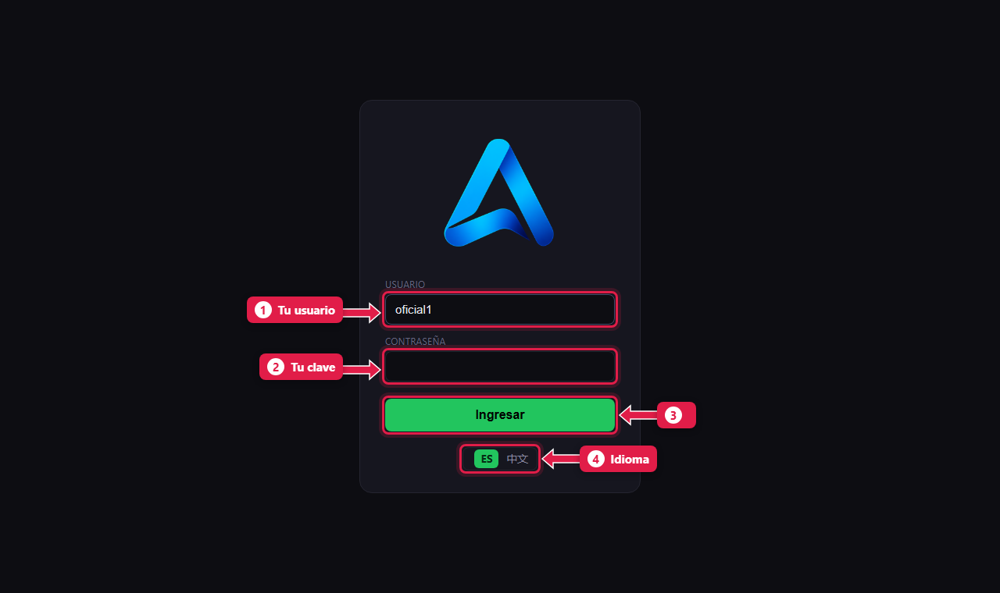
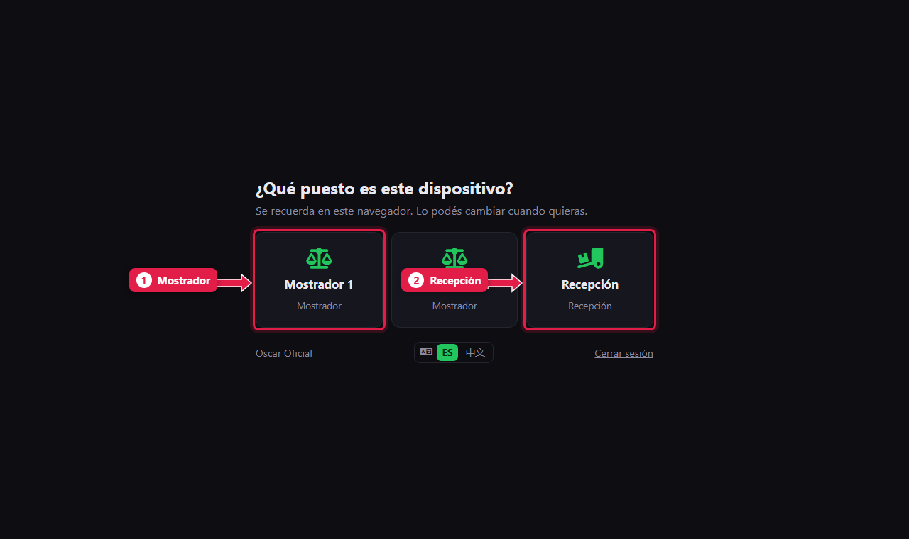
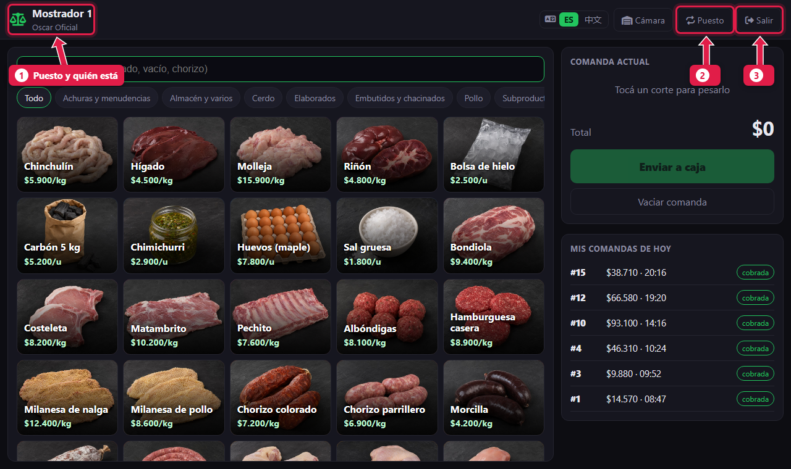

# Ingresar al sistema y elegir el puesto del dispositivo

> **Para quién es:** todos.  **Tiempo:** 1 minuto.  **Necesitás:** tu usuario y tu clave (te los da el gerente).

Para entrar escribís tu **usuario** y tu **clave** y tocás **Ingresar**. La primera vez el sistema te pregunta qué **puesto** es ese dispositivo (mostrador, caja o recepción) y lo recuerda para la próxima.

## Para qué sirve
Cada persona entra con su propio usuario: así cada comanda, venta o conteo queda a nombre de quien lo hizo. El **puesto** hace que cada dispositivo abra directo en su pantalla: la tablet del mostrador en el mostrador, la PC de la caja en la caja.

## Antes de empezar
- En una **tablet o celular**, conectate al wifi de la carnicería y abrí la dirección de la PC de la sucursal, por ejemplo `http://192.168.1.20:8250/pos/`. El gerente sabe cuál es.
- En la **PC de la sucursal**, el sistema se abre solo al prender la computadora.

## Paso a paso

### 1. Escribí tu usuario y tu clave

1. **Usuario:** el tuyo, por ejemplo `oficial1`.
2. **Contraseña:** tu clave.
3. Tocá **Ingresar**.
4. Si preferís ver el sistema en chino, tocá **中文** antes de entrar (ver [Cambiar el idioma](02-cambiar-idioma.md)).

### 2. Elegí qué puesto es este dispositivo
Solo pasa la primera vez en cada dispositivo.

1. **Mostrador:** si es la tablet del mostrador.
2. **Recepción:** si es el dispositivo de la cámara.

Ves solo los puestos donde te habilitó el gerente. Por ejemplo, la cajera solo ve **Caja 1**.

### 3. Ya estás en tu pantalla

1. Arriba a la izquierda: el **puesto** y **quién está** usando el dispositivo.
2. **Puesto:** para cambiar el puesto de este dispositivo.
3. **Salir:** cerrá tu sesión cuando dejes el dispositivo a otra persona.

## Qué pasa por detrás
- El dispositivo guarda el puesto elegido durante un año. La próxima vez, al entrar, va directo a esa pantalla.
- Si una persona tiene puestos asignados, solo puede elegir esos. Si no tiene ninguno asignado, puede usar todos.

## Problemas frecuentes
| Si te pasa… | Es porque… | Qué hacer |
|---|---|---|
| «Usuario o contraseña incorrectos» | La clave está mal escrita o el usuario fue dado de baja | Revisá mayúsculas. Si sigue, pedile al gerente que revise tu usuario |
| No aparece el puesto que necesito | No estás habilitado en ese puesto | Pedile al gerente que te lo agregue ([tutorial 18](18-alta-de-personal.md)) |
| La tablet no abre la página | No está en el wifi de la carnicería o la PC está apagada | Conectá la tablet al wifi y verificá que la PC esté prendida |
| Entré y veo la pantalla de otra persona | Alguien no cerró su sesión | Tocá **Salir** y entrá con tu usuario |

## Preguntas frecuentes

### ¿Puedo usar el mismo dispositivo para mostrador y recepción?
Sí. Tocá **Puesto** y elegí el otro. El ayudante, además, llega a recepción con el botón **Cámara** del mostrador.

### ¿Tengo que elegir el puesto cada vez?
No. Se elige una vez por dispositivo y queda guardado.

## Siguiente paso
- [Cambiar el idioma](02-cambiar-idioma.md).
- Según tu puesto: [Armar una comanda](03-armar-una-comanda.md) · [Abrir la caja](05-abrir-la-caja.md) · [Recibir un despacho](11-recibir-despacho-del-frigorifico.md).
