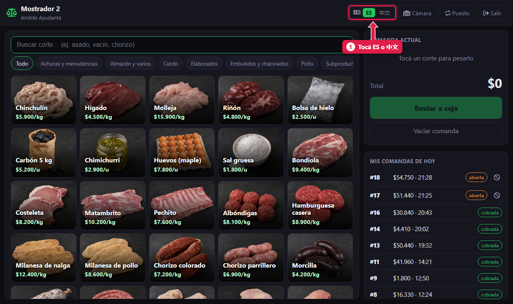
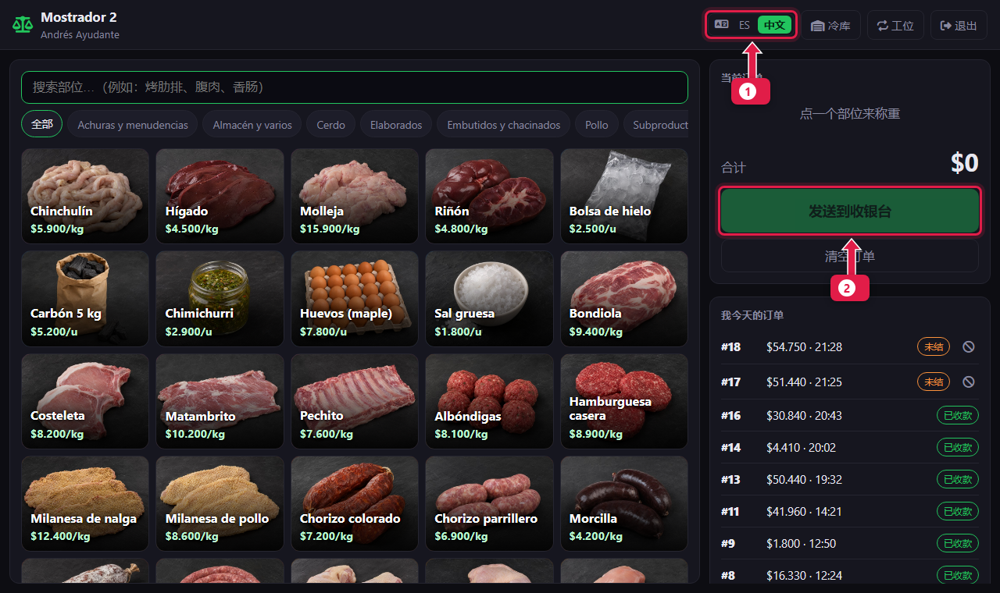

# Cambiar el idioma: español o chino

> **Para quién es:** todos.  **Tiempo:** 10 segundos.

Tocá **ES** para ver el sistema en español o **中文** para verlo en chino. El cambio queda guardado **en tu usuario**: en cualquier dispositivo donde entres, lo vas a ver en tu idioma.

## Para qué sirve
En la carnicería pueden trabajar personas que leen mejor en chino y otras en español. Cada una elige el suyo, aunque usen la misma tablet.

## Paso a paso

### 1. Tocá el idioma que querés
El selector está arriba a la derecha en el mostrador, la caja, la recepción y el admin, y abajo en la pantalla de ingreso.

1. Tocá **ES** (español) o **中文** (chino). El que está en verde es el actual.

### 2. La pantalla cambia al instante

1. El selector muestra en verde el idioma nuevo.
2. Todos los botones y textos cambian, por ejemplo el de **Enviar a caja**.

## Qué pasa por detrás
- El idioma se guarda en tu perfil. Cuando otra persona entra en el mismo dispositivo, ve **su** idioma.
- En la pantalla de ingreso (antes de entrar) se usa el último idioma elegido en ese dispositivo.

## Lo que no cambia de idioma
| Qué | Por qué |
|---|---|
| **Tickets impresos, PDF y Excel** | Siempre salen en español: los lleva el cliente y las impresoras de tickets no tienen letras chinas |
| **Nombres de productos, rubros, clientes y medios de pago** | Quedan como se cargaron. «Vacío» sigue diciendo «Vacío» |

## Preguntas frecuentes

### ¿El gerente puede dejarme el idioma elegido de antemano?
Sí. Al crear tu usuario puede elegir el **Idioma** en tu perfil ([tutorial 18](18-alta-de-personal.md)).

### Cambié el idioma y otra persona lo ve en chino. ¿Por qué?
Porque entró con tu usuario. Cada persona tiene que entrar con el suyo.

## Siguiente paso
- [Armar una comanda](03-armar-una-comanda.md) o [Abrir la caja](05-abrir-la-caja.md).
