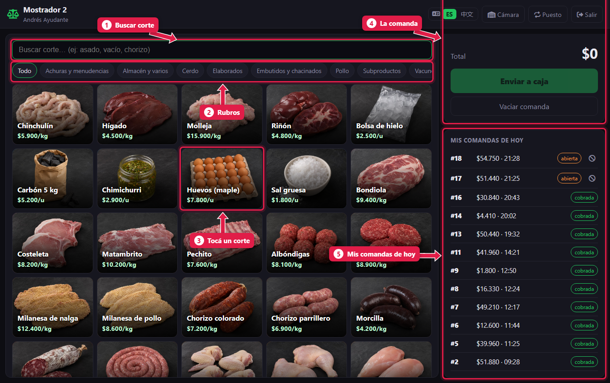
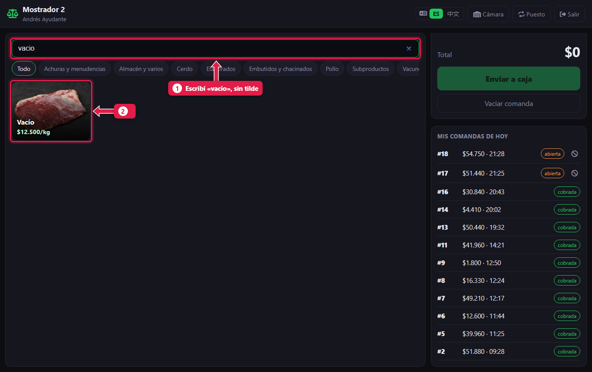
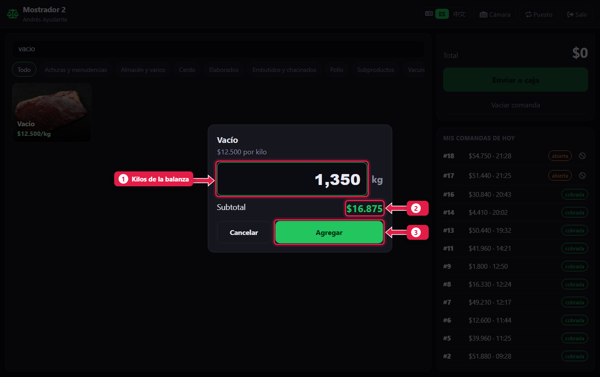
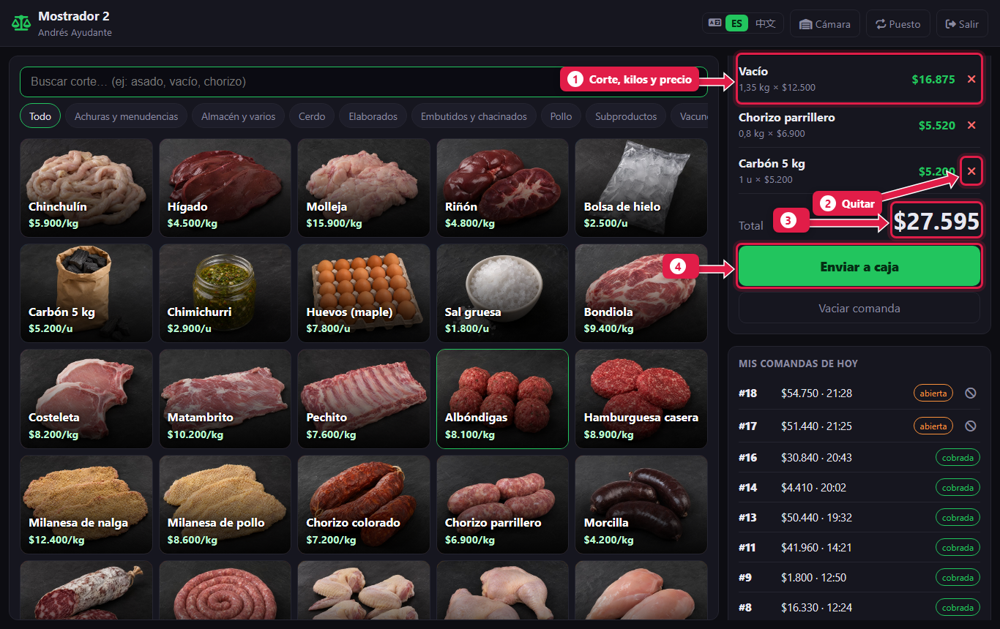
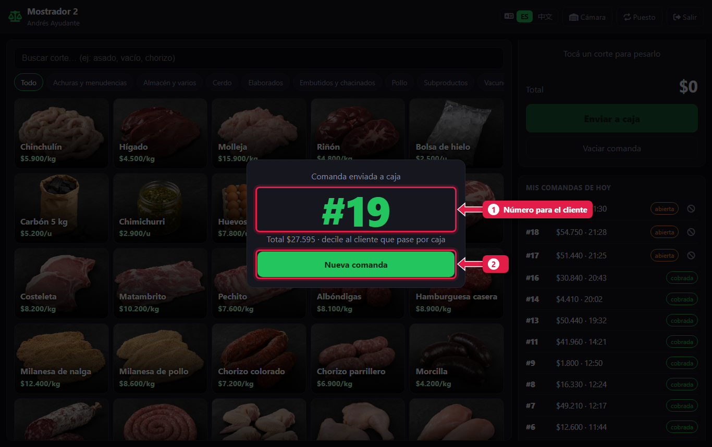

# Armar una comanda y mandarla a caja

> **Para quién es:** carnicero ayudante y oficial.  **Tiempo:** 1 minuto por cliente.  **Necesitás:** la tablet del mostrador y la balanza.

En el mostrador **pesás** cada corte, lo agregás a la **comanda** y tocás **Enviar a caja**. El sistema te da un **número**: se lo decís al cliente para que pague en la caja. En el mostrador **no se cobra**.

## Para qué sirve
Separar el mostrador de la caja hace que el carnicero no toque la plata y que cada kilo vendido quede registrado. La caja recibe la comanda armada: no tiene que volver a escribir nada.

## Antes de empezar
- Entrá con tu usuario en el puesto **Mostrador** ([tutorial 01](01-ingresar-y-elegir-puesto.md)).
- Los precios y los productos los carga el frigorífico. En el mostrador no se cambian.

## Paso a paso

### 1. Conocé la pantalla

1. **Buscador:** escribí el nombre del corte.
2. **Rubros:** Vacuno, Cerdo, Pollo, Achuras… muestran solo ese grupo.
3. **Cortes:** cada botón tiene la foto, el nombre y el precio por kilo (o por unidad).
4. **Comanda actual:** lo que vas cargando para este cliente.
5. **Mis comandas de hoy:** las que ya mandaste, y si ya se cobraron.

### 2. Buscá el corte

1. Escribí el nombre. No hace falta poner tildes: «vacio» encuentra **Vacío**.
2. Tocá el corte. Atajo: apretá **Enter** y se abre el primero.

### 3. Pesá y escribí los kilos

1. Poné la carne en la balanza y escribí los **kilos**, con coma: `1,350`. Si se vende por unidad (carbón, huevos), escribí la **cantidad**.
2. Revisá el **subtotal**: kilos × precio.
3. Tocá **Agregar** (o **Enter**).

Repetí los pasos 2 y 3 con cada producto.

### 4. Revisá la comanda

1. Cada línea muestra el **corte**, los **kilos** y el **precio**.
2. **✕:** quita una línea si te equivocaste.
3. **Total** de la comanda.
4. Tocá **Enviar a caja**.

### 5. Decile el número al cliente

1. El **número** en grande es el que el cliente dice en la caja.
2. Tocá **Nueva comanda** para atender al siguiente.

## Qué pasa por detrás
- La comanda queda **abierta** y aparece en la caja, en **Comandas en espera**.
- El stock **todavía no baja**: baja cuando la caja la cobra.
- La numeración empieza de nuevo cada día.

## Problemas frecuentes
| Si te pasa… | Es porque… | Qué hacer |
|---|---|---|
| «Sin conexión con la PC de la sucursal» | Se cortó el wifi o la PC está apagada | Esperá a que vuelva y tocá **Enviar a caja** otra vez. No se duplica |
| El corte no aparece | Está desactivado o no existe | Avisale al gerente: los productos los carga el frigorífico |
| El precio está mal | Los precios vienen del frigorífico | Avisale al gerente. No se cambia en el mostrador |
| Me equivoqué de kilos | — | Quitá la línea con **✕** y cargala de nuevo |

## Preguntas frecuentes

### ¿Puedo mandar la comanda sin internet?
Sí. El mostrador habla con la PC de la carnicería por el wifi del local, no por internet.

### ¿Y si el cliente se arrepiente?
Anulá la comanda desde **Mis comandas de hoy**: ver [Mis comandas y cómo anular una](04-mis-comandas-y-anular.md).

## Siguiente paso
- [Mis comandas del día y cómo anular una](04-mis-comandas-y-anular.md).
- Qué hace la caja con tu comanda: [Cobrar una comanda](06-cobrar-una-comanda.md).
