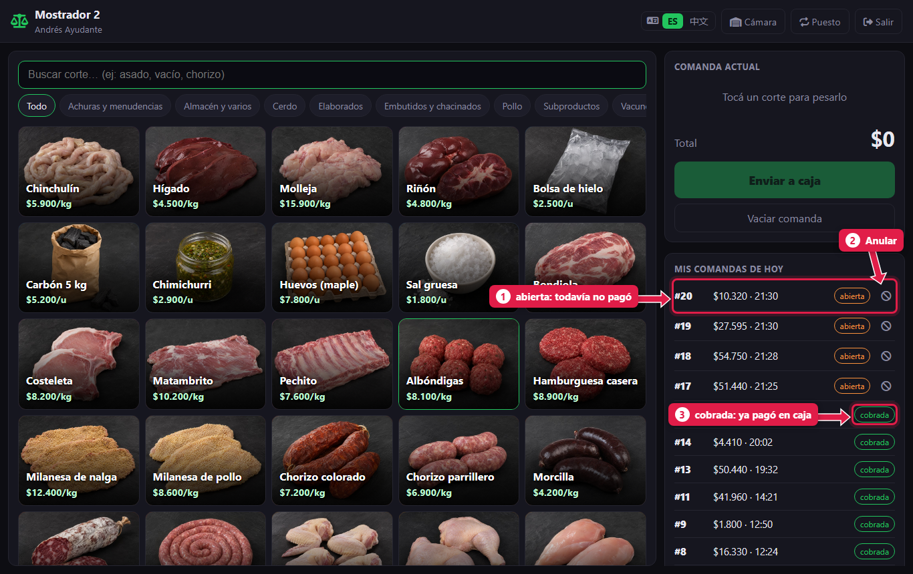
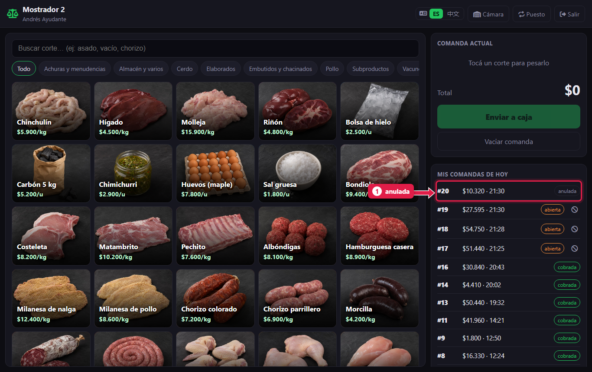

# Mis comandas del día y cómo anular una

> **Para quién es:** carnicero ayudante y oficial.  **Tiempo:** 30 segundos.

A la derecha del mostrador ves **tus comandas de hoy** y su estado. Si un cliente no paga, tocá **⊘** en esa comanda, escribí el motivo y queda **anulada**: ya no aparece en la caja.

## Para qué sirve
Una comanda que nadie paga queda «colgada» en la caja y confunde. Anularla la saca de la lista y deja registrado quién lo hizo y por qué.

## Paso a paso

### 1. Mirá el estado de tus comandas

1. **abierta:** el cliente todavía no pagó.
2. **⊘ Anular:** aparece solo en las abiertas.
3. **cobrada:** la caja ya la cobró.

La lista se actualiza sola.

### 2. Anulá la comanda
1. Tocá **⊘** en la comanda.
2. El sistema pregunta el motivo. Escribilo (por ejemplo «El cliente se arrepintió») y aceptá.

1. La comanda queda **anulada** y desaparece de la caja.

## Quién puede anular
| Rol | Sus comandas | Comandas de otros |
|---|---|---|
| Carnicero ayudante | Sí | No |
| Carnicero oficial | Sí | Sí |
| Gerente | Sí | Sí |

Una comanda **cobrada** no se anula desde el mostrador.

## Qué pasa por detrás
- Se guarda quién la anuló, cuándo y el motivo. El gerente lo revisa en el admin ([tutorial 22](22-controles-de-la-semana.md)).
- El stock no cambia: una comanda abierta todavía no lo había bajado.

## Problemas frecuentes
| Si te pasa… | Es porque… | Qué hacer |
|---|---|---|
| No aparece **⊘** | La comanda ya está cobrada o anulada | Si está cobrada y hubo un error, avisale al gerente |
| «Solo podés anular tus propias comandas» | Sos ayudante y la armó otro | Pedile al oficial o al gerente |
| «La comanda ya no está abierta» | La caja la cobró un segundo antes | Ya está cobrada: no hace falta anularla |

## Preguntas frecuentes

### ¿Es obligatorio escribir el motivo?
El sistema lo pide. Conviene escribirlo siempre: el gerente revisa las comandas anuladas cada semana.

### ¿Se puede recuperar una comanda anulada?
No. Armala de nuevo.

## Siguiente paso
- [Cobrar una comanda](06-cobrar-una-comanda.md) (lo que hace la caja).
- [Controles de la semana](22-controles-de-la-semana.md) (cómo el gerente revisa las anuladas).
