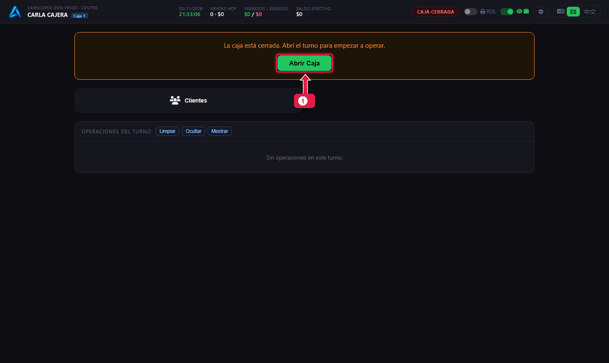
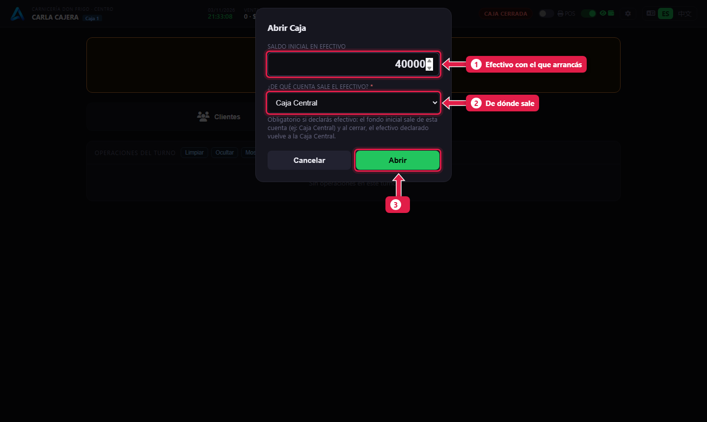
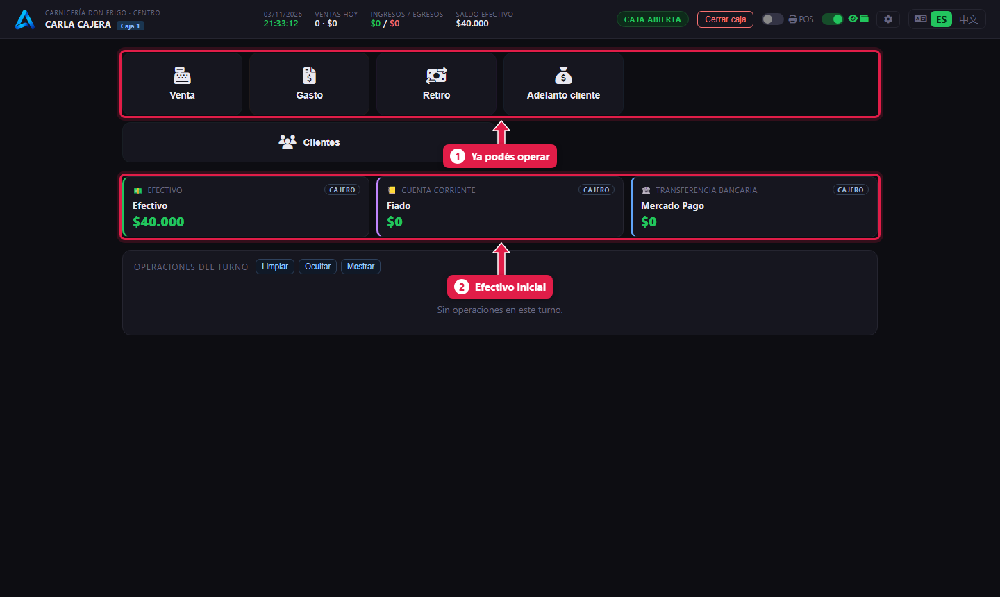

# Abrir la caja

> **Para quién es:** la cajera.  **Tiempo:** 1 minuto.  **Necesitás:** el efectivo del cambio, contado.

Al empezar el día tocás **Abrir Caja**, escribís el **efectivo con el que arrancás** (el cambio) y de qué cuenta sale (normalmente **Caja Central**). Desde ese momento ya podés cobrar.

## Para qué sirve
Abrir la caja marca el inicio del **turno**. Al cerrar, el sistema compara la plata que hay con la que debería haber desde ese momento.

## Antes de empezar
- Entrá con tu usuario en el puesto **Caja 1** ([tutorial 01](01-ingresar-y-elegir-puesto.md)).
- Contá el cambio antes de empezar.

## Paso a paso

### 1. Tocá «Abrir Caja»

1. Con la caja cerrada aparece el aviso y el botón **Abrir Caja**.

### 2. Escribí el efectivo inicial

1. **Saldo inicial en efectivo:** el cambio que hay en el cajón, por ejemplo `40000`.
2. **¿De qué cuenta sale el efectivo?:** elegí **Caja Central**. Es obligatorio si declarás efectivo.
3. Tocá **Abrir**.

### 3. Listo para cobrar

1. Aparecen los botones para operar: **Venta**, **Gasto**, **Retiro**…
2. La tarjeta de **Efectivo** arranca con el saldo inicial. Mercado Pago y Fiado arrancan en $0.

## Qué pasa por detrás
- Se crea un **turno de caja** a tu nombre con fecha y hora.
- El efectivo inicial sale de la Caja Central y entra a la caja del mostrador.

## Problemas frecuentes
| Si te pasa… | Es porque… | Qué hacer |
|---|---|---|
| «Hay un turno del día anterior sin cerrar» | Ayer no se cerró la caja | Tocá **Cerrar turno anterior**, cerralo ([tutorial 10](10-cerrar-la-caja.md)) y después abrí el de hoy |
| No aparece **Abrir Caja** | No tenés el permiso de abrir y cerrar caja | Pedíselo al gerente |
| Pide la cuenta de origen | Declaraste efectivo inicial | Elegí **Caja Central** |

## Preguntas frecuentes

### ¿Puedo abrir la caja con $0?
Sí. Escribí `0`; en ese caso no hace falta elegir cuenta de origen.

## Siguiente paso
- [Cobrar una comanda](06-cobrar-una-comanda.md).
