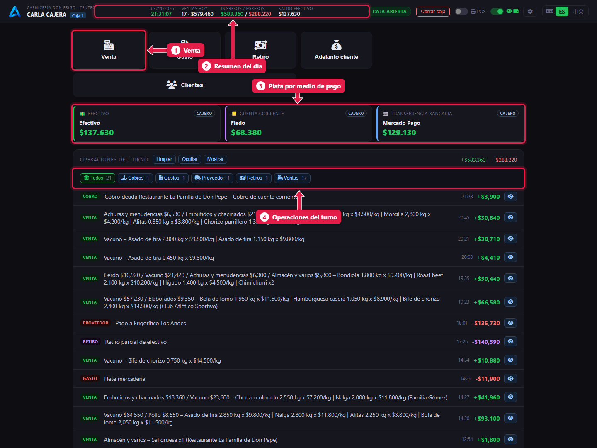
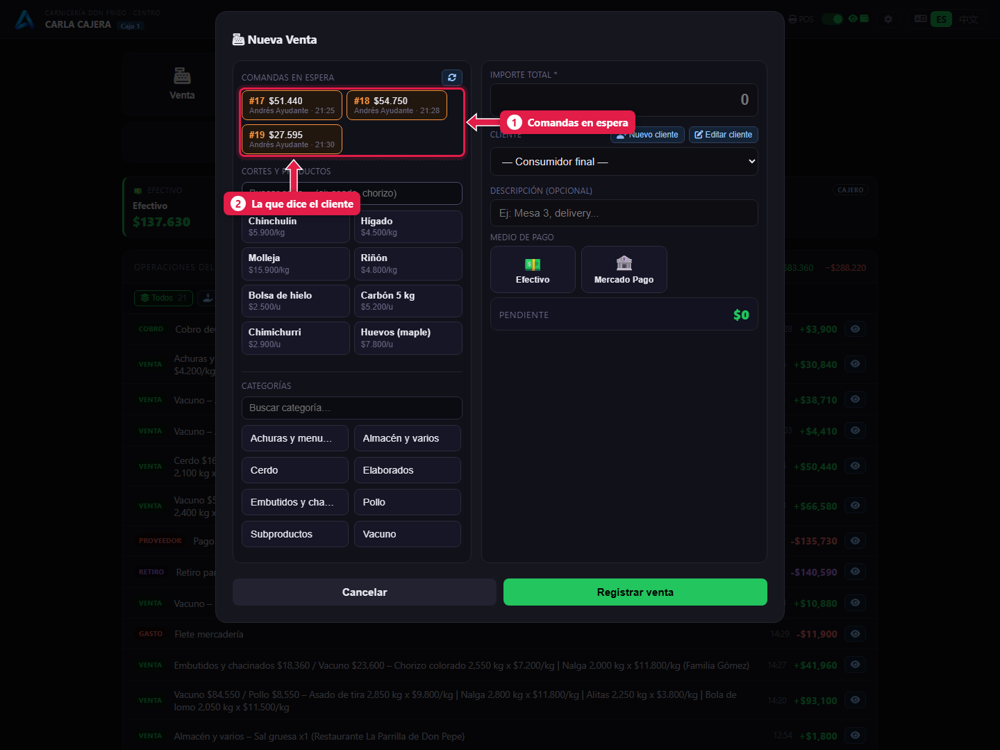
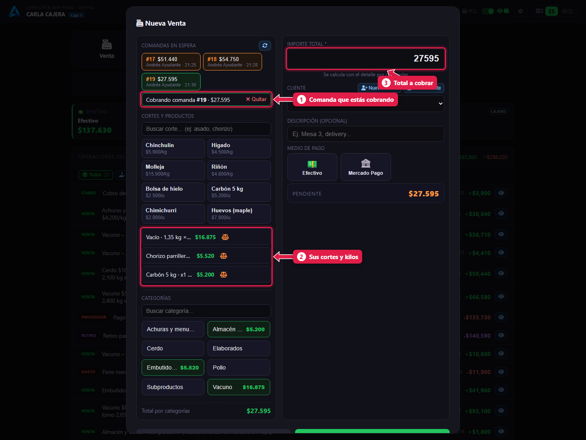
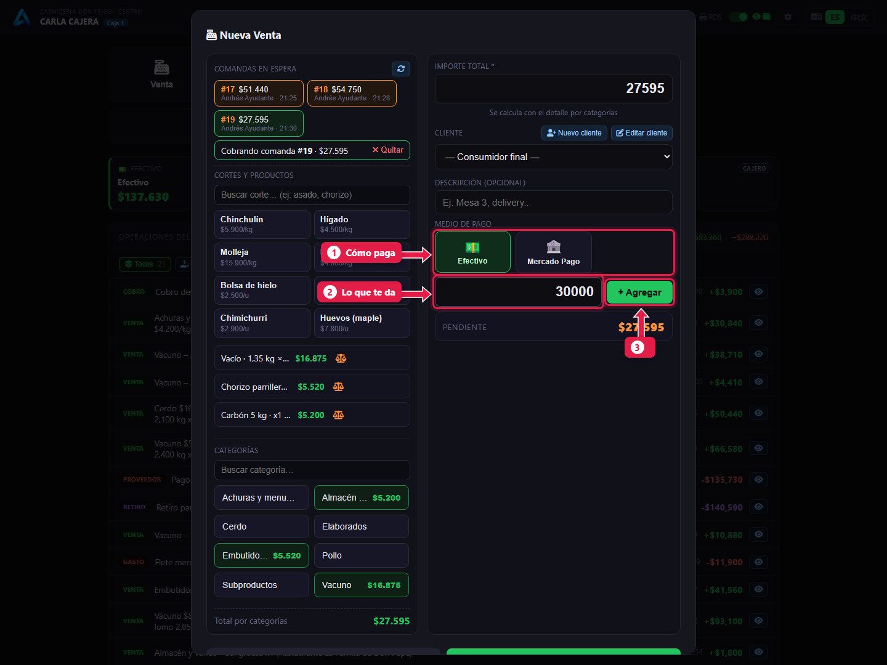
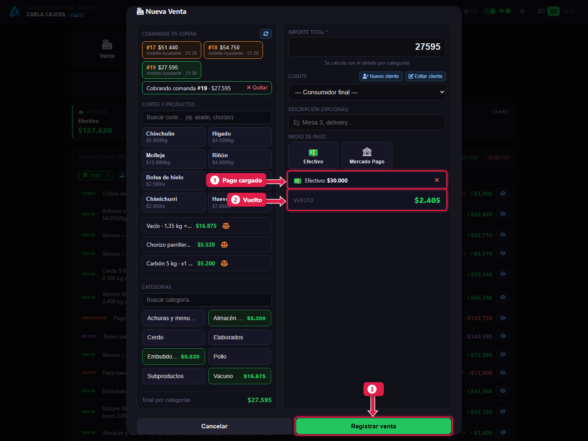
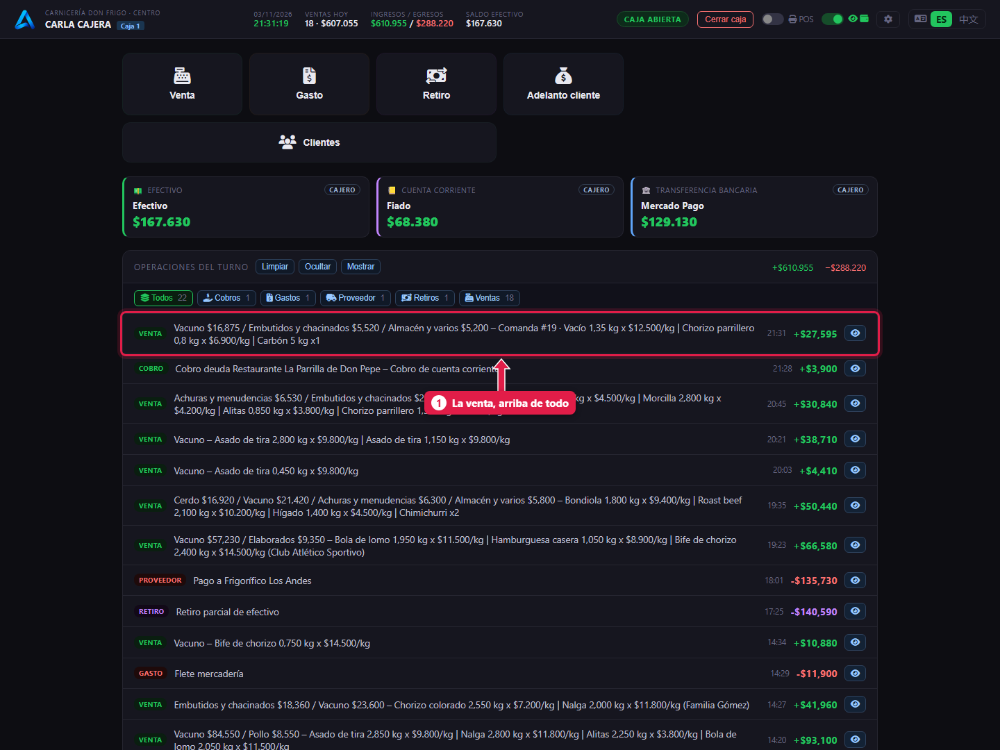

# Cobrar una comanda

> **Para quién es:** la cajera.  **Tiempo:** 30 segundos por cliente.  **Necesitás:** la caja abierta ([tutorial 05](05-abrir-la-caja.md)).

El cliente llega con un número. Tocás **Venta**, tocás **esa comanda** en *Comandas en espera*, elegís **cómo paga** y tocás **Registrar venta**. Los cortes y el total ya vienen cargados desde el mostrador.

## Para qué sirve
La cajera no pesa ni escribe precios: cobra lo que armó el carnicero. Así no hay errores de tipeo y cada kilo vendido queda registrado.

## Paso a paso

### 1. Conocé la pantalla de caja

1. **Venta:** para cobrar.
2. **Resumen del día:** fecha, ventas, ingresos y egresos, efectivo.
3. **Tarjetas por medio de pago:** cuánto entró hoy en efectivo, fiado y Mercado Pago.
4. **Operaciones del turno:** cada venta, gasto o retiro, la más nueva arriba.

### 2. Tocá «Venta» y elegí la comanda

1. **Comandas en espera:** todas las que mandó el mostrador y nadie cobró, con número, total, quién la armó y la hora.
2. Tocá la que dice el cliente.

### 3. Revisá lo que trae la comanda

1. **Cobrando comanda #…**: confirma cuál trajiste. Si te equivocaste, tocá **Quitar** y elegí otra.
2. Los cortes entran con el ícono de **balanza**: no se pueden quitar de a uno.
3. **Importe total:** se calcula solo.

Si además lleva algo por unidad (carbón, huevos), agregalo: ver [Vender por unidad](07-venta-por-unidad-y-pago-dividido.md).

### 4. Elegí cómo paga

1. Tocá el **medio de pago**: Efectivo, Mercado Pago…
2. Escribí **lo que te da** el cliente. Viene cargado con lo que falta pagar.
3. Tocá **+ Agregar**.

### 5. Mirá el vuelto y registrá

1. El **pago** que cargaste.
2. **Vuelto:** lo que le tenés que devolver. Si dice **Pendiente**, falta plata.
3. Tocá **Registrar venta** (con impresora: **Emitir Ticket**).

### 6. La venta queda en la lista

1. La venta aparece **arriba de todo**, con el número de comanda y los cortes.

## Qué pasa por detrás
- La comanda pasa a **cobrada**: desaparece de *Comandas en espera* y el carnicero la ve cobrada.
- Los kilos **bajan del stock** de cada corte.
- Si pagó en efectivo y hay impresora con cajón, el cajón se abre solo.
- Si dos cajas tocan la misma comanda a la vez, solo una la cobra: la otra recibe un aviso.

## Problemas frecuentes
| Si te pasa… | Es porque… | Qué hacer |
|---|---|---|
| No aparece la comanda | No la mandaron, o ya se cobró o se anuló | Preguntale el número al carnicero |
| Aviso de que la comanda ya fue cobrada | Otra caja la cobró un segundo antes | Cerrá el aviso y seguí con la siguiente |
| Dice **Pendiente** | El pago es menor al total | Agregá otro pago o corregí el importe |
| No veo **Fiado** | Fiado aparece recién al elegir un cliente | Ver [Fiado](08-fiado-y-cobro-de-deuda.md) |

## Preguntas frecuentes

### ¿Puedo cobrar dos comandas juntas?
No en una sola venta: cobrá una y después la otra.

### ¿Puedo quitar un corte de la comanda?
No desde la caja. Si está mal, que el carnicero anule la comanda y la arme de nuevo.

## Siguiente paso
- [Vender por unidad y cobrar con dos medios de pago](07-venta-por-unidad-y-pago-dividido.md).
- [Fiado: vender a cuenta corriente](08-fiado-y-cobro-de-deuda.md).
