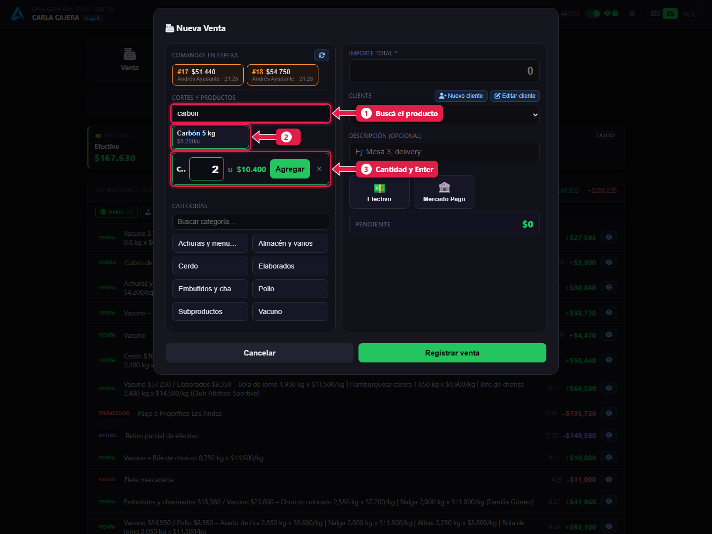
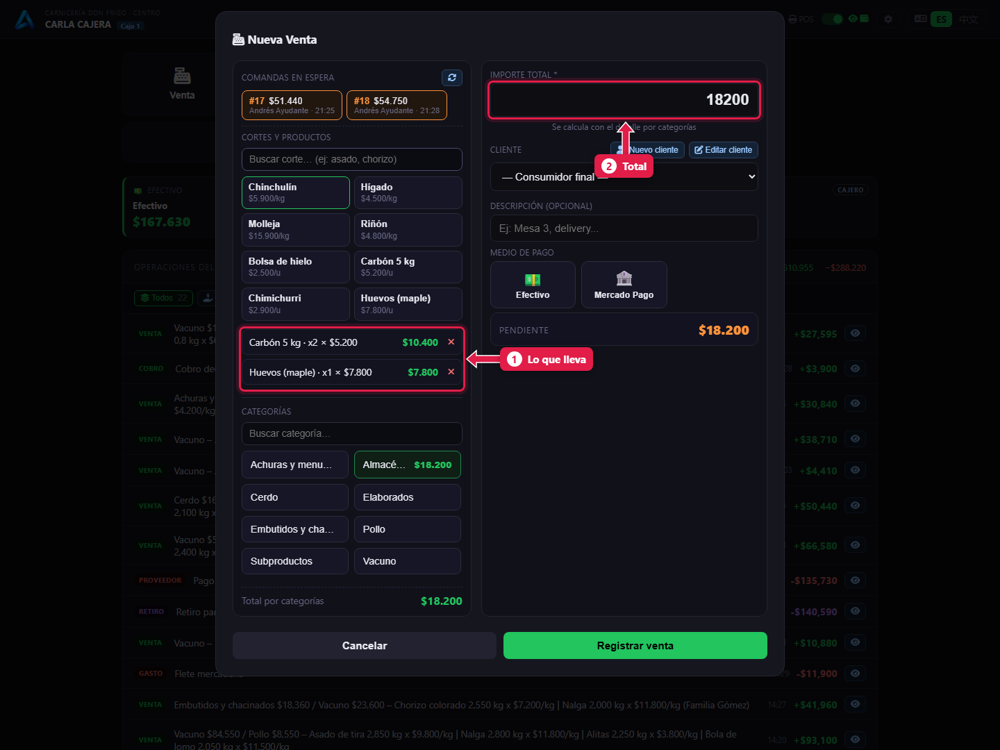
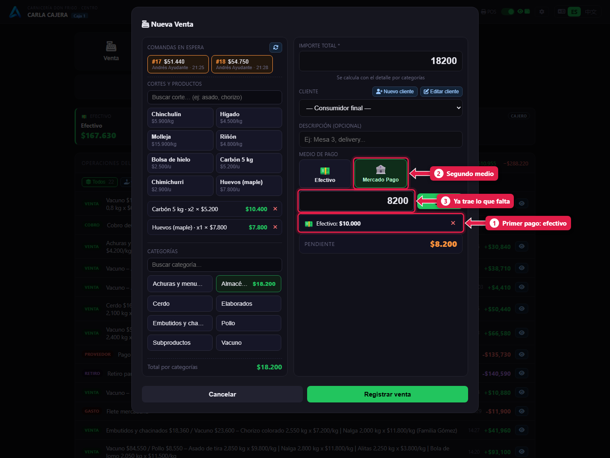
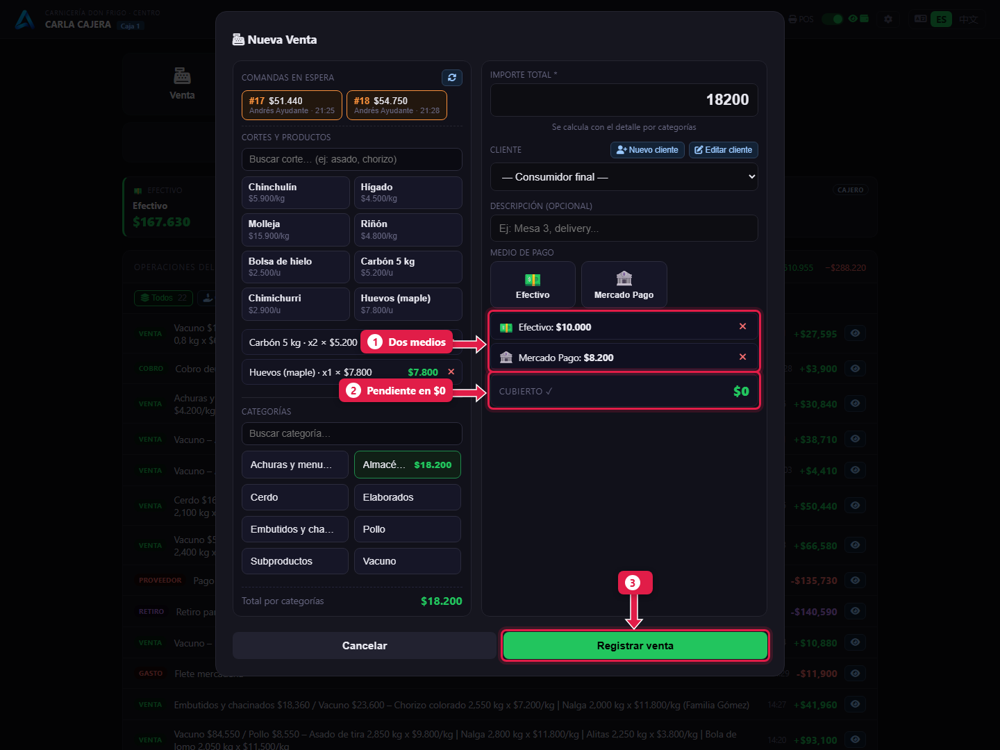

# Vender por unidad y cobrar con dos medios de pago

> **Para quién es:** la cajera.  **Tiempo:** 1 minuto.

Lo que se vende **por unidad** (carbón, huevos, sal, hielo) se agrega directo en la caja: buscás el producto, escribís la cantidad y **Enter**. Si el cliente paga **parte en efectivo y parte con Mercado Pago**, cargás los dos pagos en la misma venta.

## Para qué sirve
El cliente que pasa por carbón no necesita ir al mostrador. Y el pago dividido evita hacer dos ventas para un solo ticket.

## Paso a paso

### 1. Buscá el producto y escribí la cantidad
Tocá **Venta**. En *Cortes y productos*:

1. Escribí el nombre en el **buscador**.
2. Tocá el **producto**.
3. Escribí la **cantidad** y apretá **Enter**.

### 2. Revisá lo que lleva

1. Cada producto agregado, con cantidad y precio. Estos sí se pueden quitar con **✕**.
2. El **importe total** se calcula solo.

### 3. Cargá el primer pago y elegí el segundo medio
1. Tocá **Efectivo**, escribí lo que te da en efectivo (por ejemplo `10000`) y tocá **+ Agregar**.
2. Tocá **Mercado Pago**.

1. El **primer pago** ya está en la lista.
2. El **segundo medio** queda marcado.
3. El importe **ya trae lo que falta**. Tocá **+ Agregar**.

### 4. Registrá la venta

1. Los **dos medios** con su importe.
2. **Pendiente** en **$0**: está todo pagado.
3. Tocá **Registrar venta**.

## Qué pasa por detrás
- Se guarda una venta con dos pagos. Cada pago suma en la tarjeta de su medio.
- El cajón se abre porque uno de los pagos es en efectivo.
- Las unidades bajan del stock.

## Problemas frecuentes
| Si te pasa… | Es porque… | Qué hacer |
|---|---|---|
| Al apretar Enter no se agrega | La cantidad está vacía o en 0 | Escribí la cantidad |
| Cargué mal un pago | — | Quitalo con **✕** en la lista de pagos y cargalo de nuevo |
| No encuentro el producto | Está inactivo | Avisale al gerente |

## Preguntas frecuentes

### ¿Puedo mezclar una comanda con productos por unidad?
Sí: traé la comanda y después agregá los productos. Todo sale en la misma venta.

### ¿Puedo pagar con tres medios?
Sí, agregá tantos pagos como haga falta hasta que **Pendiente** quede en $0.

## Siguiente paso
- [Fiado: vender a cuenta corriente y cobrar la deuda](08-fiado-y-cobro-de-deuda.md).
