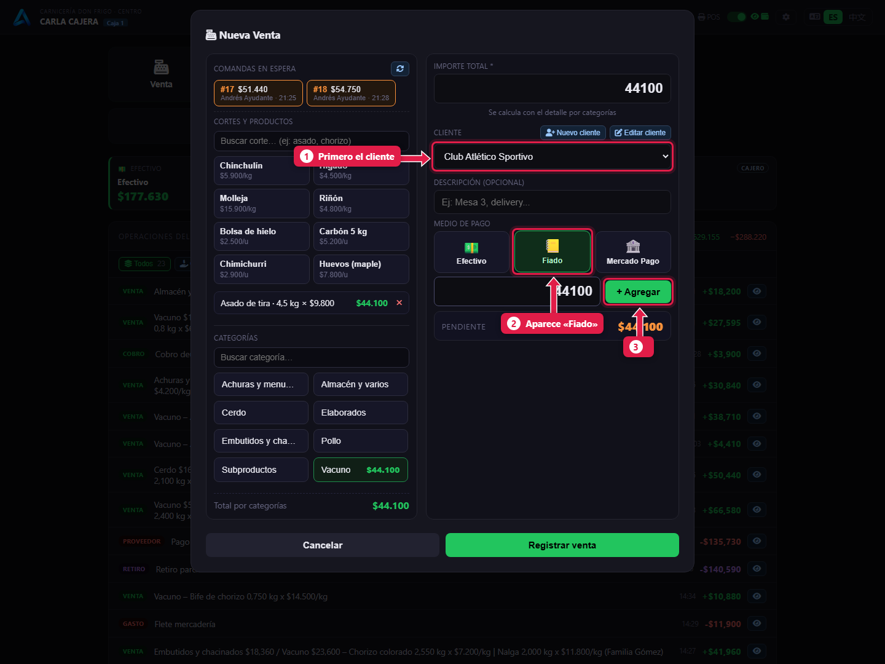
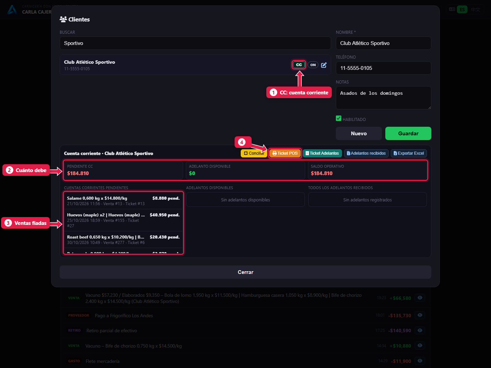
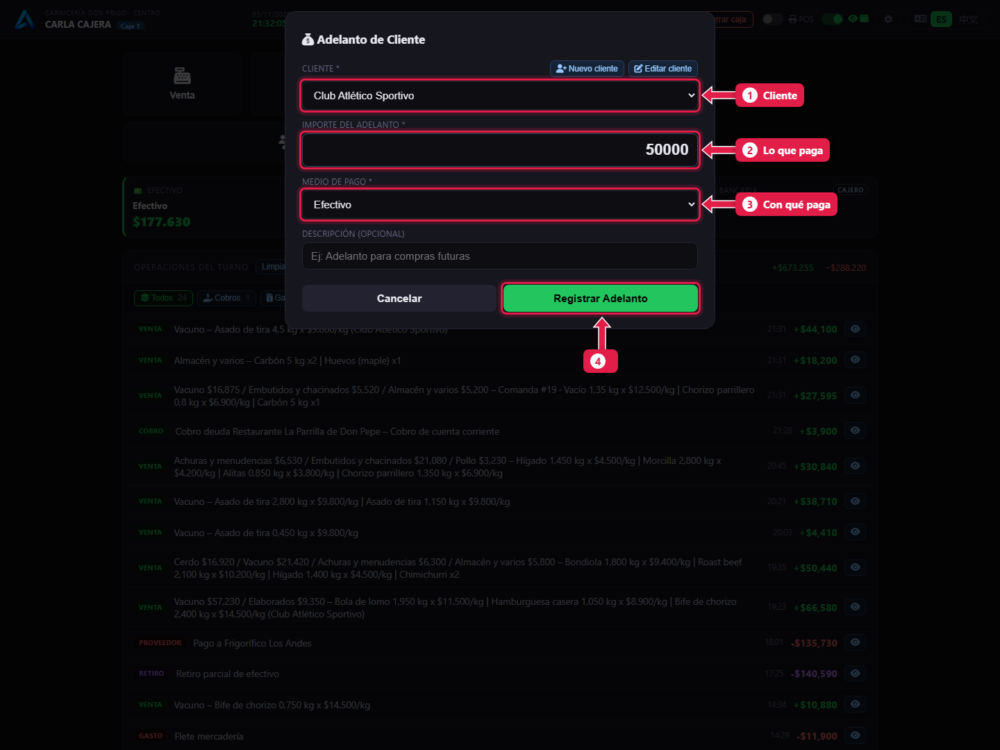
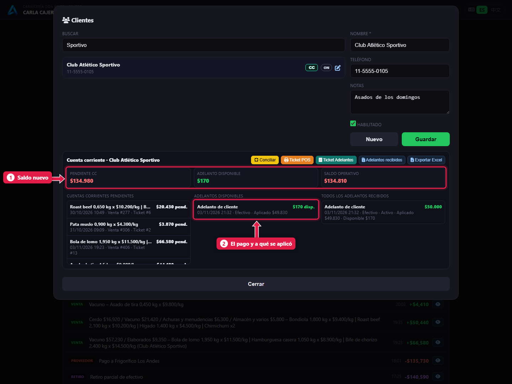

# Fiado: vender a cuenta corriente y cobrar la deuda

> **Para quién es:** la cajera.  **Tiempo:** 1 minuto.  **Necesitás:** que el cliente esté cargado.

Para **fiar**, elegís el **cliente** en la venta y pagás con **Fiado**. Cuando el cliente viene a pagar, usás **Adelanto cliente**: el sistema cancela sus ventas fiadas **más viejas** primero.

## Para qué sirve
Restaurantes, rotiserías o clientes de confianza compran y pagan a fin de semana. La cuenta corriente muestra en todo momento cuánto debe cada uno.

## Antes de empezar
- El cliente tiene que existir. Se crea con **Clientes → Nuevo** o con **Nuevo cliente** dentro de la venta.
- El cobro automático de deudas lo activa el gerente en Configuración ([tutorial 19](19-puestos-camaras-y-configuracion.md)).

## Paso a paso

### 1. Vendé fiado
Tocá **Venta** y cargá lo que lleva (o traé su comanda).

1. Elegí primero el **cliente**.
2. Recién ahí aparece **Fiado**. Tocalo.
3. Tocá **+ Agregar** y después **Registrar venta**.

### 2. Mirá cuánto debe
Tocá **Clientes**, buscá al cliente y tocá **CC**.

1. **CC:** abre la cuenta corriente.
2. **Pendiente CC:** cuánto debe en total.
3. **Cuentas corrientes pendientes:** cada venta fiada que falta pagar.
4. **Ticket POS:** imprime el resumen para dárselo al cliente.

### 3. Registrá el pago del cliente
Cerrá esa ventana y tocá **Adelanto cliente**.

1. **Cliente** que paga.
2. **Importe** que entrega.
3. **Medio de pago:** con qué paga (Fiado no aparece acá).
4. Tocá **Registrar Adelanto**.

### 4. Verificá que bajó la deuda

1. El **saldo nuevo**: bajó lo que pagó.
2. El **pago**, cuánto se **aplicó** y cuánto queda **disponible**. El sistema cancela **ventas fiadas enteras**: si lo que sobra no alcanza para la siguiente venta completa, ese resto queda disponible y se usa en el próximo pago.

## Qué pasa por detrás
- La venta fiada **no** suma plata a la caja: es una deuda. Aparece en la tarjeta **Fiado**.
- El pago del cliente sí entra a la caja, en el medio con que pagó.
- Con el cobro automático activo, el sistema cancela ventas fiadas enteras, de la **más vieja** a la más nueva, mientras alcance la plata. Deja una operación **Cobro deuda … automático por adelantos** en la lista.

## Problemas frecuentes
| Si te pasa… | Es porque… | Qué hacer |
|---|---|---|
| No aparece **Fiado** | No elegiste cliente | Elegí el cliente primero |
| No aparece el botón **Clientes** | No tenés permiso de crear o editar clientes | Pedíselo al gerente |
| El pago quedó como «disponible» y no bajó la deuda | El cobro automático está apagado | Usá **Conciliar** en la cuenta corriente o pedile al gerente que lo active |
| Quedó un resto «disponible» aunque el cliente todavía debe | Ese resto no alcanza para cancelar la siguiente venta entera | Es normal: se aplica con el próximo pago. También podés usar **Conciliar** |

## Preguntas frecuentes

### ¿Puedo imprimirle al cliente lo que debe?
Sí: en la cuenta corriente, **Ticket POS**. **Exportar Excel** baja el detalle.

### ¿Se puede anular un pago mal cargado?
Lo anula el gerente desde el admin (*Adelantos de clientes → Revertir y anular adelantos*), y solo si no tuvo plata real aplicada a otra cosa.

## Siguiente paso
- [Gastos y retiros de efectivo](09-gastos-y-retiros.md).
