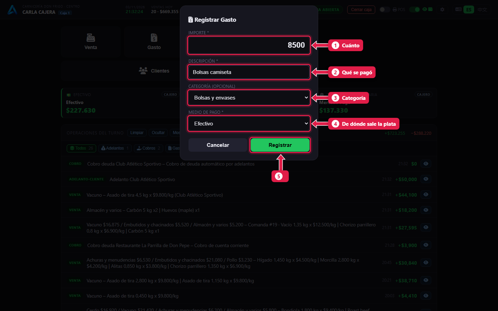
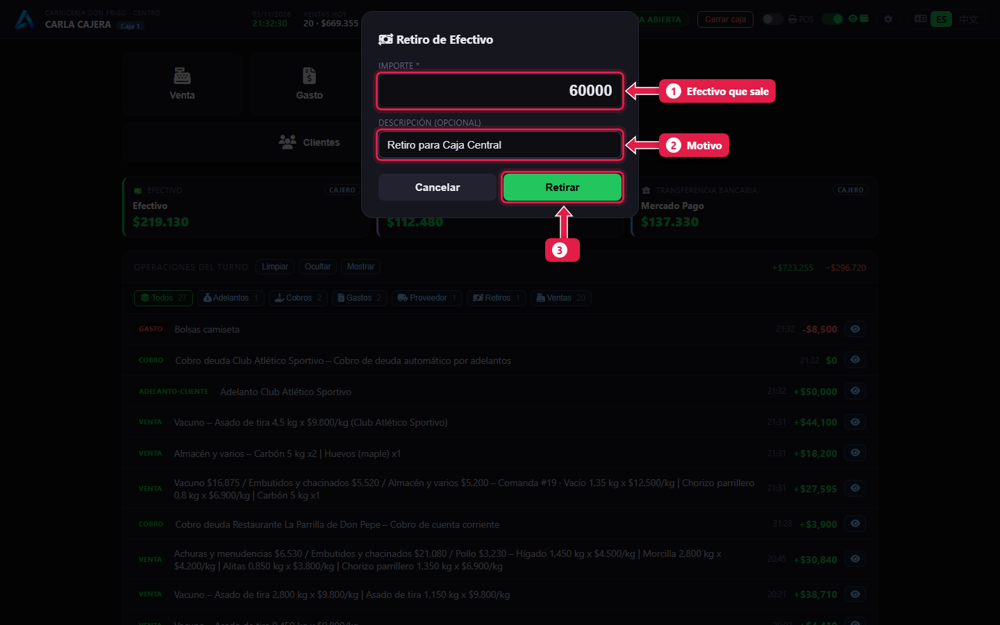
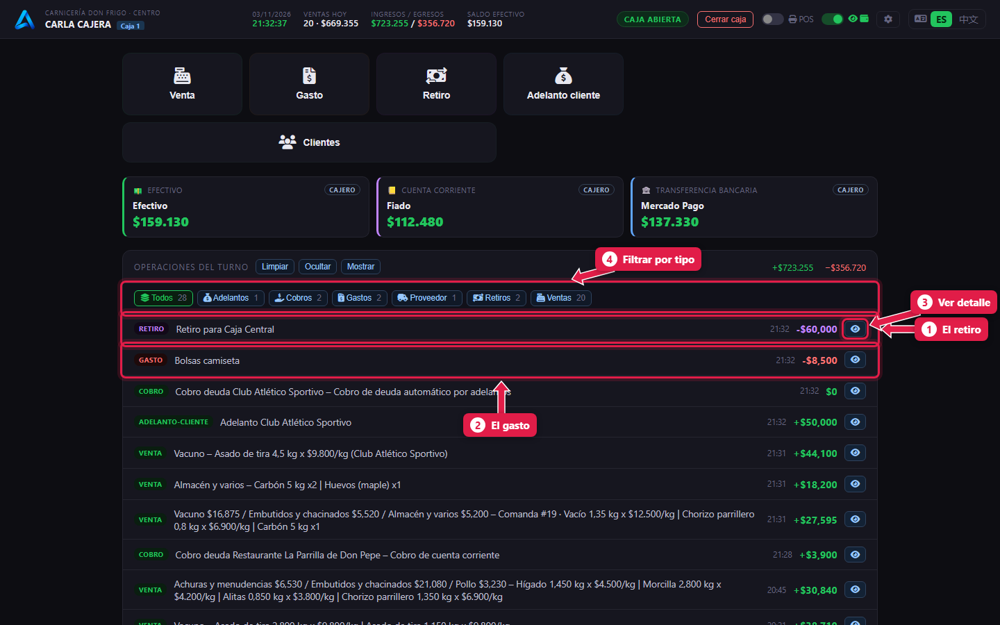

# Gastos y retiros de efectivo

> **Para quién es:** la cajera.  **Tiempo:** 30 segundos.

Si pagás algo con plata de la caja (bolsas, limpieza, un flete), tocá **Gasto**. Si sacás efectivo de la caja para llevarlo a la caja central, tocá **Retiro**. Las dos cosas restan del efectivo que tiene que haber al cerrar.

## Para qué sirve
Si no se anota, al cerrar la caja falta plata y no se sabe por qué. Anotado, el cierre da justo y el gerente ve en qué se gastó.

## Paso a paso

### 1. Registrá un gasto
Tocá **Gasto**.

1. **Importe:** cuánto se pagó.
2. **Descripción:** qué se pagó, por ejemplo «Bolsas camiseta».
3. **Categoría:** Bolsas y envases, Limpieza, Flete… (opcional).
4. **Medio de pago:** de dónde salió la plata (normalmente Efectivo).
5. Tocá **Registrar**.

### 2. Registrá un retiro
Tocá **Retiro**.

1. **Importe:** el efectivo que sale.
2. **Descripción:** el motivo (opcional).
3. Tocá **Retirar**.

### 3. Revisá las operaciones del turno

1. El **retiro**.
2. El **gasto**.
3. **👁:** abre el detalle (y permite reimprimir).
4. **Filtros:** muestran solo ventas, gastos, retiros, cobros…

## Qué pasa por detrás
- El gasto queda en el turno y en los reportes del gerente por categoría.
- El retiro siempre es en **efectivo**.
- Los dos bajan el **efectivo esperado** al cerrar.

## Problemas frecuentes
| Si te pasa… | Es porque… | Qué hacer |
|---|---|---|
| No aparece el botón **Gasto** o **Retiro** | No tenés ese permiso | Pedíselo al gerente |
| No aparece **Pago proveedor** | Ese botón es del gerente | Avisale al gerente |
| Me equivoqué de importe | — | Avisale al gerente: se corrige con un ajuste ([tutorial 22](22-controles-de-la-semana.md)) |

## Preguntas frecuentes

### ¿El pago al proveedor de mercadería es un gasto?
No. Es **Pago proveedor**, un botón que tiene el gerente. Queda en la cuenta del proveedor.

## Siguiente paso
- [Cerrar la caja](10-cerrar-la-caja.md).
