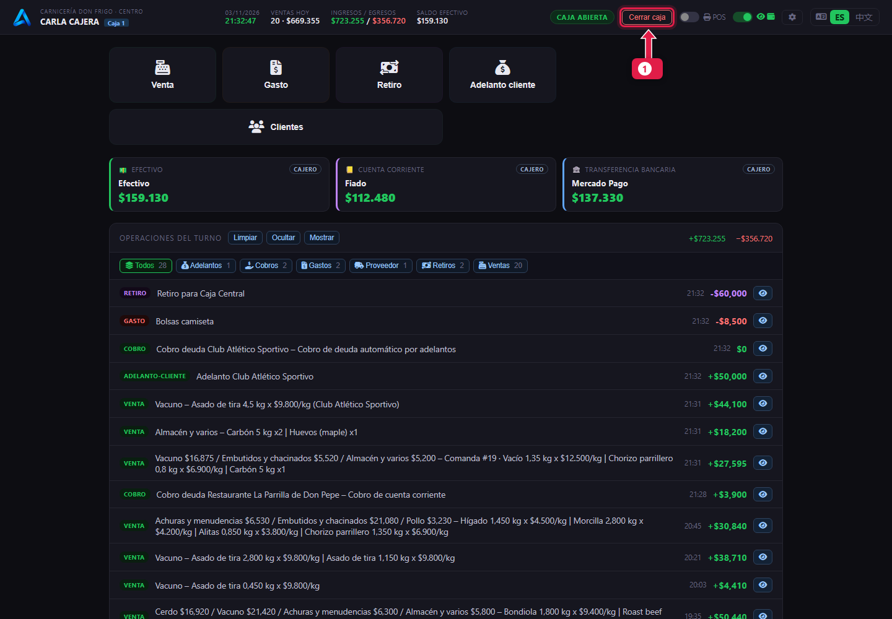
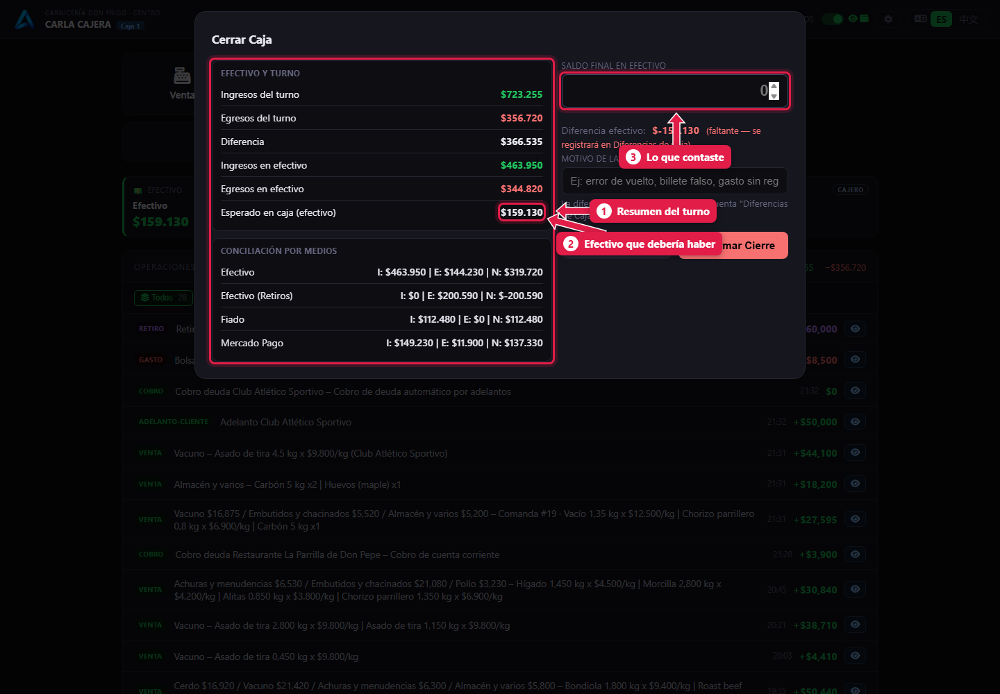
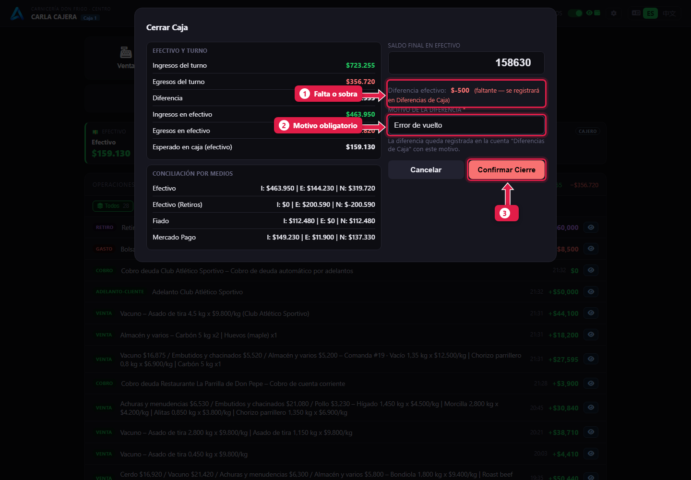
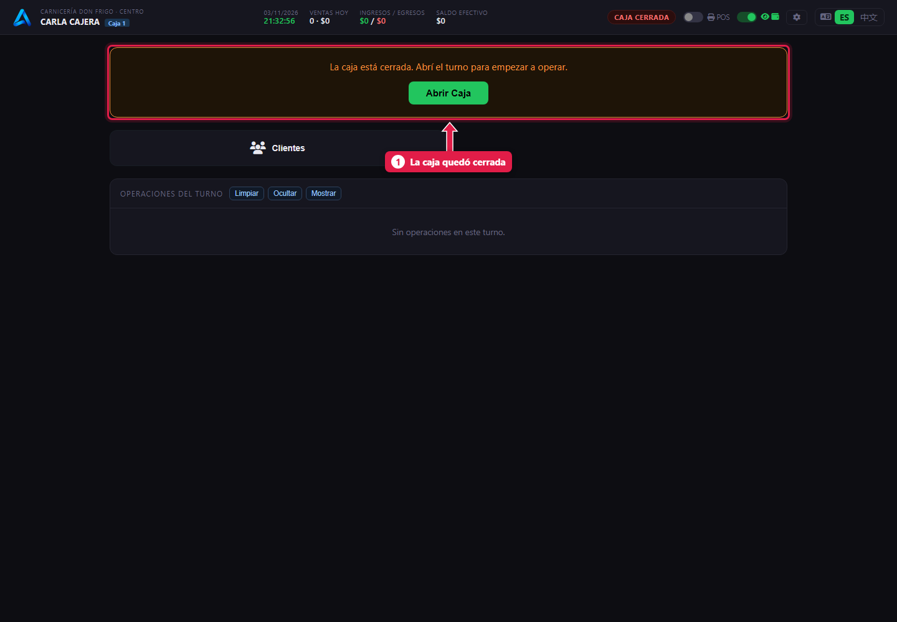

# Cerrar la caja

> **Para quién es:** la cajera.  **Tiempo:** 5 minutos.  **Necesitás:** el efectivo del cajón, contado.

Al final del día tocás **Cerrar caja**, escribís **cuánto efectivo contaste** y tocás **Confirmar Cierre**. Si no coincide con lo que debería haber, el sistema te pide el **motivo** de la diferencia.

## Para qué sirve
El cierre controla que la plata de la caja coincida con lo que se vendió, gastó y retiró. Cada diferencia queda registrada con su motivo para que el gerente la revise.

## Paso a paso

### 1. Tocá «Cerrar caja»

1. **Cerrar caja**, arriba.

### 2. Mirá el resumen y escribí lo que contaste

1. **Resumen del turno:** ingresos, egresos y movimientos por medio de pago.
2. **Esperado en caja (efectivo):** lo que debería haber en el cajón.
3. **Saldo final en efectivo:** escribí lo que **contaste**.

### 3. Si no coincide, explicá por qué

1. **Diferencia efectivo:** cuánto falta (o sobra).
2. **Motivo de la diferencia:** obligatorio si hay diferencia. Por ejemplo «Error de vuelto».
3. Tocá **Confirmar Cierre**. Se abre el **PDF** del cierre para imprimir o guardar.

### 4. La caja queda cerrada

1. Ya no se puede operar hasta [abrir la caja](05-abrir-la-caja.md) de nuevo.

## Qué pasa por detrás
- El turno queda **cerrado** y no se puede modificar.
- El efectivo declarado vuelve a la **Caja Central**.
- La diferencia va a la cuenta **Diferencias de Caja**, con tu motivo. El gerente la ve en *Turnos de caja* ([tutorial 22](22-controles-de-la-semana.md)).

## Problemas frecuentes
| Si te pasa… | Es porque… | Qué hacer |
|---|---|---|
| No deja cerrar | Hay diferencia y falta el motivo | Escribí el motivo |
| Me equivoqué al escribir lo contado | El turno ya se cerró | Avisale al gerente: se corrige con un ajuste de cuenta |
| No se abre el PDF | El navegador bloqueó la ventana nueva | Permití las ventanas emergentes. El gerente lo baja desde *Turnos de caja* |

## Preguntas frecuentes

### ¿Y Mercado Pago? ¿Lo tengo que declarar?
En esta versión el cierre solo pide el efectivo. Lo cobrado por Mercado Pago figura en el resumen, por medio de pago.

### ¿Puedo cerrar sin contar?
No conviene: el arqueo es la única forma de detectar faltantes a tiempo.

## Siguiente paso
- Mañana: [Abrir la caja](05-abrir-la-caja.md).
- Para el gerente: [Controles de la semana](22-controles-de-la-semana.md).
