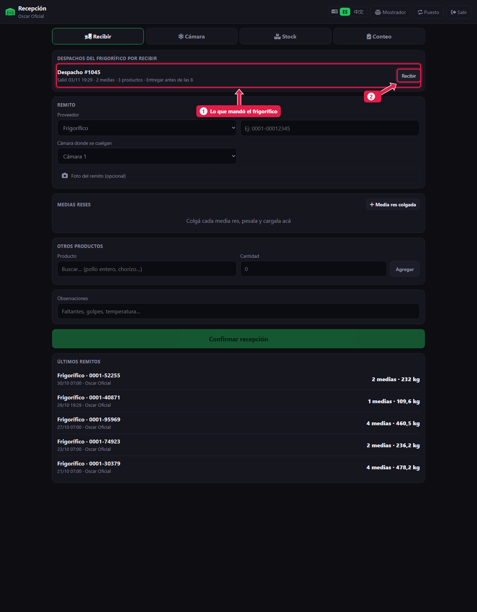
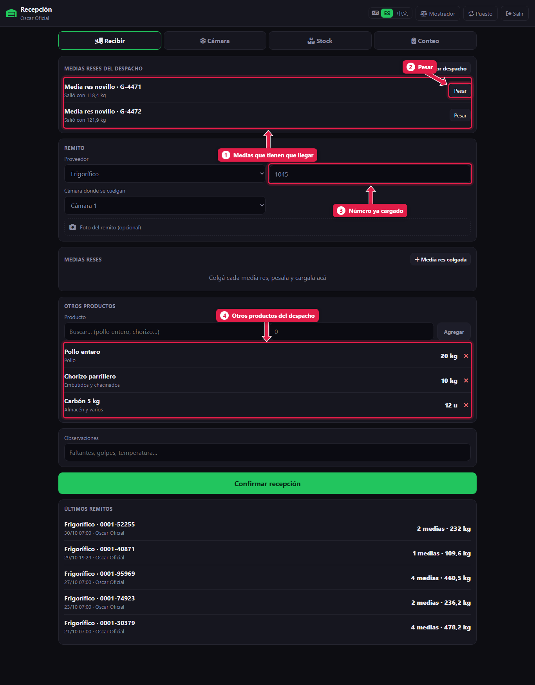
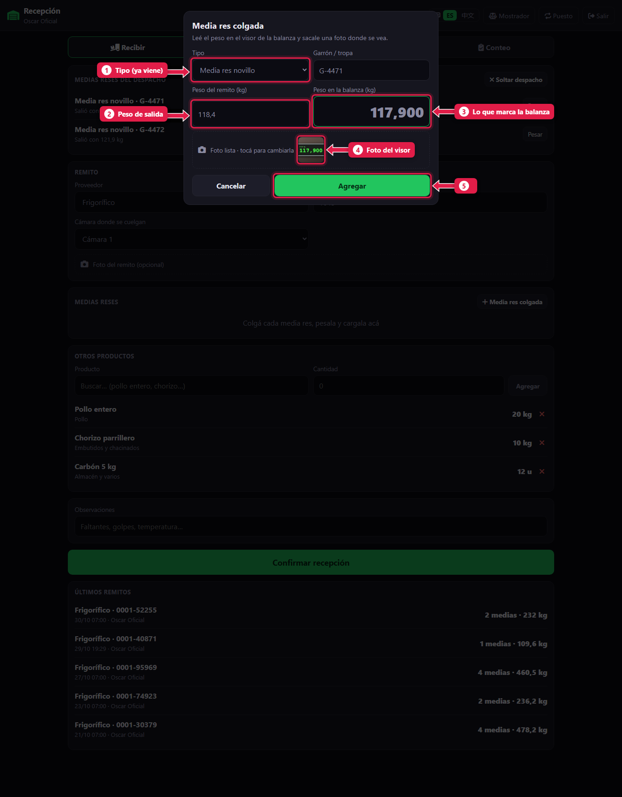
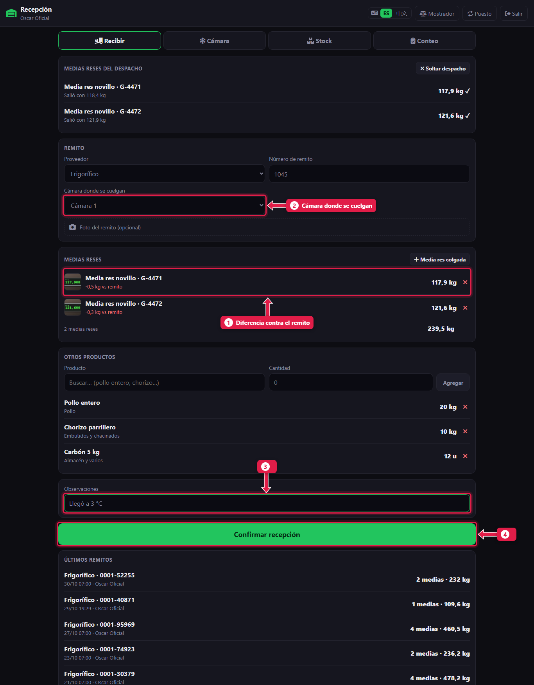
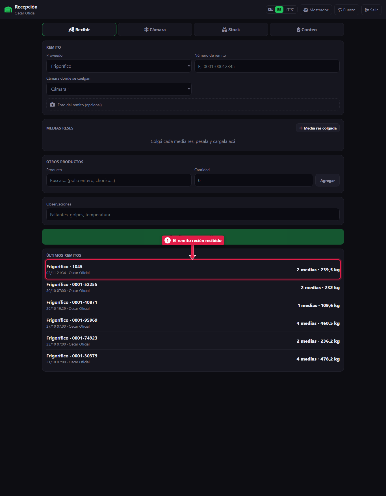

# Recibir un despacho del frigorífico

> **Para quién es:** oficial, ayudante y gerente.  **Tiempo:** 2 minutos por media res.  **Necesitás:** la balanza de colgar y el celular o la tablet con cámara.

Lo que manda el frigorífico aparece solo en **Despachos del frigorífico por recibir**. Tocás **Recibir**, **pesás** cada media res con **foto del visor**, elegís la **cámara** y tocás **Confirmar recepción**.

## Para qué sirve
La media res sale del frigorífico con un peso y llega con otro. Pesarla al colgarla, con foto, deja la prueba de lo que llegó de verdad. El frigorífico ve la diferencia en su panel.

## Antes de empezar
- Puesto **Recepción**, o botón **Cámara** desde el mostrador.
- El martes, **primero se liquida** y después se recibe la carne nueva ([tutorial 15](15-liquidacion-semanal-contar.md)).

## Paso a paso

### 1. Tocá «Recibir» en el despacho que llegó

1. El **despacho**: número, cuándo salió, cuántas medias y productos trae, y la nota del frigorífico.
2. Tocá **Recibir**.

### 2. Mirá lo que tiene que llegar

1. **Medias reses del despacho:** cada una con el peso con que salió.
2. **Pesar:** tocalo cuando la media esté colgada en la balanza.
3. **Número de remito:** ya viene cargado.
4. **Otros productos:** pollo, embutidos, carbón… ya vienen cargados con la cantidad del despacho.

### 3. Pesá cada media res

1. **Tipo:** ya viene del despacho (por ejemplo «Media res novillo»).
2. **Peso del remito:** el peso con que salió del frigorífico.
3. **Peso en la balanza:** escribí lo que marca el visor.
4. **Foto del visor:** sacá la foto con la media colgada y el número a la vista. Es la prueba del peso.
5. Tocá **Agregar**.

Repetí con cada media.

### 4. Elegí la cámara y confirmá

1. Cada media muestra la **diferencia contra el remito**. En rojo: llegó menos.
2. **Cámara donde se cuelgan:** normalmente Cámara 1.
3. **Observaciones:** faltantes, golpes, temperatura.
4. Tocá **Confirmar recepción**.

Si alguno de los otros productos llegó en otra cantidad, quitá la línea con **✕** y cargala con lo que llegó.

### 5. Recepción confirmada

1. El remito aparece primero en **Últimos remitos**, con la cantidad de medias y los kilos.

## Qué pasa por detrás
- Las medias quedan **en la cámara**, listas para despostar ([tutorial 13](13-camara-y-desposte.md)).
- Los otros productos **suman stock**.
- El despacho pasa a **recibido** y el frigorífico ve los pesos reales en su panel.

## Problemas frecuentes
| Si te pasa… | Es porque… | Qué hacer |
|---|---|---|
| No aparece el despacho | Todavía no sincronizó, o ya se recibió | Esperá un minuto. Si sigue sin aparecer, avisale al gerente |
| «No sacaste foto del visor. ¿Agregar igual?» | Falta la foto | Sacala. Si no se puede, aceptá y anotalo en observaciones |
| Aviso de que falta pesar una media | Hay medias del despacho sin pesar | Pesala. Si no llegó, confirmá igual: queda como faltante |
| La diferencia sale muy grande | Se tipeó mal el peso | Quitá la media con **✕** y pesala de nuevo antes de confirmar |

## Preguntas frecuentes

### ¿Qué hago si el despacho llegó incompleto?
Pesá lo que llegó, escribí en **Observaciones** lo que falta y confirmá. El sistema lo marca como faltante.

## Siguiente paso
- [La cámara: mover y despostar una media res](13-camara-y-desposte.md).
- [Recibir mercadería de otro proveedor](12-recibir-de-otro-proveedor.md).
