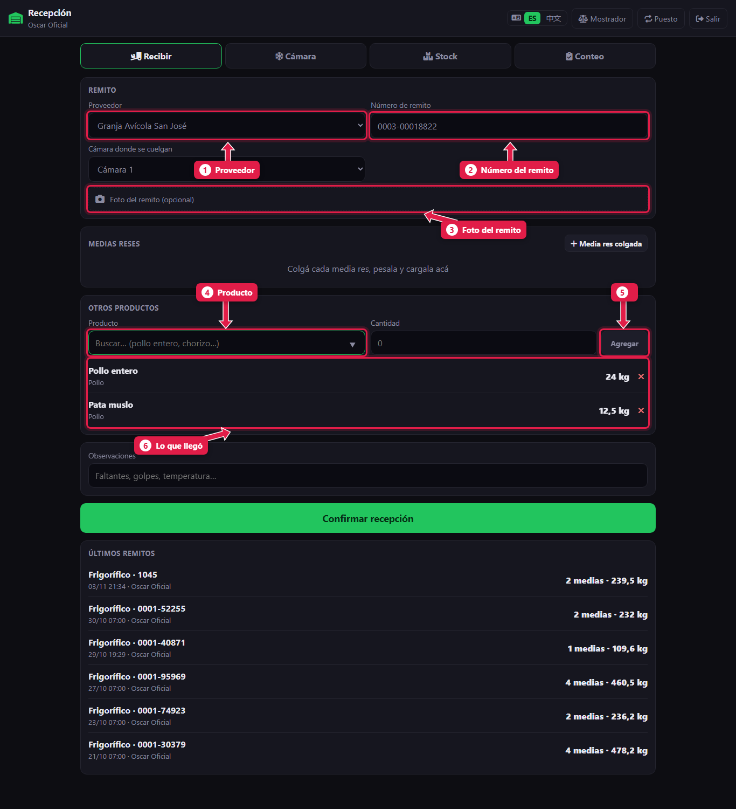
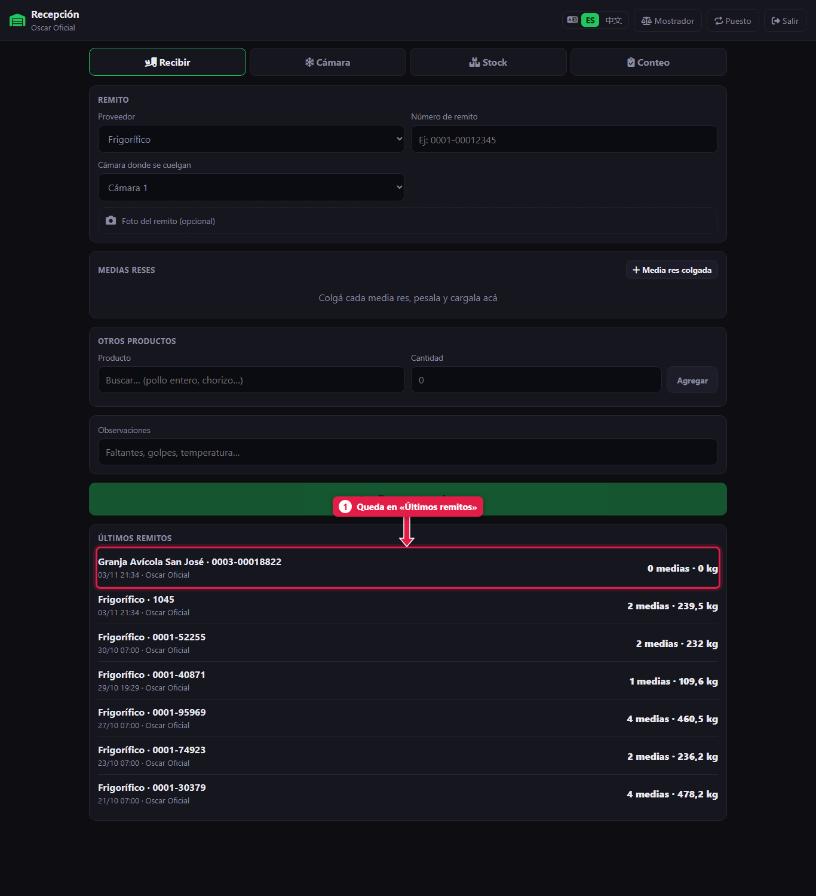

# Recibir mercadería de otro proveedor

> **Para quién es:** oficial, ayudante y gerente.  **Tiempo:** 2 minutos.

Cuando llega mercadería de **otro proveedor** (por ejemplo, la granja de pollos), en **Recibir** elegís el **proveedor**, escribís el **número de remito**, cargás cada **producto** con su cantidad y tocás **Confirmar recepción**.

## Para qué sirve
Todo lo que entra tiene que sumar stock. Si no se carga, el martes en la liquidación parece que «sobra» mercadería.

## Paso a paso

### 1. Cargá el remito

1. **Proveedor:** elegilo de la lista.
2. **Número de remito:** el que figura en el papel.
3. **Foto del remito:** sacale foto al papel (opcional, pero recomendable).
4. **Producto:** buscalo y escribí la **cantidad** al lado.
5. Tocá **Agregar**. Repetí con cada producto.
6. **Lo que llegó:** revisá la lista. Quitá con **✕** lo que esté mal.

Si llegan medias reses de este proveedor, tocá **Media res colgada** y pesalas como en el [tutorial 11](11-recibir-despacho-del-frigorifico.md).

Al final, tocá **Confirmar recepción**.

### 2. El remito queda registrado

1. Aparece primero en **Últimos remitos**.

## Qué pasa por detrás
- Cada producto suma su cantidad al **stock**.
- El remito queda guardado con la foto, quién lo recibió y cuándo.

## Problemas frecuentes
| Si te pasa… | Es porque… | Qué hacer |
|---|---|---|
| «Elegí un producto de la lista» | El nombre no coincide con ningún producto | Escribí parte del nombre y elegilo de la lista |
| «Ingresá la cantidad» | La cantidad está vacía o en 0 | Escribí la cantidad, con coma si hace falta: `12,5` |
| No está el proveedor | No está cargado | El gerente lo carga en *Compras → Proveedores* |
| **Confirmar recepción** no se activa | No cargaste nada | Agregá al menos un producto o una media |

## Preguntas frecuentes

### ¿Acá se paga al proveedor?
No. Recibir solo registra la mercadería. El pago lo hace el gerente desde la caja con **Pago proveedor**.

## Siguiente paso
- [Ver el stock por corte](14-ver-el-stock.md).
