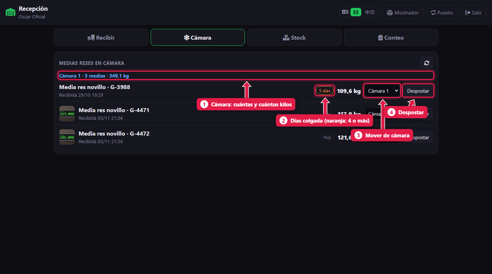
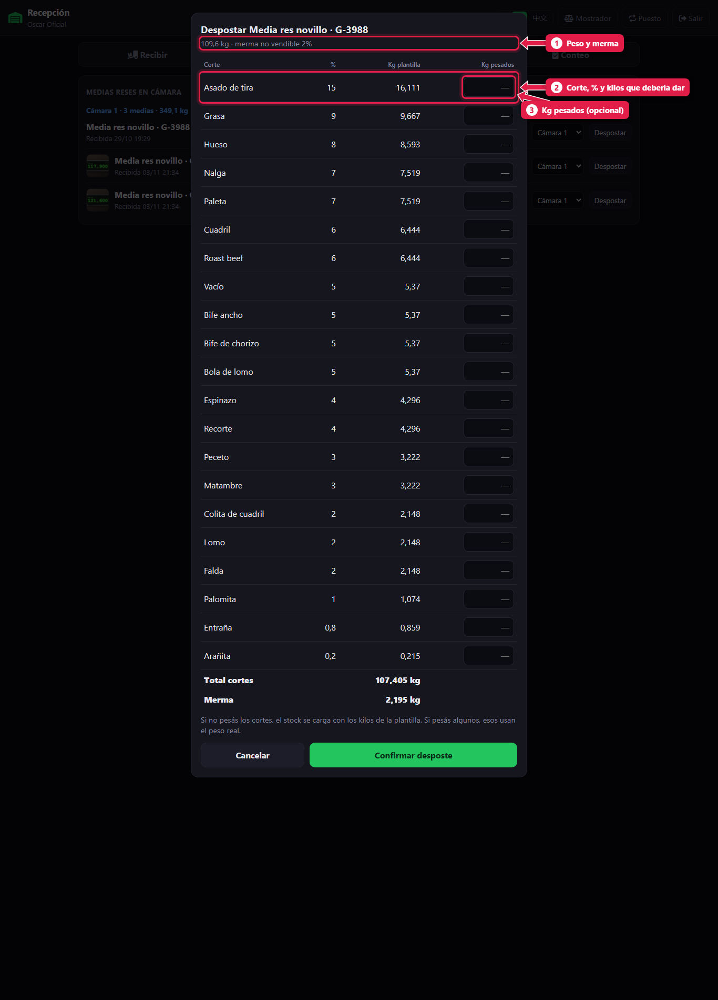
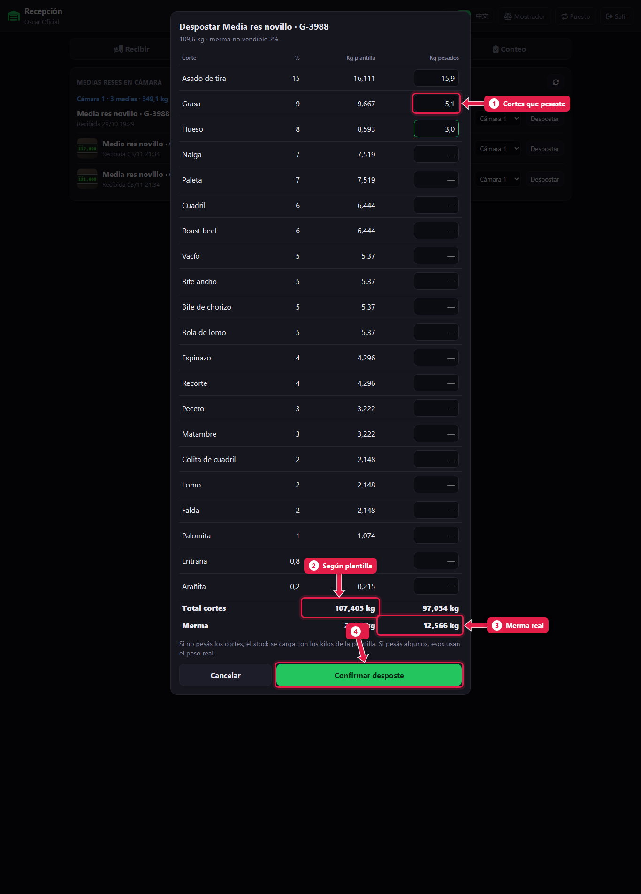
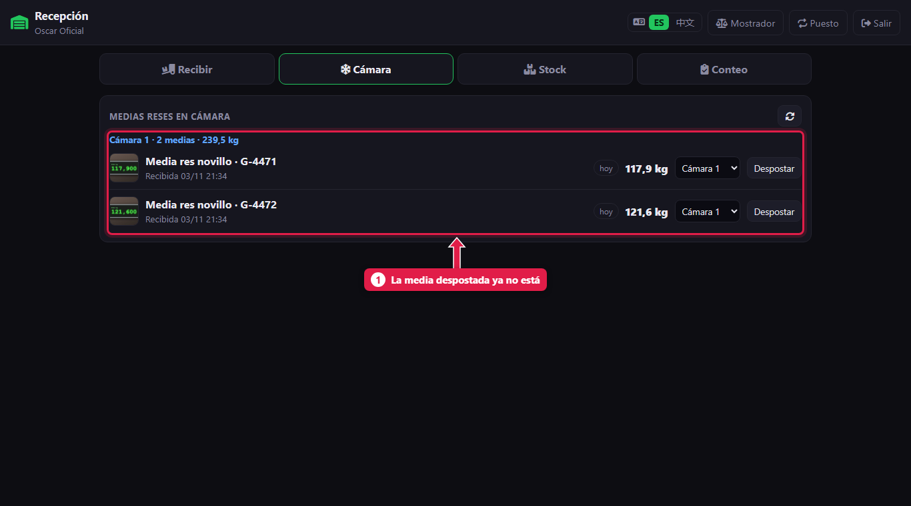

# La cámara: mover y despostar una media res

> **Para quién es:** el oficial y el gerente (el ayudante puede ver y mover, no despostar).  **Tiempo:** 2 minutos.

En la pestaña **Cámara** ves cada media res colgada y **cuántos días** lleva. Para cortarla, tocás **Despostar**: el sistema muestra cuántos kilos debería dar cada corte según la **plantilla**. Si pesaste algunos cortes, escribís esos kilos. Tocás **Confirmar desposte** y los cortes suman stock.

## Para qué sirve
La media res no se vende entera: se vende en cortes. Despostar en el sistema convierte esos kilos en stock de asado, vacío, nalga… y calcula la **merma** (lo que se pierde en hueso, grasa y recorte que no se vende).

## Paso a paso

### 1. Mirá las medias en cámara

1. **Cámara:** cuántas medias tiene y cuántos kilos.
2. **Días colgada:** con **4 días o más** se pone **naranja**. Conviene despostar primero esas.
3. **Mover:** elegí otra cámara en el desplegable y la media se mueve.
4. **Despostar:** abre la planilla de desposte.

### 2. Mirá la plantilla

1. Arriba, el **peso** de la media y la **merma no vendible** de la plantilla.
2. Cada fila: el **corte**, su **%** y los **kilos que debería dar**.
3. **Kg pesados:** opcional. Si no pesás, dejalo vacío.

### 3. Si pesaste algunos cortes, escribí los kilos

1. Los **cortes que pesaste**, con sus kilos reales. Los demás usan los de la plantilla.
2. **Total cortes** según la plantilla.
3. **Merma real:** el peso de la media menos la suma de los cortes.
4. Tocá **Confirmar desposte**.

### 4. La media sale de la cámara

1. La media despostada ya no está en la lista.

## Qué pasa por detrás
- Cada corte **suma stock** con sus kilos (los pesados o los de la plantilla).
- Se guarda la **merma de desposte**. El frigorífico la ve en su panel: en naranja si pasa del 4 %.
- Se guarda quién desposteó y cuándo.

## Problemas frecuentes
| Si te pasa… | Es porque… | Qué hacer |
|---|---|---|
| No aparece **Despostar** | Sos ayudante | Lo hace el oficial o el gerente |
| No aparece el desplegable para mover | Hay una sola cámara activa | El gerente puede agregar cámaras ([tutorial 19](19-puestos-camaras-y-configuracion.md)) |
| La merma sale muy alta | Se tipeó mal algún peso | Revisá los kilos antes de confirmar. Una vez confirmado no se deshace |

## Preguntas frecuentes

### ¿Conviene pesar los cortes?
De vez en cuando, sí: así se ve si la plantilla se parece a lo que rinde la carne de verdad. Si los números se alejan mucho, avisale al frigorífico.

## Siguiente paso
- [Ver el stock por corte](14-ver-el-stock.md).
