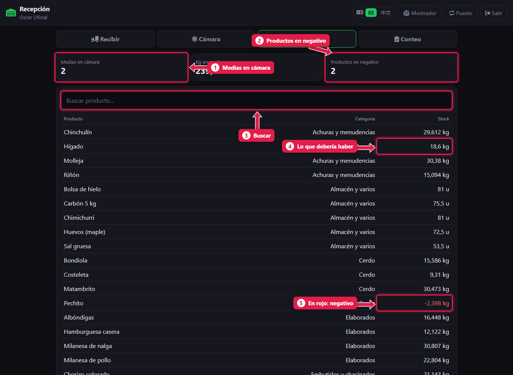
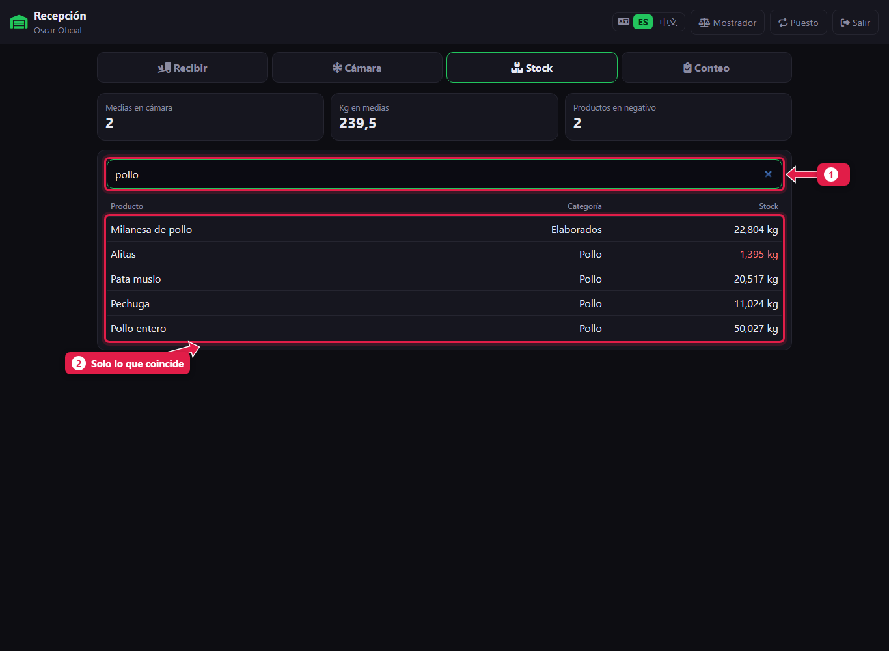

# Ver el stock por corte

> **Para quién es:** oficial, ayudante y gerente (la cajera no lo ve).  **Tiempo:** 1 minuto.

La pestaña **Stock** muestra cuánto **debería** haber de cada producto según el sistema: lo recibido y despostado, menos lo vendido y lo tirado. Arriba están las medias en cámara y cuántos productos quedaron en negativo.

## Para qué sirve
Saber qué cortes quedan antes de abrir, y detectar errores: un producto en **negativo** quiere decir que se vendió más de lo que entró.

## Paso a paso

### 1. Mirá el resumen y la lista

1. **Medias en cámara** (y al lado, sus kilos).
2. **Productos en negativo:** cuántos hay.
3. **Buscar producto.**
4. **Stock:** lo que debería haber, en kilos o unidades.
5. **En rojo:** stock negativo.

### 2. Buscá un producto

1. Escribí parte del nombre o del rubro.
2. La lista muestra **solo lo que coincide**.

## Qué significa un negativo
Lo más común:
- Un **desposte sin cargar**: se vendió asado de una media que en el sistema sigue colgada.
- Un corte **vendido con el nombre de otro** en el mostrador.
- Mercadería que **llegó y no se cargó** en Recibir.

Se corrige **contando**: un [conteo de control](17-conteo-de-control.md) o la [liquidación](15-liquidacion-semanal-contar.md) deja el stock igual a lo que hay de verdad.

## Preguntas frecuentes

### ¿El stock es lo que hay en la cámara?
Es lo que **debería** haber. Lo que hay de verdad se sabe contando.

### ¿Por qué la cajera no ve el stock?
Porque su rol no tiene el permiso **Ver stock**. Lo puede habilitar el gerente.

## Siguiente paso
- [Liquidación semanal: contar](15-liquidacion-semanal-contar.md).
