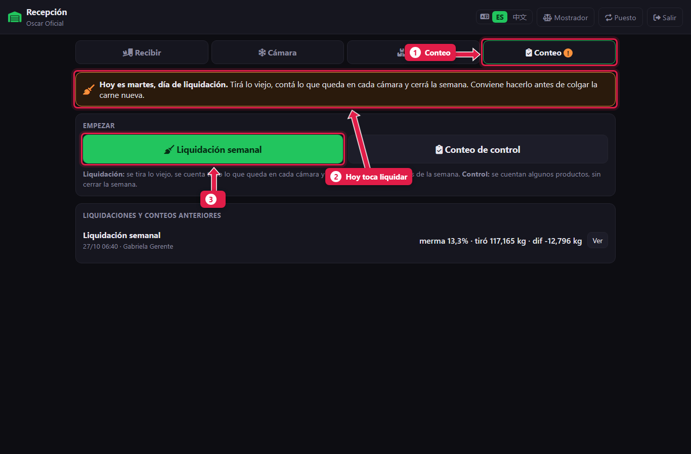
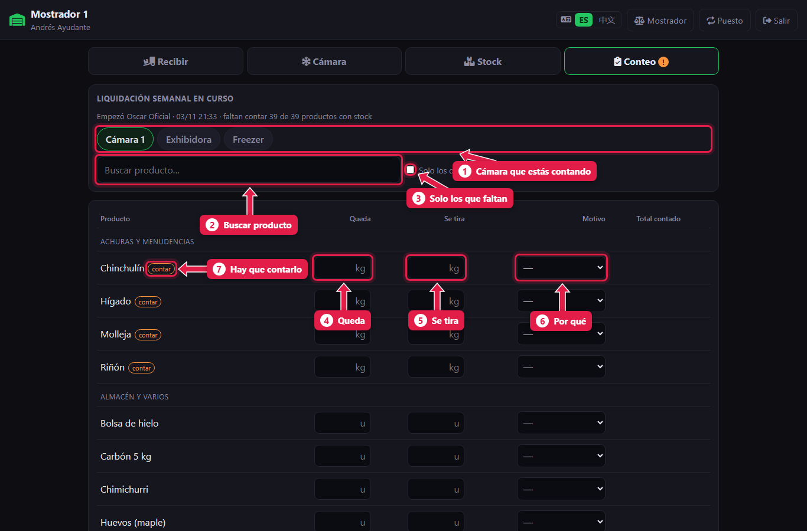
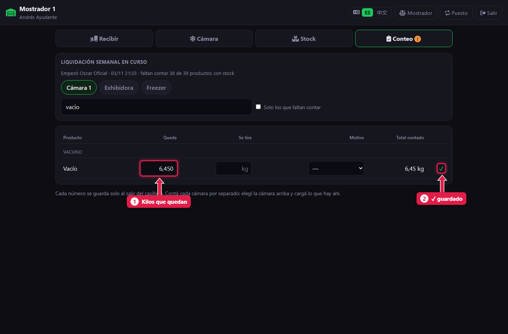
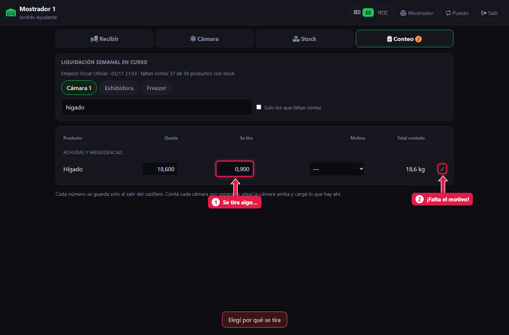
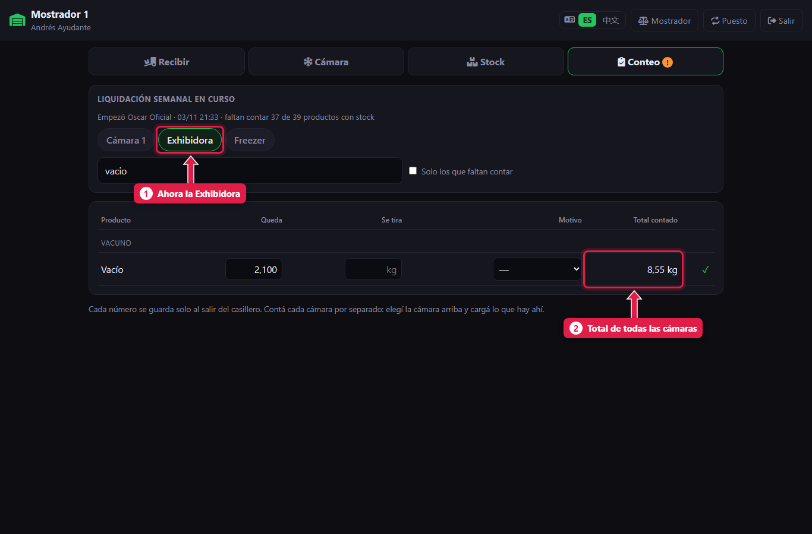
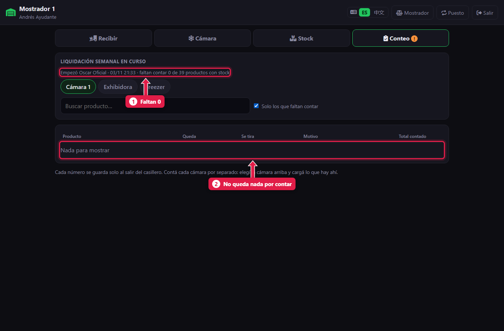

# Liquidación semanal: contar lo que queda y lo que se tira

> **Para quién es:** el ayudante y el oficial cuentan; el oficial o el gerente la empiezan.  **Tiempo:** 30 a 60 minutos.  **Cuándo:** el día de liquidación (martes), **antes de abrir** y **antes de recibir la carne nueva**.

Una vez por semana se **cuenta todo** lo que se vende por kilo, cámara por cámara: lo que **queda** bien y lo que **se tira** (con su motivo). Con eso el sistema cierra el **balance de kilos** de la semana.

## Para qué sirve
Es el control más importante de la carnicería: muestra cuántos kilos se perdieron en la semana y en qué (merma de desposte, lo tirado y lo que falta). Quien cuenta **no ve** cuánto debería haber: así el conteo es honesto.

## Antes de empezar
- Es martes (o el día de liquidación de la sucursal). El sistema lo avisa en la pestaña **Conteo**.
- Solo puede haber **un conteo abierto** por vez.
- Si todavía no llegó la carne nueva, mejor: se cuenta menos.

## Paso a paso

### 1. Empezá la liquidación (oficial o gerente)
Entrá a **Recepción → Conteo**.

1. Pestaña **Conteo** (con un **!** naranja el día de liquidación).
2. El aviso: hoy toca liquidar.
3. Tocá **Liquidación semanal**.

### 2. Conocé la planilla

1. **Cámara** que estás contando: Cámara 1, Exhibidora, Freezer.
2. **Buscar producto.**
3. **Solo los que faltan contar:** deja a la vista lo pendiente.
4. **Queda:** lo que está bien y sigue a la venta, en kilos o unidades.
5. **Se tira:** lo que se descarta.
6. **Motivo:** obligatorio si se tira algo.
7. **contar:** productos con stock que hay que contar sí o sí.

### 3. Cargá cada producto

1. Escribí los **kilos que quedan**. Con **Enter** pasás al casillero siguiente.
2. Al salir del casillero se guarda solo y aparece **✓**.

### 4. Si se tira algo, elegí el motivo

1. Escribiste kilos en **Se tira**…
2. …y aparece **!**: falta el **motivo**. Elegí uno: vencido, olor o color; golpeado o quemado por frío; limpieza o recorte sin venta; decomiso; otro. Al elegirlo aparece **✓**.

### 5. Pasá a la otra cámara

1. Tocá la otra **cámara** y contá lo que hay ahí.
2. Si un producto está en dos cámaras, cargalo en cada una: el **total** se suma solo.

Pueden contar dos personas a la vez, en dos tablets, cada una en una cámara.

### 6. Verificá que no falte nada

1. Arriba dice cuántos **faltan contar**.
2. Con **Solo los que faltan contar** tildado, la lista queda vacía cuando terminaste.

Si de un producto obligatorio no queda nada, cargá **0**.

## Qué pasa por detrás
- Cada número se guarda al momento, con quién lo cargó.
- El stock **no cambia** hasta que se cierra la liquidación ([tutorial 16](16-liquidacion-cerrar.md)).

## Problemas frecuentes
| Si te pasa… | Es porque… | Qué hacer |
|---|---|---|
| **!** en una fila | Falta el motivo o hubo un error | Elegí el motivo o corregí el número |
| «Ya hay un conteo abierto» | Quedó otro conteo sin terminar | Terminalo, o que el oficial lo anule |
| Cargué mal una fila | — | Vaciá los dos casilleros (**Queda** y **Se tira**): la línea se borra |
| No veo el botón **Liquidación semanal** | Sos ayudante | La empieza el oficial o el gerente; después contás vos |

## Preguntas frecuentes

### ¿Por qué no veo cuánto debería haber?
A propósito: quien cuenta no tiene que estar influenciado. Las diferencias las ve el oficial o el gerente al cerrar.

### ¿Hay que contar lo que se vende por unidad?
La liquidación pide todo lo que tiene stock y se vende por kilo. Lo demás se puede contar si se quiere.

## Siguiente paso
- [Ver las diferencias y cerrar la liquidación](16-liquidacion-cerrar.md).
