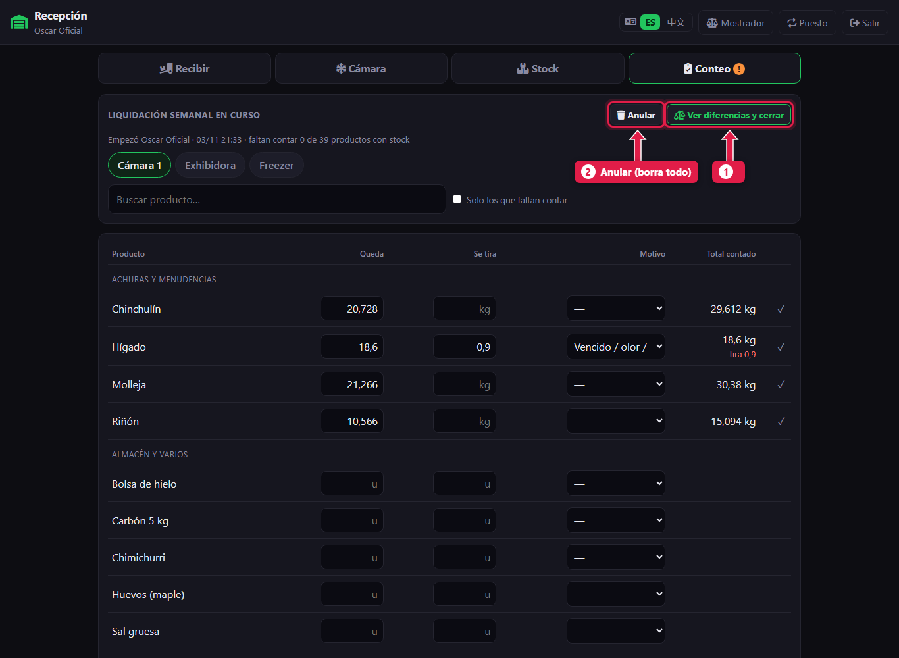
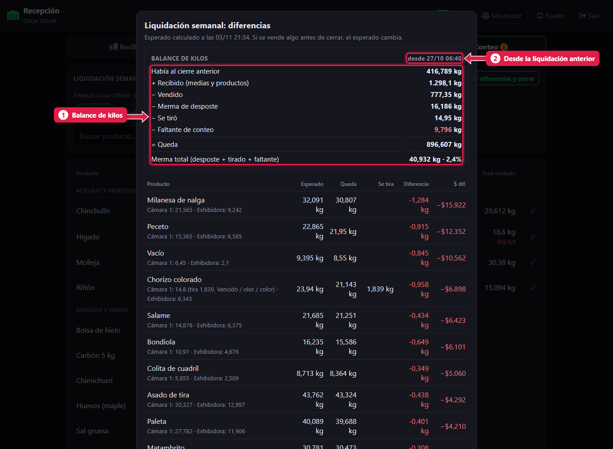
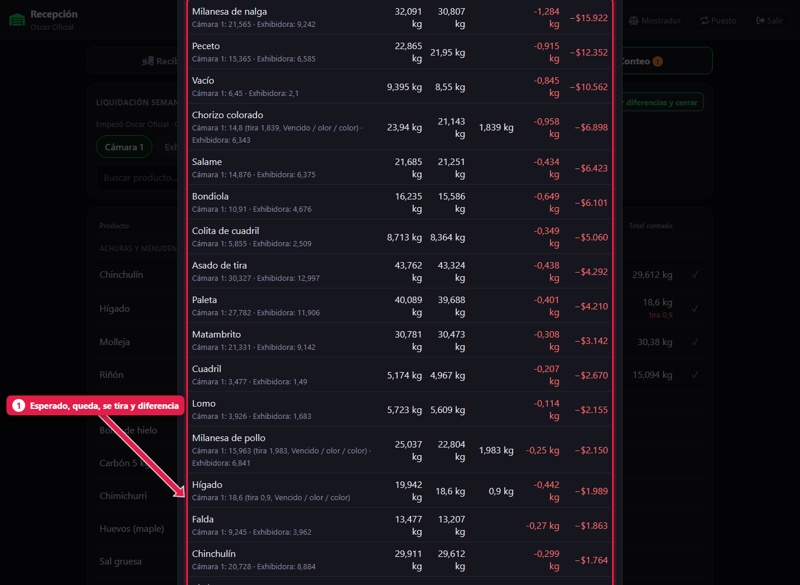
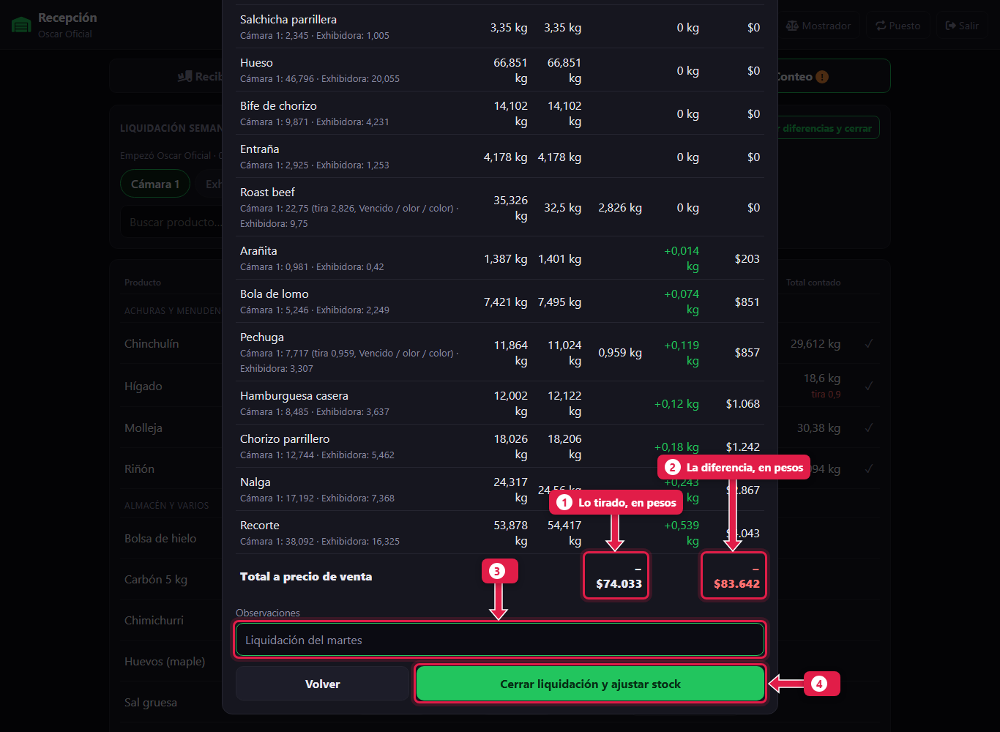
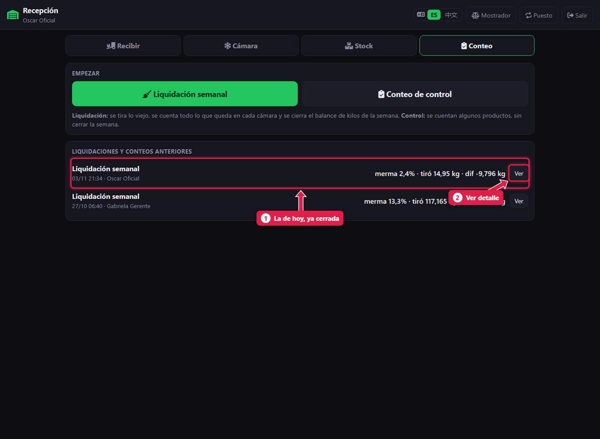

# Ver las diferencias y cerrar la liquidación

> **Para quién es:** el oficial y el gerente.  **Tiempo:** 10 minutos.  **Necesitás:** que esté todo contado ([tutorial 15](15-liquidacion-semanal-contar.md)).

Con todo contado, tocás **Ver diferencias y cerrar**. El sistema muestra el **balance de kilos** de la semana, la **merma total** y cada producto con su diferencia en kilos y en pesos. Revisás, escribís una observación y tocás **Cerrar liquidación y ajustar stock**.

## Para qué sirve
Es la foto de la semana: cuántos kilos entraron, cuántos se vendieron, cuántos se perdieron y por qué. Al cerrar, el stock del sistema queda **igual a lo que se contó**.

## El balance de kilos
```
  Había al cierre anterior
+ Recibido (medias y productos)
− Vendido
− Merma de desposte
− Se tiró
± Faltante o sobrante de conteo
= Queda
```
**Merma total** = merma de desposte + lo que se tiró + el faltante. Se muestra en kilos y en % de lo que hubo en la semana. En **rojo si pasa el 6 %**.

## Paso a paso

### 1. Tocá «Ver diferencias y cerrar»


1. **Ver diferencias y cerrar.**
2. **Anular:** borra todo el conteo sin tocar el stock. Usalo solo si hay que empezar de nuevo.

### 2. Revisá el balance de kilos


1. El **balance de kilos** de la semana.
2. **Desde:** la fecha de la liquidación anterior.

Si falta contar algún producto obligatorio, arriba aparece la lista y no se puede cerrar.

### 3. Revisá las diferencias por producto


1. Cada producto: **esperado**, **queda**, **se tira** y **diferencia** en kilos y en pesos. **Arriba, los faltantes más caros.** Debajo del nombre, el detalle por cámara.

### 4. Cerrá


1. **Lo tirado**, en pesos.
2. **La diferencia**, en pesos (negativo = faltante).
3. **Observaciones:** lo que haga falta aclarar.
4. Tocá **Cerrar liquidación y ajustar stock**.

### 5. La liquidación queda en el historial


1. La liquidación de hoy, con la merma, lo tirado y la diferencia.
2. **Ver:** abre el detalle completo.

## Qué pasa por detrás
- El stock queda **igual a lo contado**: lo tirado sale como **merma** y la diferencia como **ajuste**.
- **No se puede deshacer.**
- El balance sube al frigorífico en la próxima sincronización.

## Problemas frecuentes
| Si te pasa… | Es porque… | Qué hacer |
|---|---|---|
| No deja cerrar: lista de productos sin contar | Faltan productos obligatorios | Contalos (si no queda nada, cargá 0) |
| La merma está en rojo | Pasa del 6 % | Mirá los faltantes más caros: kilos mal tipeados en comandas, despostes sin cargar o carne vieja |
| El esperado cambió entre una vez y otra | Se vendió algo mientras tanto | Por eso conviene liquidar **antes de abrir** |

## Preguntas frecuentes

### ¿Qué hago si un faltante es enorme?
Antes de cerrar, recontá ese producto. Si después de cerrar aparece el error, se corrige con un [conteo de control](17-conteo-de-control.md).

## Siguiente paso
- Ahora sí: [recibir la carne nueva](11-recibir-despacho-del-frigorifico.md).
- [Conteo de control e historial](17-conteo-de-control.md).
