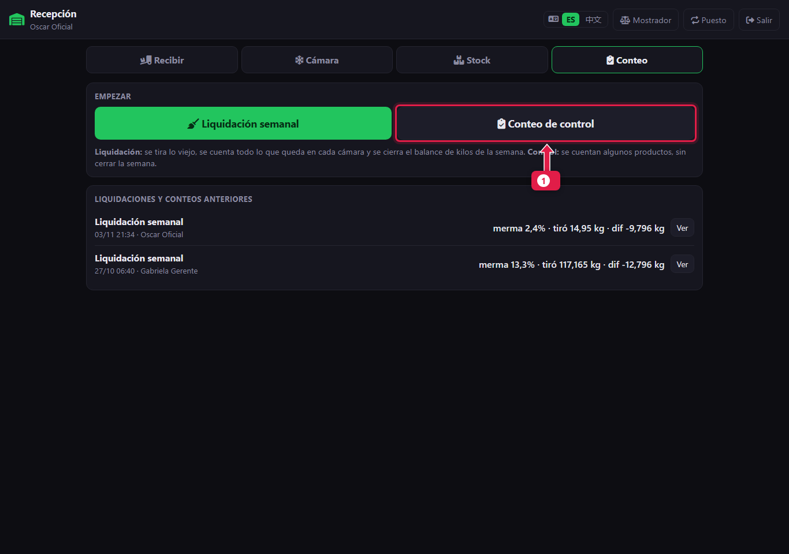
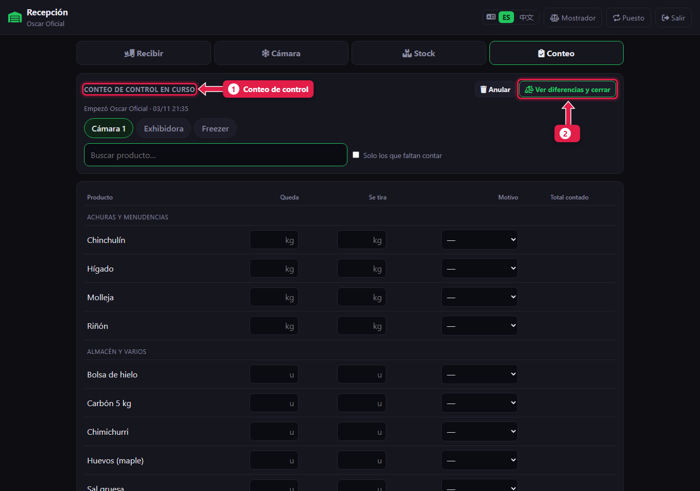
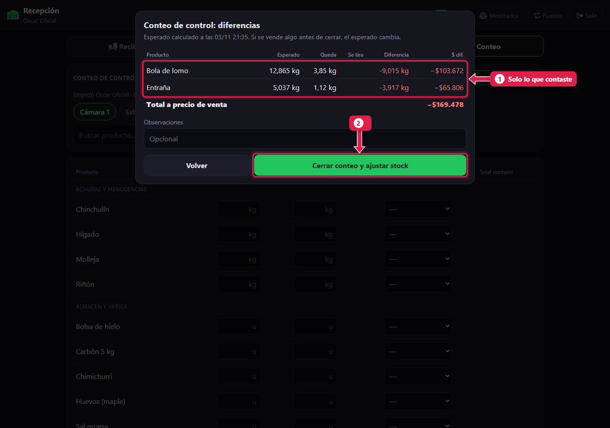
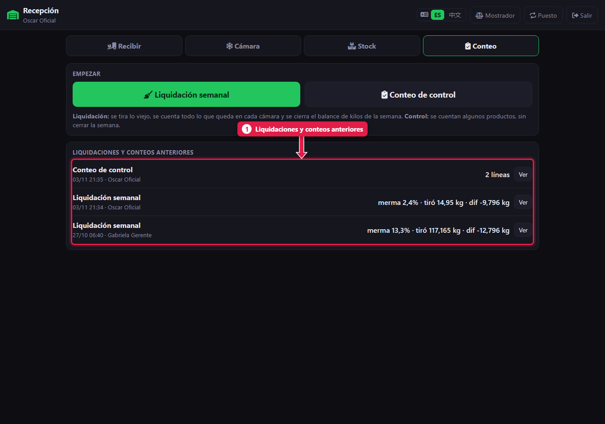
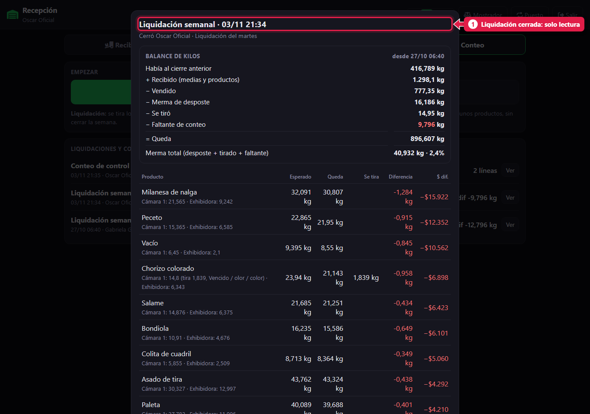

# Conteo de control e historial

> **Para quién es:** el oficial y el gerente.  **Tiempo:** 5 minutos.

El **conteo de control** sirve para revisar **algunos productos** en cualquier momento, sin cerrar la semana. Contás lo que querés revisar, mirás las diferencias y cerrás: el stock de esos productos queda igual a lo contado.

## Para qué sirve
Si un corte caro aparece en negativo o te parece que falta, no hace falta esperar al martes: lo contás y lo corregís.

## Liquidación o control
| | Liquidación semanal | Conteo de control |
|---|---|---|
| Cuándo | El día de liquidación | Cuando haga falta |
| Qué se cuenta | Todo lo que tiene stock y se vende por kilo | Solo lo que quieras revisar |
| Qué cierra | El balance de kilos de la semana | Nada: solo ajusta lo contado |

## Paso a paso

### 1. Empezá el conteo de control

1. Tocá **Conteo de control**.

### 2. Contá los productos que querés revisar
Buscá cada producto y cargá **Queda** (y **Se tira**, si corresponde), igual que en la [liquidación](15-liquidacion-semanal-contar.md).

1. El título dice **Conteo de control en curso**.
2. Al terminar, tocá **Ver diferencias y cerrar**.

### 3. Revisá y cerrá

1. Aparecen **solo los productos que contaste**, con su diferencia.
2. Escribí una observación y tocá **Cerrar** para ajustar el stock.

### 4. Consultá el historial

1. **Liquidaciones y conteos anteriores**, con la merma, lo tirado y la diferencia. Tocá **Ver** para abrir uno.

1. El detalle de una liquidación cerrada: balance, diferencias y lo contado por cámara. **Es de solo lectura.**

## Qué pasa por detrás
- Solo cambia el stock de los productos contados.
- Queda guardado en el historial con quién lo hizo.

## Preguntas frecuentes

### ¿Puedo hacer un control el mismo día de la liquidación?
Sí, pero no al mismo tiempo: solo puede haber un conteo abierto. Terminá uno antes de empezar el otro.

## Siguiente paso
- Para el gerente: [Controles de la semana](22-controles-de-la-semana.md).
