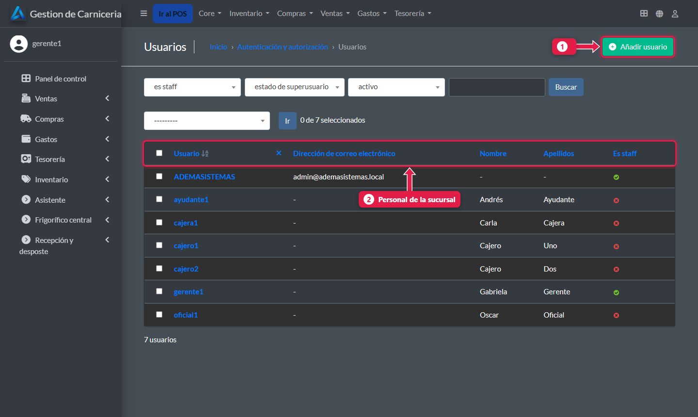
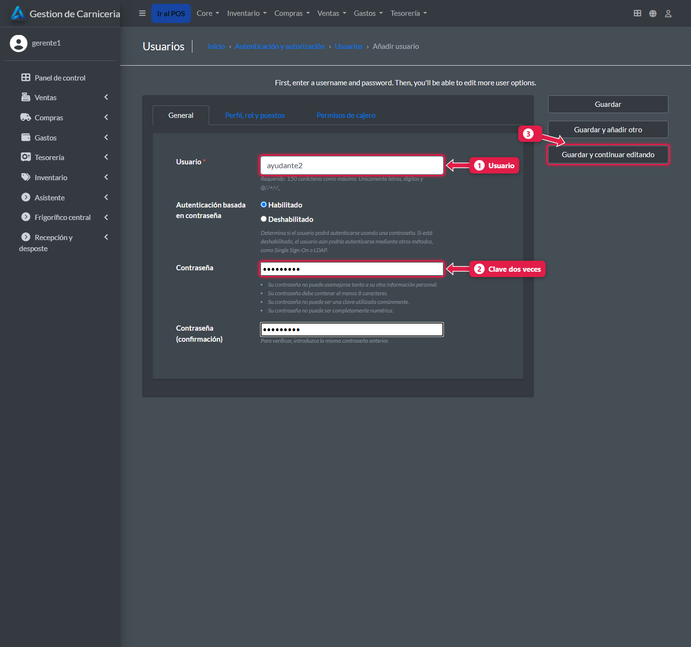
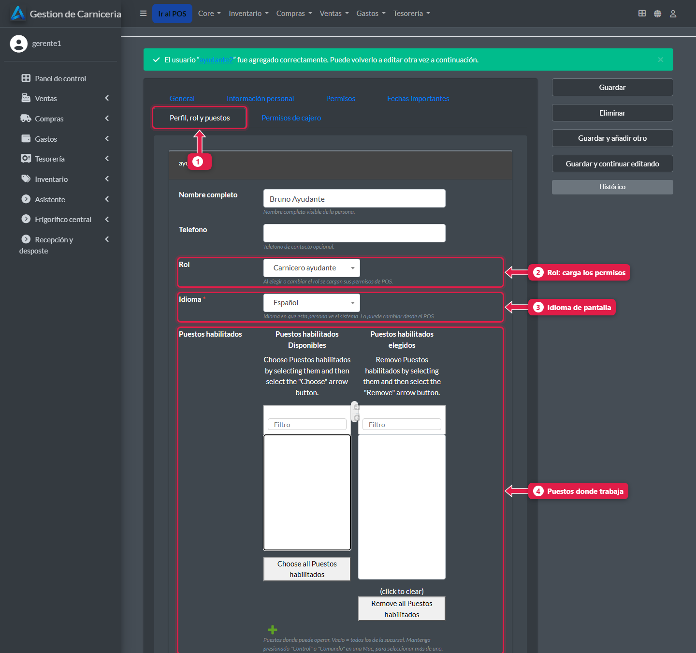
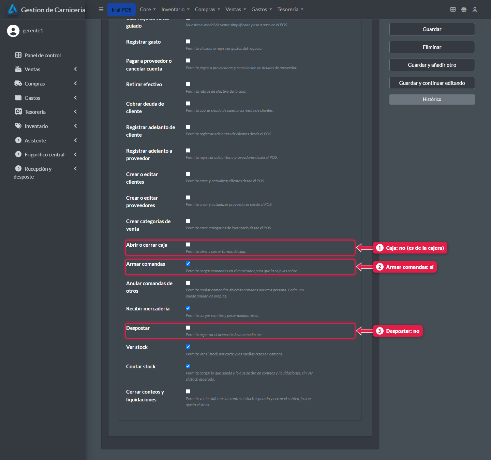
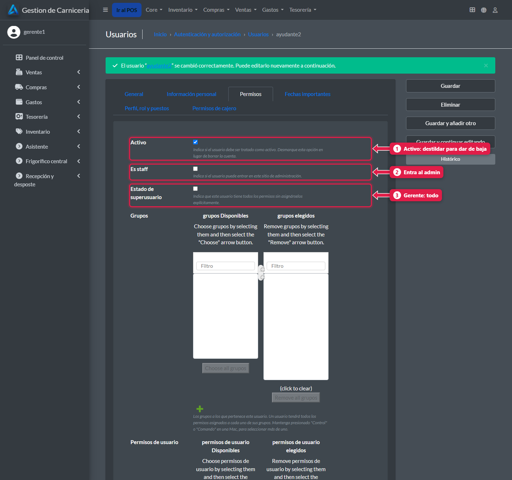

# Dar de alta a una persona: usuario, rol y puestos

> **Para quién es:** el gerente.  **Tiempo:** 3 minutos.  **Dónde:** el admin de la PC de la sucursal (`http://<PC>:8250/admin/`).

En **Usuarios → Agregar** escribís el usuario y la clave. Después, en **Perfil, rol y puestos**, elegís el **rol** (que carga los permisos solo), los **puestos** donde trabaja y su **idioma**.

## Para qué sirve
Cada persona entra con lo suyo y ve solo lo que le corresponde: el carnicero no ve la caja y la cajera no ve el stock.

## Los roles
| Rol | Qué le habilita |
|---|---|
| **Carnicero ayudante** | Armar y anular sus comandas, recibir, ver stock y contar |
| **Carnicero oficial** | Lo del ayudante + despostar, anular comandas de otros, cerrar conteos y liquidaciones |
| **Cajera** | Abrir y cerrar caja, cobrar, gastos, retiros, adelantos y clientes |
| **Gerente de sucursal** | Todo |

## Paso a paso

### 1. Abrí la lista de usuarios
En el admin: **Autenticación y autorización → Usuarios**.

1. **Añadir usuario.**
2. El personal de la sucursal.

### 2. Escribí el usuario y la clave

1. **Usuario:** corto y sin espacios, por ejemplo `ayudante2`.
2. **Contraseña**, dos veces.
3. Tocá **Guardar y continuar editando**.

### 3. Elegí rol, idioma y puestos
Abrí la pestaña **Perfil, rol y puestos**.

1. La pestaña **Perfil, rol y puestos**. Completá también el **Nombre completo**.
2. **Rol:** al guardar, carga los permisos de ese rol.
3. **Idioma:** español o chino ([tutorial 02](02-cambiar-idioma.md)).
4. **Puestos habilitados:** pasá a «elegidos» los puestos donde trabaja (doble clic sobre cada uno). Si no elegís ninguno, puede usar todos.

Tocá **Guardar y continuar editando**.

### 4. Revisá los permisos que cargó el rol
Pestaña **Permisos de cajero**.

1. **Abrir o cerrar caja:** no (es de la cajera).
2. **Armar comandas:** sí.
3. **Despostar:** no (es del oficial).

Podés ajustar alguno a mano, por ejemplo un ayudante que también desposta. Si después cambiás el rol, los permisos vuelven a ser los del rol nuevo.

### 5. Para dar de baja: destildá «Activo»
Pestaña **Permisos**.

1. **Activo:** destildalo para que la persona ya no pueda entrar. **No la borres**: sus ventas y comandas quedan a su nombre.
2. **Es staff:** deja entrar al admin.
3. **Es superusuario:** acceso a todo, incluido el dashboard. Solo para el gerente.

## Si es cajera: asignale los medios de pago
Ver [Qué medios de pago usa cada cajera](20-medios-de-pago-de-la-cajera.md). Sin asignaciones ve todas las cuentas, incluidas las internas.

## Problemas frecuentes
| Si te pasa… | Es porque… | Qué hacer |
|---|---|---|
| La persona no ve su puesto | No está en *Puestos habilitados* | Agregáselo |
| La lista de puestos parece vacía | En el tema oscuro del admin el texto de las opciones sale blanco sobre blanco | Hacé doble clic igual sobre cada puesto: se pasa a «elegidos». Al guardar, quedan en el perfil |
| El gerente no puede entrar al admin | Le falta **Es staff** (y **Es superusuario**) | Tildalos en la pestaña Permisos |
| Ajusté permisos y se perdieron | Se cambió el rol después | Volvé a ajustarlos |

## Preguntas frecuentes

### ¿El rol Gerente ya da acceso al admin?
No. El rol carga los permisos del POS. Para el admin hay que tildar **Es staff** y **Es superusuario**.

## Siguiente paso
- [Puestos, cámaras y datos de la sucursal](19-puestos-camaras-y-configuracion.md).
