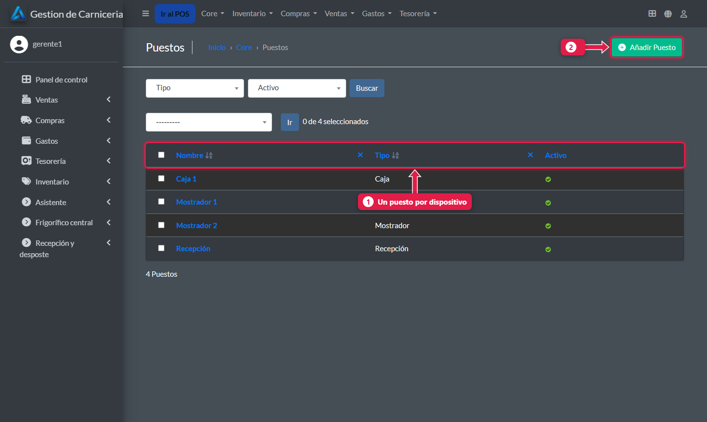
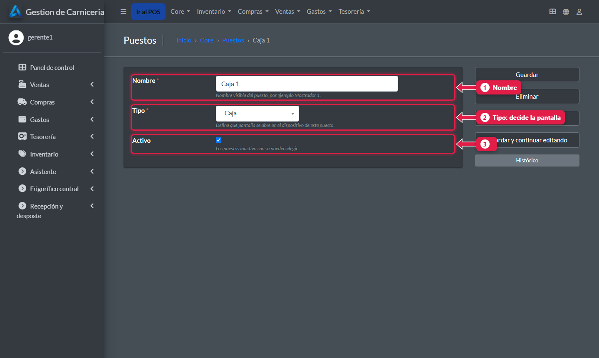
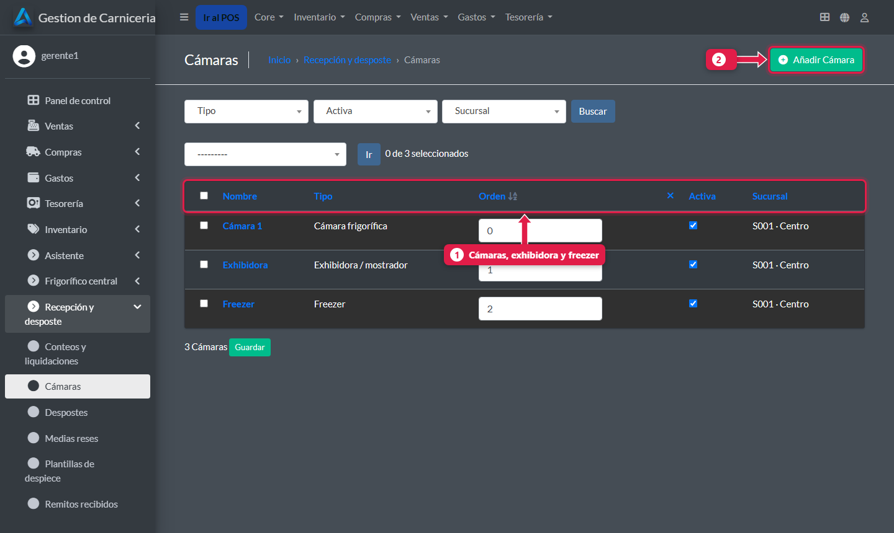
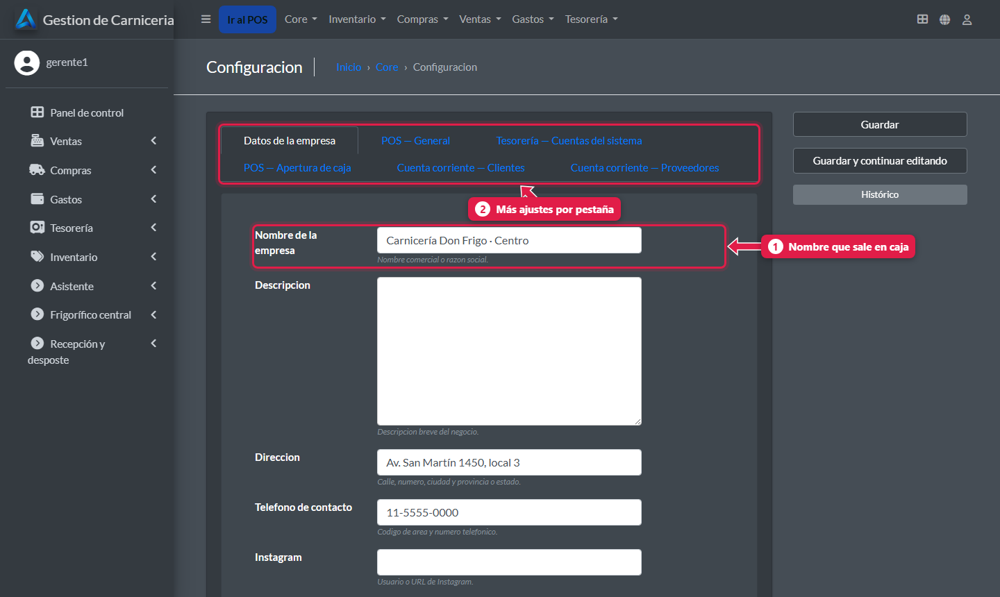
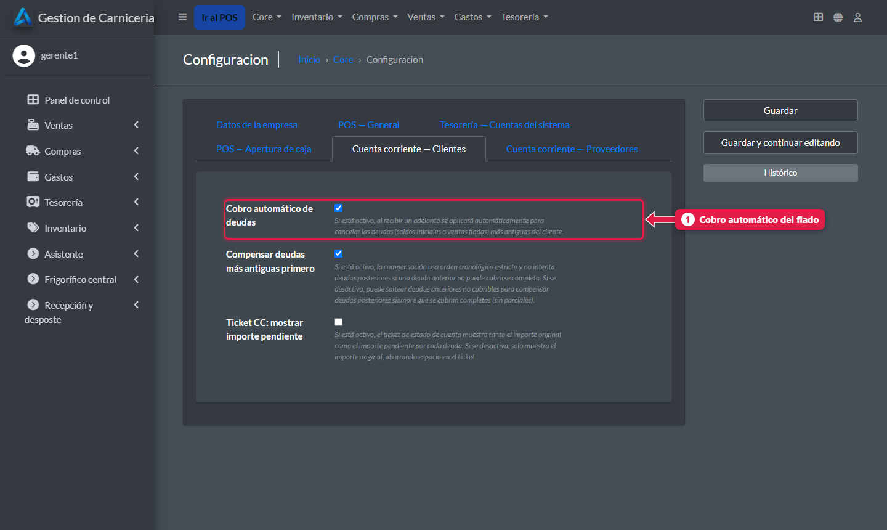

# Puestos, cámaras y datos de la sucursal

> **Para quién es:** el gerente.  **Tiempo:** 5 minutos.  **Dónde:** el admin de la PC de la sucursal.

En el admin cargás un **puesto** por cada dispositivo (caja, mostrador, recepción), las **cámaras** de frío y los **datos del negocio**.

## Para qué sirve
El puesto decide qué pantalla abre cada dispositivo. Las cámaras aparecen al recibir, al mover medias y al contar.

## Paso a paso

### 1. Puestos
**Core → Puestos**.

1. Un **puesto por dispositivo**: Caja 1, Mostrador 1, Mostrador 2, Recepción.
2. **Añadir puesto** para una tablet nueva.

1. **Nombre:** como lo reconoce el personal.
2. **Tipo:** **Caja**, **Mostrador** o **Recepción**. Decide qué pantalla se abre.
3. **Activo:** un puesto que no se usa se desactiva.

### 2. Cámaras
**Recepción y desposte → Cámaras**.

1. Cada cámara con su **tipo** (cámara frigorífica, exhibidora o freezer) y su **orden**. La primera cámara activa de tipo cámara es la que se ofrece al recibir medias.
2. **Añadir cámara.** Una cámara que ya no se usa se **desactiva**, no se borra.

### 3. Datos del negocio
**Core → Configuración**.

1. **Nombre:** sale arriba en la caja y en el dashboard.
2. Más ajustes en las **pestañas**: impresora, cuentas de tesorería, apertura de caja y cuenta corriente.

### 4. Cobro automático del fiado
Pestaña **Cuenta corriente — Clientes**.

1. **Cobro automático de deudas:** si está tildado, cuando un cliente paga, el sistema cancela solo sus deudas más viejas ([tutorial 08](08-fiado-y-cobro-de-deuda.md)).

## Lo que esta pantalla no tiene
- **Día de liquidación:** el sistema lo guarda (martes, por defecto) pero en esta versión **no aparece** en Configuración. Para cambiarlo hay que pedírselo a soporte.
- **Estado de la sincronización:** la última sincronización y el último error tampoco se muestran acá. El frigorífico los ve en su panel ([tutorial 23](23-panel-central.md)).

## Problemas frecuentes
| Si te pasa… | Es porque… | Qué hacer |
|---|---|---|
| Una tablet abre la pantalla equivocada | El puesto tiene otro tipo | Cambiá el **Tipo** del puesto, o tocá **Puesto** en la tablet |
| No aparece una cámara al contar | Está inactiva | Activala |

## Preguntas frecuentes

### ¿Los productos y precios se cambian acá?
No. Los carga el frigorífico y bajan solos ([tutorial 26](26-catalogo-precios-y-plantillas.md)). Si se tocan en la sucursal, el cambio se pierde.

## Siguiente paso
- [Qué medios de pago usa cada cajera](20-medios-de-pago-de-la-cajera.md).
