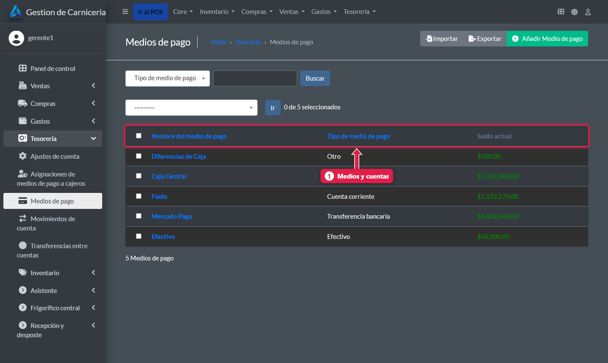
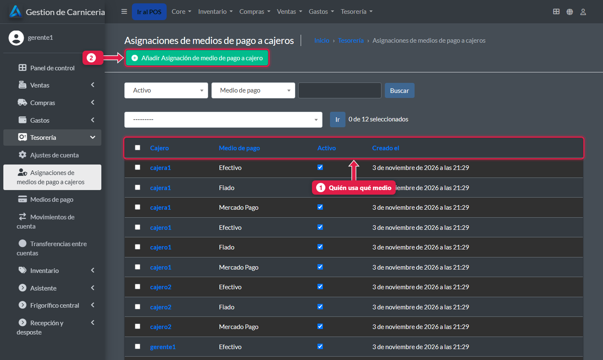
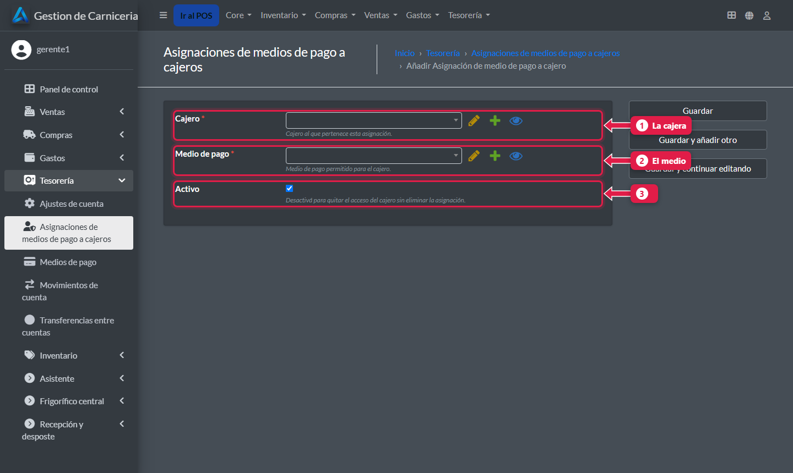

# Qué medios de pago usa cada cajera

> **Para quién es:** el gerente.  **Tiempo:** 2 minutos.

En **Tesorería → Asignaciones de medios de pago a cajeros** elegís con qué medios cobra cada cajera. Lo normal: **Efectivo**, **Mercado Pago** y **Fiado**.

## Para qué sirve
La tesorería tiene cuentas internas (Caja Central, Diferencias de Caja) que no son para cobrar. Si la cajera no tiene asignaciones, ve **todas**, incluidas esas.

## Paso a paso

### 1. Los medios de pago
**Tesorería → Medios de pago**.

1. Los **medios y cuentas**: Efectivo, Mercado Pago, Fiado y las cuentas internas.

### 2. Las asignaciones
**Tesorería → Asignaciones de medios de pago a cajeros**.

1. **Quién usa qué medio.**
2. **Añadir** una asignación.

### 3. Asigná un medio

1. **Usuario:** la cajera.
2. **Medio de pago.**
3. **Activo:** tildado. Destildalo para quitarle ese medio sin borrar la asignación.

Repetí con cada medio.

## Qué pasa por detrás
- En la caja, la cajera ve solo sus medios activos. Si intenta usar otro, el sistema lo rechaza.
- El gerente (superusuario) ve siempre todos.

## Preguntas frecuentes

### ¿Cómo agrego un medio nuevo, por ejemplo tarjeta de débito?
En **Medios de pago → Añadir**, con su **categoría** (Tarjeta de Crédito/Débito). Después asignáselo a la cajera.

## Siguiente paso
- [Dashboard financiero y reportes](21-dashboard-y-reportes.md).
