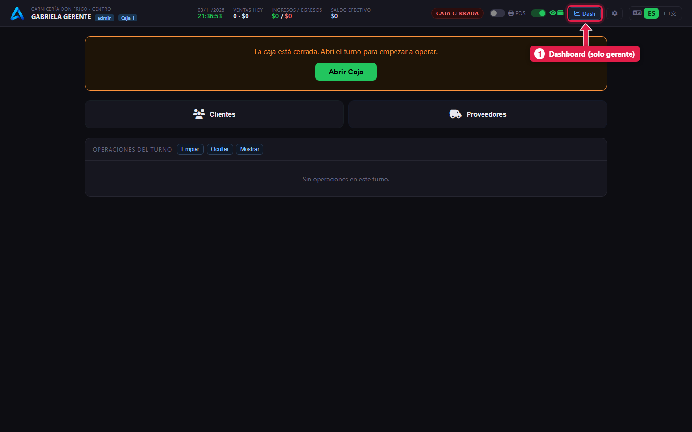
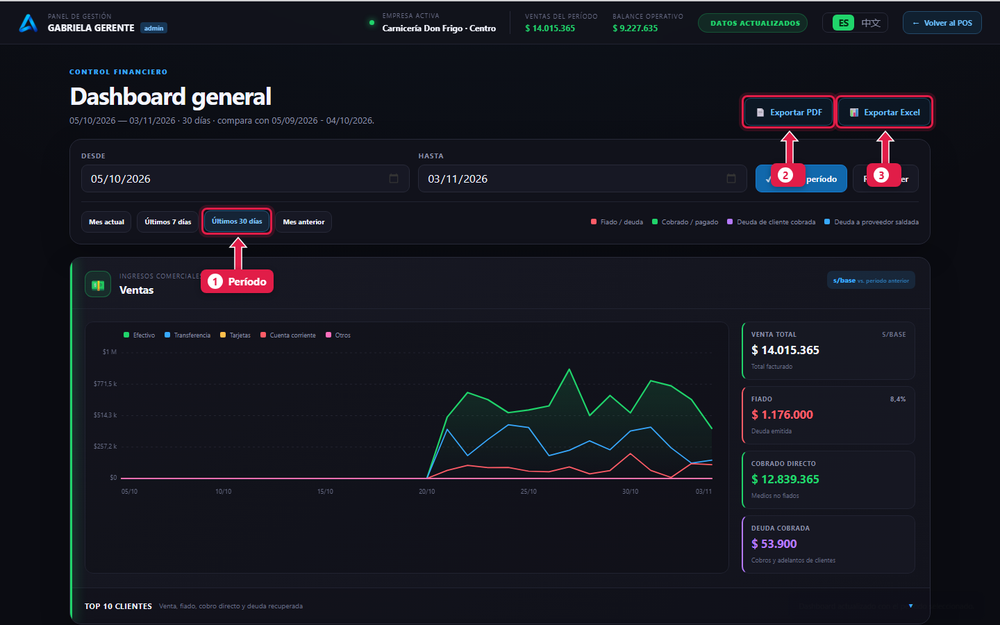
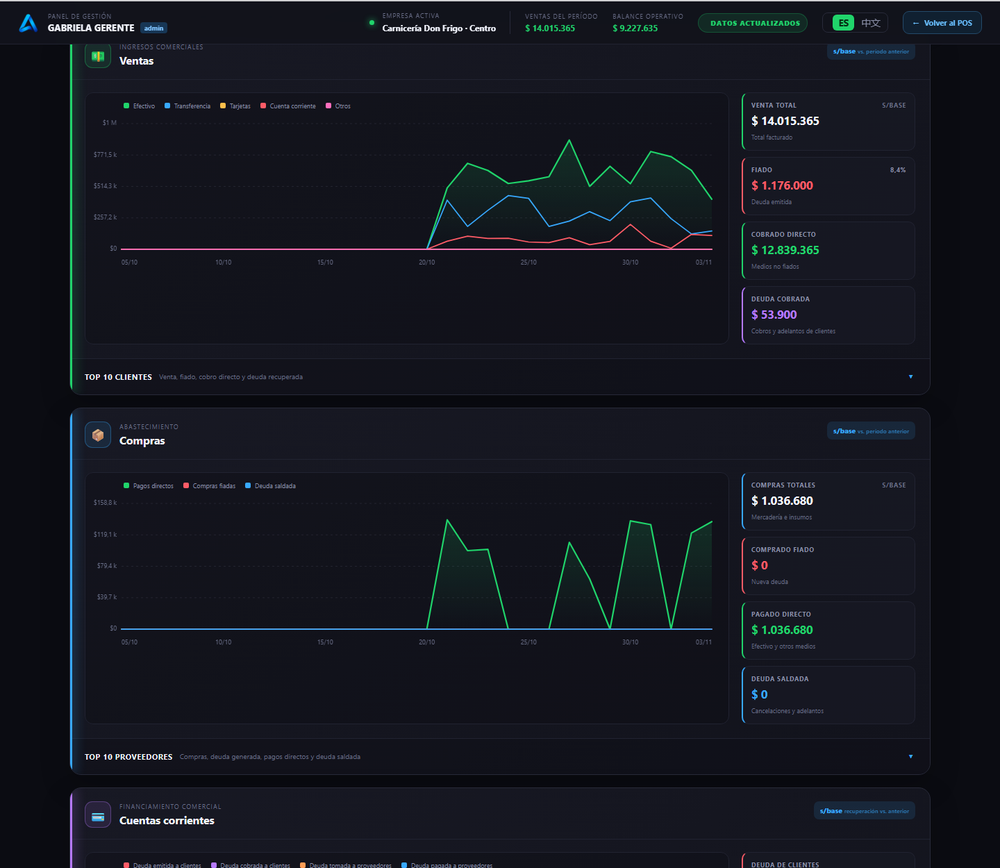
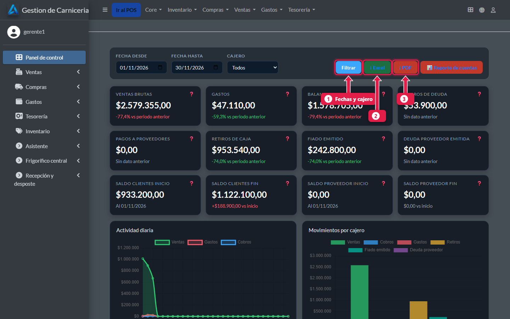

# Dashboard financiero y reportes

> **Para quién es:** el gerente (superusuario).  **Tiempo:** 5 minutos.

El botón **Dash** de la caja abre el **dashboard financiero**: ventas, compras, cuentas corrientes y gastos del período, comparados con el período anterior. Se exporta a **PDF** o **Excel**. El **panel de control** del admin tiene otro resumen con filtro por cajero.

## Para qué sirve
Ver de un vistazo cuánto se vendió, cuánto se fió, cuánto se cobró y en qué se gastó, sin sumar tickets a mano.

## Paso a paso

### 1. Abrí el dashboard

1. **Dash**: solo lo ven los superusuarios.

### 2. Elegí el período y exportá

1. **Período:** Mes actual, Últimos 7 días, Últimos 30 días, Mes anterior, o fechas a mano + **Aplicar período**.
2. **Exportar PDF.**
3. **Exportar Excel.**

### 3. Leé cada panel

Hay cuatro paneles: **Ventas**, **Compras**, **Cuentas corrientes** y **Gastos**. Cada uno tiene la evolución día por día y tarjetas con el total y la comparación con el período anterior. Abajo de cada panel, el **Top 10** (clientes, proveedores, saldos o gastos).

### 4. El panel de control del admin
En el admin, **Panel de control**.

1. **Filtrar** por fechas y por cajero.
2. **Excel.**
3. **PDF.**

## Qué pasa por detrás
- Los dos tableros usan el mismo cálculo: no pueden mostrar números distintos para lo mismo.
- El dashboard funciona sin internet.
- Los PDF y Excel salen siempre en español.

## Preguntas frecuentes

### ¿Dónde está el PDF de cada cierre de caja?
En **Ventas → Turnos de caja**, columna **Cierre PDF** ([tutorial 22](22-controles-de-la-semana.md)).

### ¿El dashboard muestra los kilos y la merma?
No: es financiero. Los kilos y la merma están en la [liquidación](16-liquidacion-cerrar.md) y en el [panel de la central](23-panel-central.md).

## Siguiente paso
- [Controles de la semana](22-controles-de-la-semana.md).
