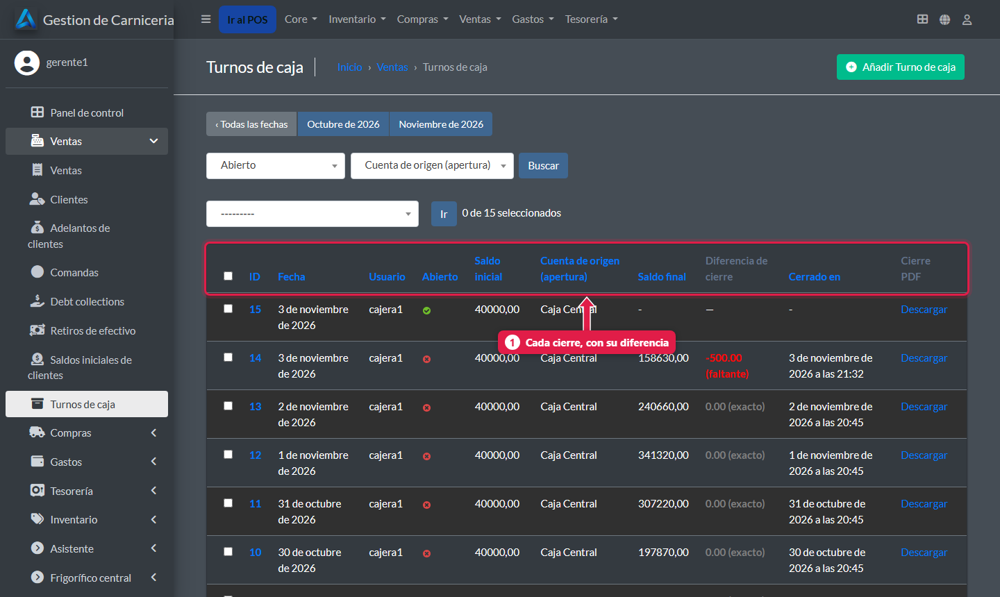
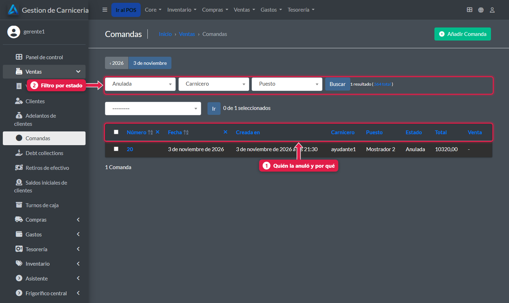
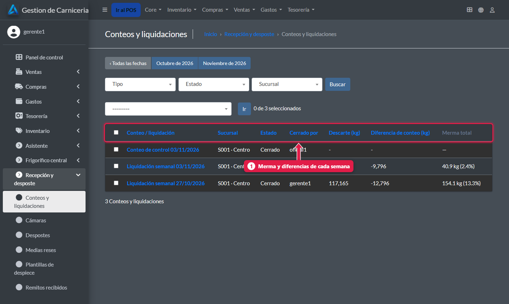
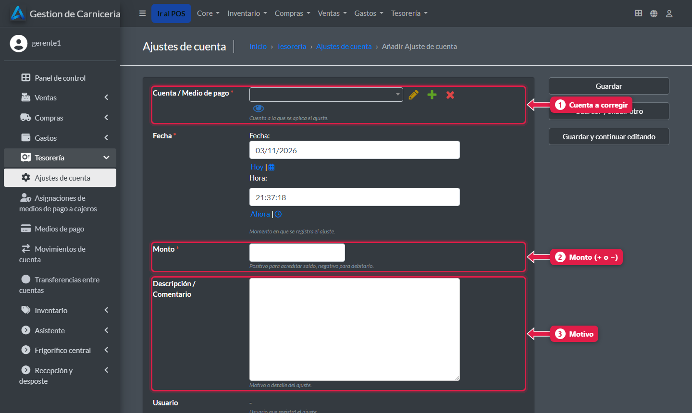

# Controles de la semana: caja, comandas anuladas y mermas

> **Para quién es:** el gerente.  **Tiempo:** 15 minutos por semana.

Una vez por semana, conviene revisar tres cosas en el admin: las **diferencias de caja**, las **comandas anuladas** y la **merma de la liquidación**. Los errores de caja se corrigen con un **ajuste de cuenta**.

## Para qué sirve
Un faltante chico todos los días o muchas comandas anuladas por la misma persona son señales que solo se ven mirando la semana entera.

## Paso a paso

### 1. Diferencias de caja
**Ventas → Turnos de caja**.

1. Cada cierre con su **saldo inicial**, **saldo final**, **diferencia de cierre** (en rojo si faltó) y el **PDF** del cierre. Abrí el turno para ver el **motivo** que escribió la cajera.

### 2. Comandas anuladas
**Ventas → Comandas**, filtrando por estado **anulada**.

1. Cada comanda anulada, con **quién** la anuló y el **motivo**.
2. **Filtro por estado:** abierta, cobrada o anulada.

### 3. Merma de la liquidación
**Recepción y desposte → Conteos y liquidaciones**.

1. Cada liquidación con su **merma** y sus **diferencias**. Si la merma pasa del **6 %**, buscá la causa: carne vieja, despostes sin cargar o kilos mal tipeados en las comandas.

### 4. Corregir un error de caja: ajuste de cuenta
**Tesorería → Ajustes de cuenta → Añadir**.

1. **Cuenta** a corregir (por ejemplo Efectivo o Diferencias de Caja).
2. **Monto:** positivo suma, negativo resta.
3. **Descripción:** el motivo, siempre.

## Qué pasa por detrás
- El turno cerrado no se toca: el ajuste es un movimiento nuevo que deja rastro.

## Preguntas frecuentes

### ¿Puedo editar un turno cerrado para corregirlo?
No conviene: se pierde el registro. Usá un ajuste de cuenta.

## Siguiente paso
- Para el frigorífico: [El panel de la central](23-panel-central.md).
