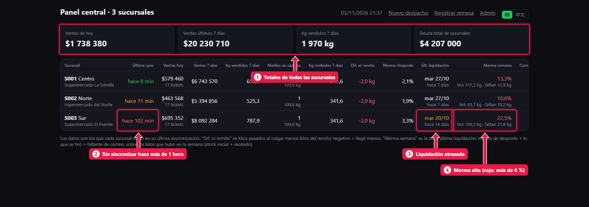
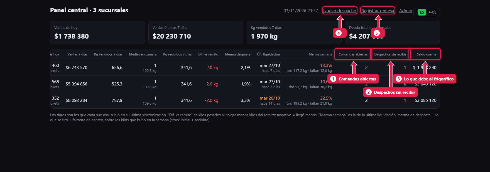

# El panel de la central: cómo viene cada sucursal

> **Para quién es:** el frigorífico.  **Tiempo:** 5 minutos cada mañana.  **Dónde:** `/central/` en el servidor de la central.

El panel muestra **una fila por sucursal** con lo que cada una subió: cuándo sincronizó, cuánto vendió, cuántos kilos, cuántas medias tiene colgadas, la merma y cuánto debe. Los números en **naranja** o **rojo** son alertas. Se recarga solo cada 2 minutos.

## Para qué sirve
Ver todas las carnicerías juntas sin llamar a nadie, y detectar a tiempo una PC sin internet, una liquidación atrasada o una merma alta.

## Paso a paso

### 1. Leé las alertas

1. **Totales:** ventas de hoy y de 7 días, kilos vendidos y deuda total de las sucursales.
2. **Última sync:** verde, menos de 10 minutos; naranja, de 10 a 60; **rojo, más de una hora**: la PC está apagada o sin internet.
3. **Últ. liquidación:** naranja si pasaron **más de 8 días** o nunca liquidó.
4. **Merma semana:** la de la última liquidación (desposte + tirado + faltante). Naranja si pasa del 4 %, **rojo si pasa del 6 %**. Abajo, los kilos tirados y faltantes.

### 2. Las columnas de la derecha

1. **Comandas abiertas** en este momento.
2. **Despachos sin recibir:** los que la sucursal todavía no confirmó.
3. **Saldo cuenta:** lo que la sucursal le debe al frigorífico.
4. **Nuevo despacho** ([tutorial 24](24-despachar-a-una-sucursal.md)).
5. **Registrar remesa** ([tutorial 25](25-cuenta-corriente-de-sucursales.md)).

## Qué mira cada columna
| Columna | Qué mirar |
|---|---|
| Ventas hoy / 7 días · Kg vendidos | Comparar contra las otras sucursales y contra la semana anterior |
| Medias en cámara | Cuántas quedan colgadas y sus kilos |
| Kg recibidos y **Dif. vs remito** | Kilos pesados al colgar menos el peso de salida. En rojo si llegó más de 1 kg menos |
| Merma desposte | Naranja si pasa del 4 % |

## Problemas frecuentes
| Si te pasa… | Es porque… | Qué hacer |
|---|---|---|
| Una sucursal en rojo en *Última sync* | La PC está apagada o sin internet | Llamá a la sucursal. Mientras tanto vende igual; sube todo cuando vuelve |
| Los números de hoy no cambian | La sucursal no está sincronizando | Mismo caso anterior |

## Preguntas frecuentes

### ¿Desde la central se puede corregir una venta de una sucursal?
No. Cada dato se cambia donde se escribe: las ventas, en la sucursal. Si la central toca una venta, el cambio no llega a la sucursal.

## Siguiente paso
- [Despachar mercadería a una sucursal](24-despachar-a-una-sucursal.md).
