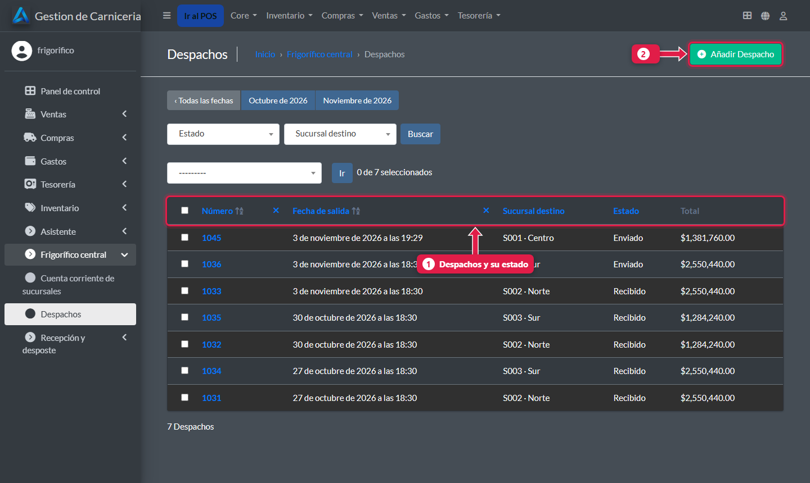
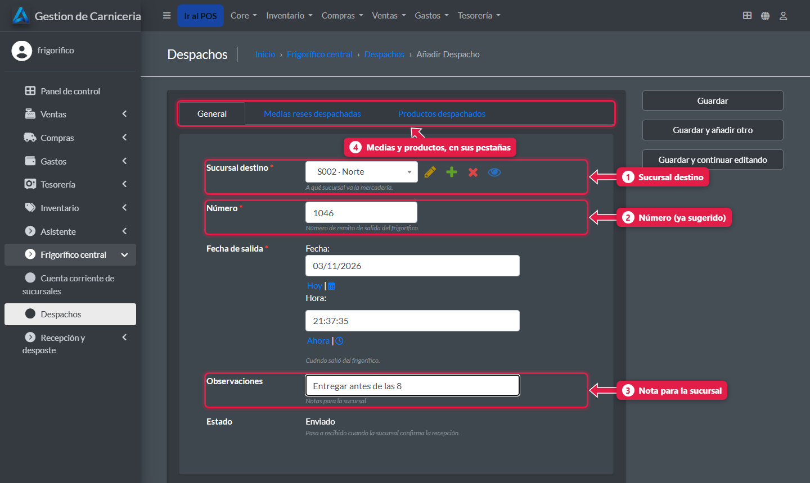
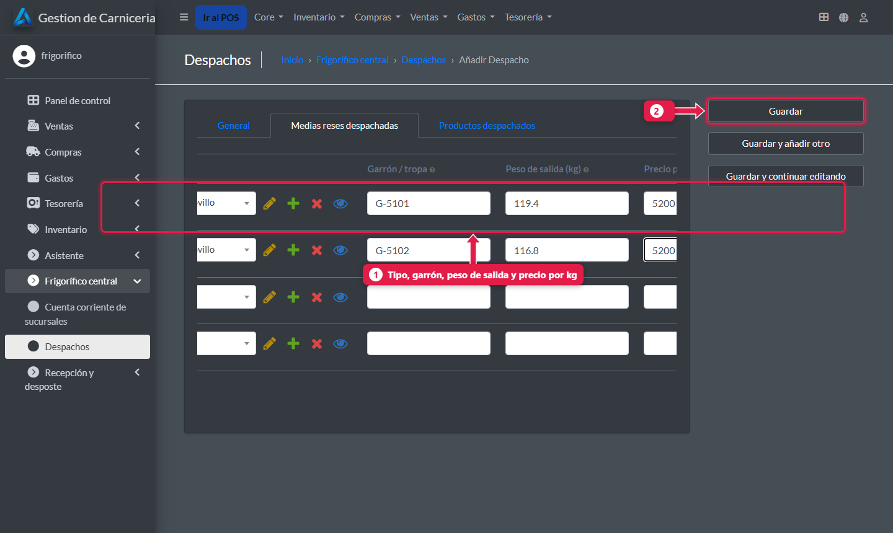
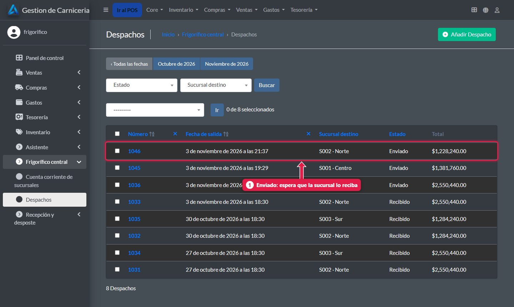

# Despachar mercadería a una sucursal

> **Para quién es:** el frigorífico.  **Tiempo:** 5 minutos.  **Dónde:** admin de la central → **Frigorífico central → Despachos**.

Creás un **despacho** con la sucursal destino, una fila por **media res** (tipo, garrón, peso de salida y precio por kilo) y los **otros productos**. Al guardar, la deuda de la sucursal sube sola. En el minuto siguiente, la sucursal lo ve en **Despachos por recibir**.

## Para qué sirve
La sucursal recibe el despacho con todo precargado: solo pesa y confirma. Y la cuenta corriente queda al día sin cargar nada a mano.

## Paso a paso

### 1. Abrí los despachos

1. Los **despachos** con fecha, sucursal, estado (**Enviado** o **Recibido**) y total.
2. **Añadir despacho.**

### 2. Completá los datos generales

1. **Sucursal destino.**
2. **Número:** el sistema sugiere el siguiente.
3. **Observaciones:** una nota para la sucursal, por ejemplo «Entregar antes de las 8».
4. Las **medias** y los **productos** van en sus pestañas.

### 3. Cargá las medias reses
Pestaña **Medias reses despachadas**.

1. Una fila por media: **tipo** (la plantilla, por ejemplo Media res novillo), **garrón**, **peso de salida** y **precio por kilo** (precio de transferencia a la sucursal).
2. Completá la pestaña **Productos despachados** si va pollo, embutidos u otros, y tocá **Guardar**.

### 4. El despacho queda enviado

1. Queda **Enviado** hasta que la sucursal lo recibe.

## Qué pasa por detrás
- El **total** del despacho (medias × kilos × precio + productos) entra como **deuda** en la cuenta de la sucursal. Si corregís el despacho, la deuda se ajusta.
- En la próxima sincronización la sucursal lo ve para recibir ([tutorial 11](11-recibir-despacho-del-frigorifico.md)).
- Cuando la sucursal confirma, pasa a **Recibido** y los pesos reales llegan al panel.

## Problemas frecuentes
| Si te pasa… | Es porque… | Qué hacer |
|---|---|---|
| La sucursal no ve el despacho | Su PC no sincronizó | Mirá *Última sync* en el [panel](23-panel-central.md) |
| Me equivoqué de peso o precio | — | Editá el despacho antes de que lo reciban: la deuda se recalcula |

## Siguiente paso
- [Cuenta corriente de cada sucursal](25-cuenta-corriente-de-sucursales.md).
