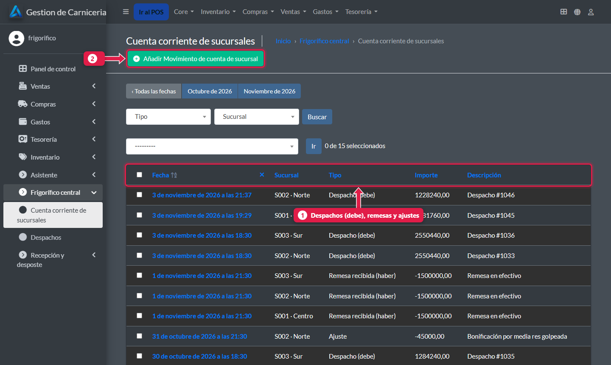
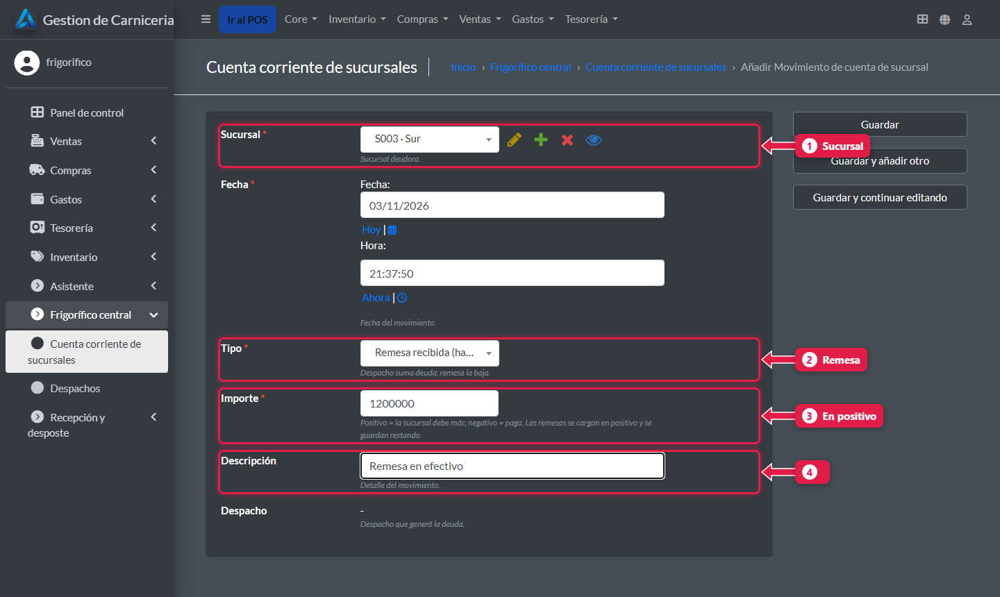
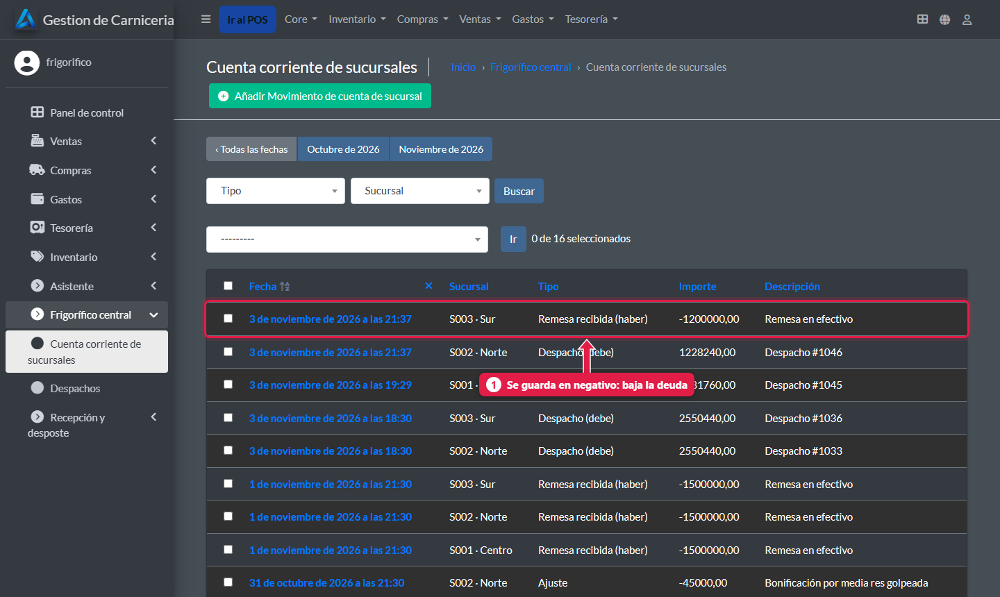

# Cuenta corriente de cada sucursal: remesas y ajustes

> **Para quién es:** el frigorífico.  **Tiempo:** 1 minuto.

Cada sucursal **debe** lo que se le despacha y **paga** con **remesas**. Cuando llega una remesa, la cargás en **Cuenta corriente de sucursales → Añadir**, con tipo **Remesa** y el importe **en positivo**: el sistema la resta de la deuda.

## Los tres tipos de movimiento
| Tipo | Qué es | Cómo se carga |
|---|---|---|
| **Despacho (debe)** | La mercadería enviada | **Solo**, al guardar el despacho |
| **Remesa recibida (haber)** | La plata que manda la sucursal | A mano, en positivo: se guarda restando |
| **Ajuste** | Una corrección (por ejemplo una bonificación) | A mano: positivo suma deuda, negativo la baja. Siempre con descripción |

## Paso a paso

### 1. Mirá los movimientos

1. **Despachos, remesas y ajustes** de todas las sucursales. Se filtran por sucursal.
2. **Añadir** un movimiento.

### 2. Registrá una remesa

1. **Sucursal.**
2. **Tipo:** Remesa recibida.
3. **Importe:** en positivo.
4. **Descripción:** por ejemplo «Remesa en efectivo». Tocá **Guardar**.

### 3. La remesa baja la deuda

1. Se guarda **en negativo**: baja el saldo. El saldo de cada sucursal está en el [panel](23-panel-central.md), columna **Saldo cuenta**.

## Preguntas frecuentes

### ¿Hay que cargar los despachos acá?
No: se cargan solos al guardar el despacho.

## Siguiente paso
- [Catálogo: productos, precios, fotos y plantillas](26-catalogo-precios-y-plantillas.md).
