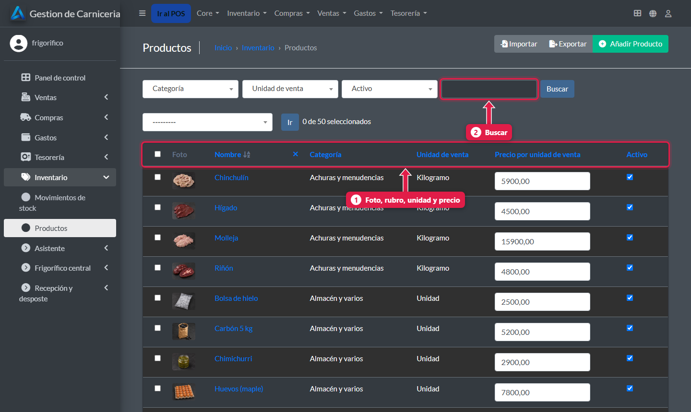
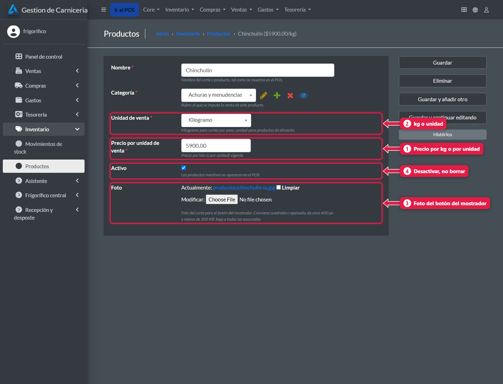
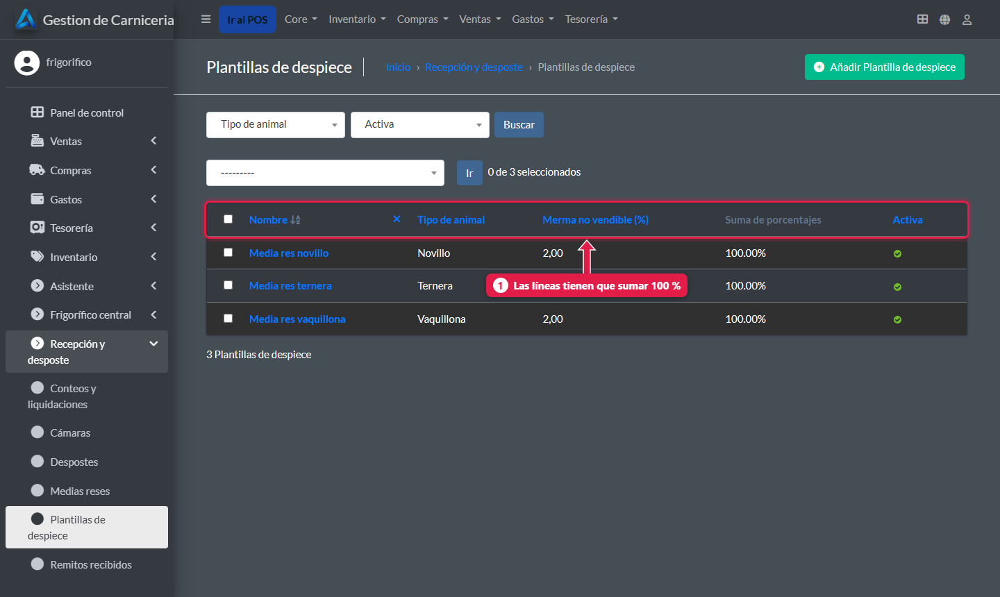
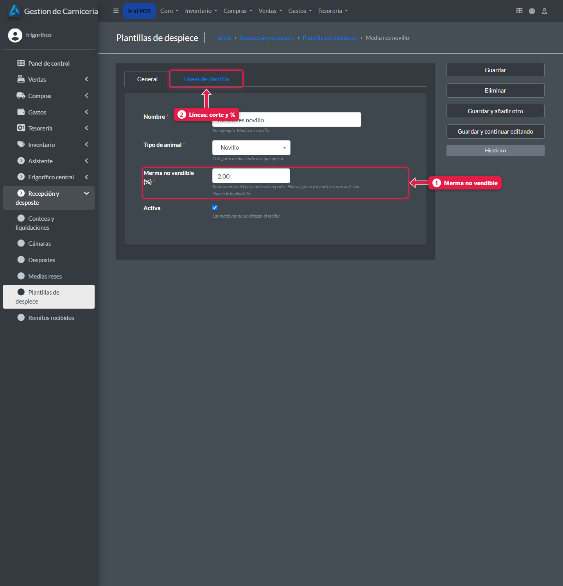
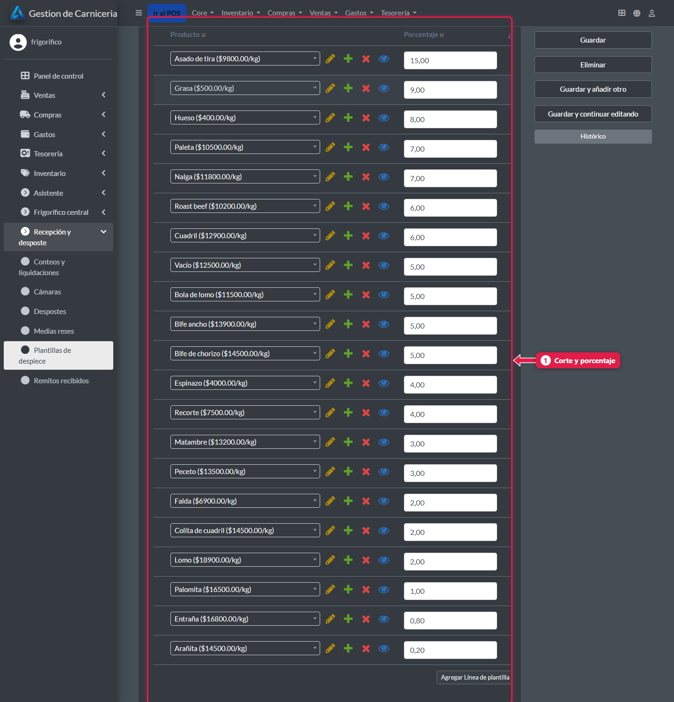

# Catálogo: productos, precios, fotos y plantillas de despiece

> **Para quién es:** el frigorífico.  **Tiempo:** 2 minutos por producto.

Los **productos**, sus **precios** y **fotos**, los **rubros** y las **plantillas de despiece** se cargan **solo en la central**. Cada cambio baja a todas las sucursales en la siguiente sincronización.

## Para qué sirve
Un solo lugar para los precios: todas las carnicerías venden al mismo precio y con los mismos botones en el mostrador.

## Paso a paso

### 1. Productos
**Inventario → Productos**.

1. Cada producto con **foto**, **rubro**, **unidad** y **precio**.
2. **Buscar** por nombre.

### 2. Editá un producto

1. **Precio:** por kilo o por unidad.
2. **Unidad:** **kg** (se pesa en el mostrador) o **unidad** (se cuenta).
3. **Foto:** la del botón del mostrador. Conviene apaisada, de unos 600 px y menos de 300 KB.
4. **Activo:** un producto que no se vende más se **desactiva**, no se borra.

### 3. Plantillas de despiece
**Recepción y desposte → Plantillas de despiece**.

1. Cada plantilla con su **merma** y el **total de porcentajes**. Las líneas tienen que sumar **100 %**: si no, se marca con ⚠.

1. **Merma:** el % del peso que no se vende (por ejemplo 2 %).
2. La pestaña de **líneas**: un corte por fila.

1. Cada **corte** con su **porcentaje** sobre el peso ya sin merma. Ejemplo: asado de tira 15 %, vacío 5 %.

## Qué pasa por detrás
- Los cambios bajan a todas las sucursales en el próximo minuto.
- Si una sucursal toca un precio en su PC, el cambio **no sube** y se pierde la próxima vez que la central modifique ese producto.
- La plantilla calcula los kilos de cada corte al despostar: `peso × (1 − merma %) × porcentaje del corte`.

## Preguntas frecuentes

### ¿Puedo tener precios distintos por sucursal?
No en esta versión: el precio es uno para todas.

## Siguiente paso
- [Abrir una sucursal nueva](27-abrir-una-sucursal-nueva.md).
