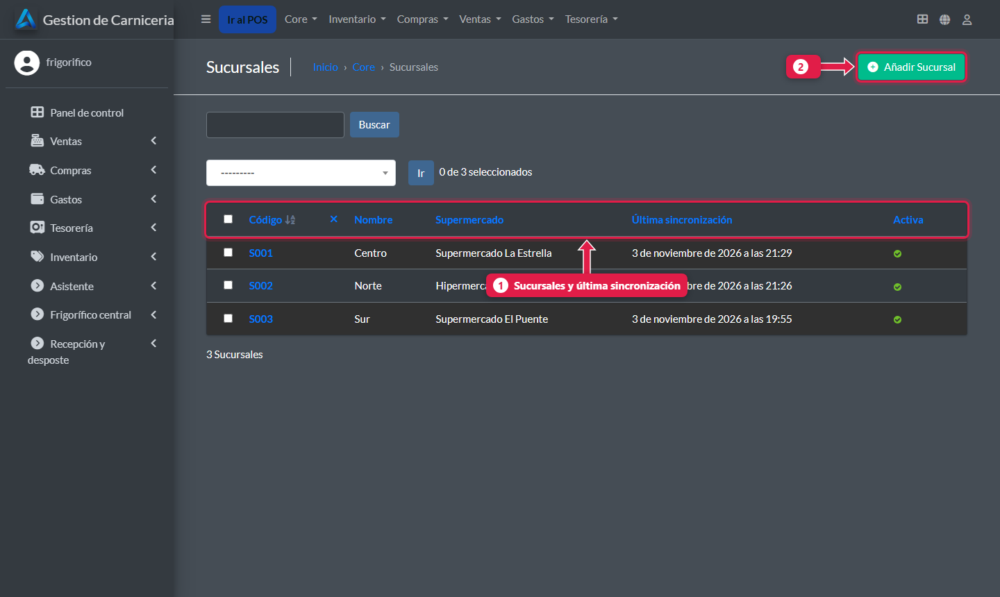
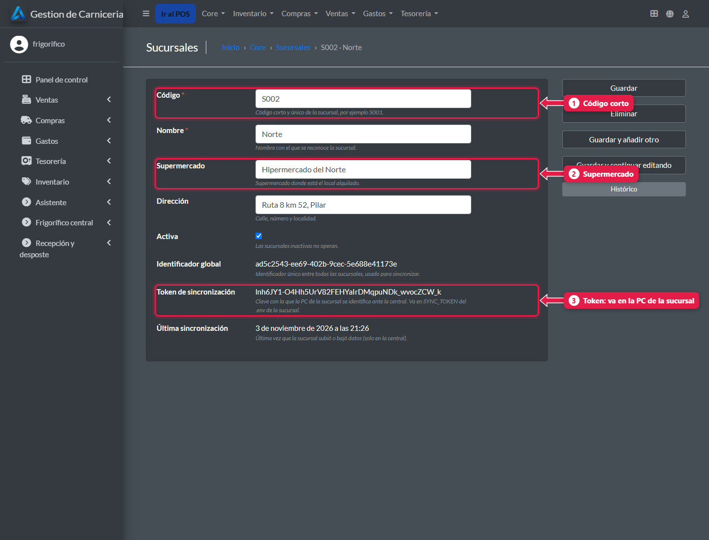

# Abrir una sucursal nueva

> **Para quién es:** el frigorífico y quien instala.  **Tiempo:** 30 minutos.

Primero creás la sucursal en la **central** (eso genera su **token de sincronización**). Después instalás el sistema en la **PC de la sucursal** y le cargás ese token. En el primer minuto baja todo el catálogo.

## Paso a paso

### 1. Creá la sucursal en la central
**Core → Sucursales → Añadir**.



1. Las **sucursales** con su última sincronización.
2. **Añadir sucursal.**

Completá código, nombre y supermercado, y guardá.

### 2. Copiá el token


1. **Código:** corto y único, por ejemplo `S004`.
2. **Supermercado** donde está el local.
3. **Token de sincronización:** se genera solo al guardar. Es la «llave» de esa PC: copialo y no lo compartas.

### 3. Instalá el sistema en la PC de la sucursal
1. Corré el instalador `GestionDeCarnicerias_Installer_vX.Y.Z.exe`. Trae su propia base de datos, deja la app arrancando sola al iniciar sesión y abre el puerto **8250** para las tablets.
2. Editá `C:\GestionDeCarnicerias\config.env`:

   ```env
   SYNC_MODO=sucursal
   SYNC_URL=https://<dirección de la central>
   SYNC_TOKEN=<el token que copiaste>
   ```

3. Cerrá la app desde el ícono de la bandeja y abrila de nuevo.

### 4. Terminá en la sucursal
1. Cargá el personal y los puestos ([tutorial 18](18-alta-de-personal.md), [tutorial 19](19-puestos-camaras-y-configuracion.md)).
2. Conectá las tablets al wifi y abrí `http://<IP de la PC>:8250/pos/`.
3. Verificá en el [panel central](23-panel-central.md) que la sucursal aparezca **en verde**.

## Qué pasa por detrás
- Con el token, la central sabe qué sucursal es y acepta solo sus datos.
- La PC baja catálogo, precios, fotos, plantillas y sus despachos; sube ventas, comandas, recepciones, despostes y conteos.

## Problemas frecuentes
| Si te pasa… | Es porque… | Qué hacer |
|---|---|---|
| La sucursal no aparece en verde | Token o dirección mal copiados, o sin internet | Revisá `config.env` y reiniciá la app |
| La PC ya tenía datos de antes | Nunca se sincronizaron | Que soporte corra una vez `python manage.py sincronizar --inicial` |

## Siguiente paso
- Operación técnica: [Operación y mantenimiento](../04-operacion/README.md).
