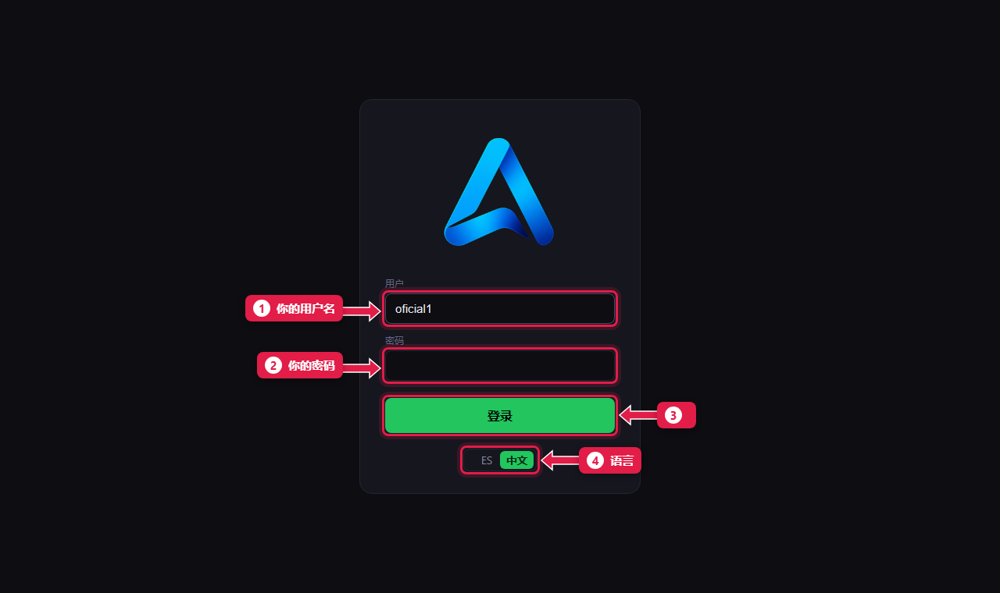
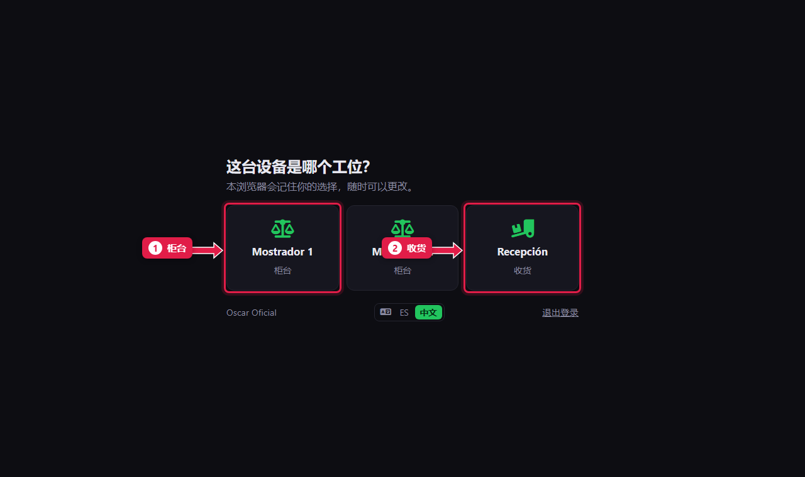
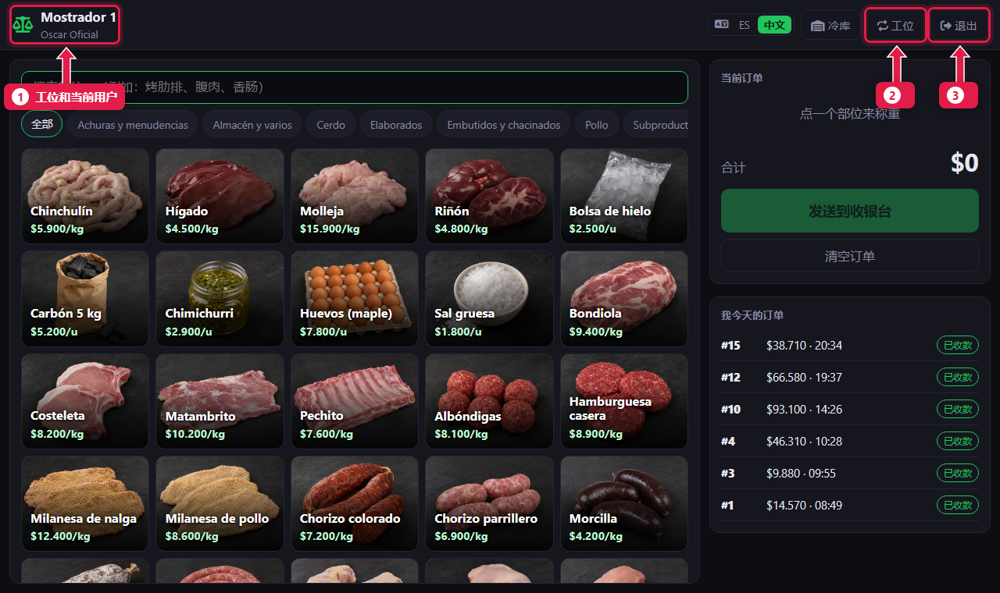

# 登录系统并选择设备工位

> **适合谁：** 所有人。  **时间：** 1 分钟。  **需要：** 你的用户名和密码（由分店经理提供）。

输入**用户名**和**密码**，点**登录**。第一次登录时，系统会问这台设备是哪个**工位**（柜台、收银台或收货），并记住它。

## 有什么用
每个人用自己的账号登录：每张订单、每笔销售、每次盘点都记在操作人名下。**工位**让每台设备直接打开自己的界面：柜台的平板打开柜台界面，收银电脑打开收银台界面。

## 开始之前
- 在**平板或手机**上，连上肉店的 Wi-Fi，打开分店电脑的地址，例如 `http://192.168.1.20:8250/pos/`。地址问分店经理。
- 在**分店电脑**上，开机后系统会自动打开。

## 操作步骤

### 1. 输入用户名和密码

1. **用户：** 你的用户名，例如 `oficial1`。
2. **密码：** 你的密码。
3. 点**登录**。
4. 想用西班牙语界面，登录前点 **ES**（见[切换语言](02-cambiar-idioma.md)）。

### 2. 选择这台设备的工位
每台设备只有第一次需要选。

1. **柜台（Mostrador）：** 柜台用的平板。
2. **收货（Recepción）：** 冷库旁边的设备。

你只能看到经理给你开通的工位。比如收银员只看到 **Caja 1**。

### 3. 进入你的界面

1. 左上角：**工位**和**当前使用设备的人**。
2. **工位：** 更换这台设备的工位。
3. **退出：** 把设备交给别人时，先退出你的账号。

## 系统在后台做了什么
- 设备会记住选好的工位一年。下次登录直接进入该界面。
- 如果员工被分配了工位，只能选那些工位；没有分配的话，可以用所有工位。

## 常见问题
| 遇到…… | 原因…… | 怎么办 |
|---|---|---|
| “用户名或密码错误” | 密码输错，或账号已停用 | 检查大小写。还不行，请经理检查你的账号 |
| 找不到需要的工位 | 你没有被开通该工位 | 请经理加上（[教程 18](18-alta-de-personal.md)） |
| 平板打不开页面 | 没连肉店的 Wi-Fi，或电脑没开 | 平板连上 Wi-Fi，确认电脑已开机 |
| 进去后是别人的界面 | 别人没退出 | 点**退出**，用你的账号登录 |

## 常见疑问

### 同一台设备能当柜台又当收货吗？
可以。点**工位**换成另一个。助理屠宰工也可以在柜台点**冷库**按钮进入收货界面。

### 每次都要选工位吗？
不用。每台设备选一次就记住了。

## 下一步
- [切换语言](02-cambiar-idioma.md)。
- 按你的岗位：[录入订单](03-armar-una-comanda.md) · [开班](05-abrir-la-caja.md) · [接收发货单](11-recibir-despacho-del-frigorifico.md)。
