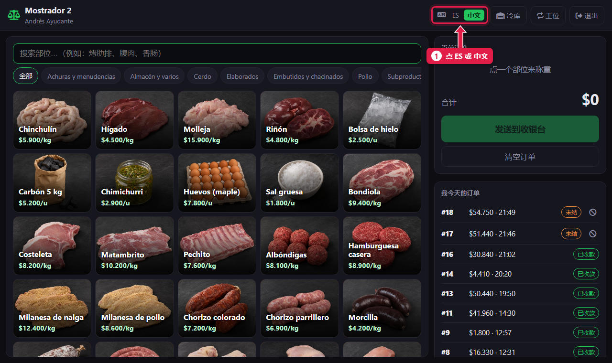
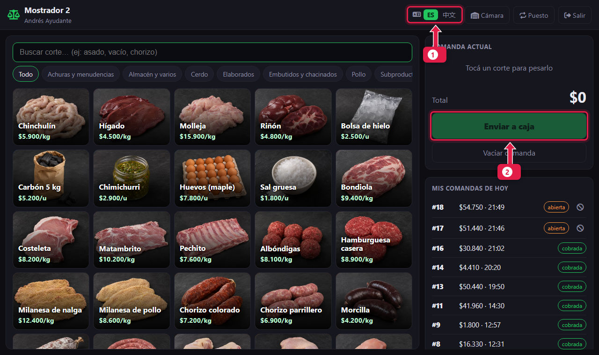

# 切换语言：西班牙语或中文

> **适合谁：** 所有人。  **时间：** 10 秒。

点 **中文** 用中文看系统，点 **ES** 用西班牙语看系统。设置保存在**你的账号**里：不管在哪台设备登录，都是你选的语言。

## 有什么用
肉店里有人看中文更方便，有人看西班牙语更方便。就算用同一台平板，每个人也能选自己的语言。

## 操作步骤

### 1. 点你要的语言
柜台、收银台、收货和后台的选择器在右上角；登录界面的在下方。

1. 点 **中文** 或 **ES**。绿色的是当前语言。

### 2. 界面立刻切换

1. 选择器上新的语言变成绿色。
2. 所有按钮和文字都换了，比如**发送到收银台**按钮。

## 系统在后台做了什么
- 语言保存在你的个人资料里。别人在同一台设备登录，看到的是**他自己**的语言。
- 登录界面（还没登录时）使用这台设备上次选的语言。

## 不会切换语言的内容
| 内容 | 原因 |
|---|---|
| **打印的小票、PDF 和 Excel** | 永远是西班牙语：小票是给顾客的，小票打印机没有中文字体 |
| **商品、类别、客户和支付方式的名称** | 按录入时的样子显示。“Vacío”还是“Vacío” |

## 常见疑问

### 经理能提前帮我设好语言吗？
可以。经理创建你的账号时，可以在个人资料里选**语言**（[教程 18](18-alta-de-personal.md)）。

### 我改了语言，别人看到的也是中文，为什么？
因为他用的是你的账号。每个人都要用自己的账号登录。

## 下一步
- [录入订单](03-armar-una-comanda.md)或[开班](05-abrir-la-caja.md)。
