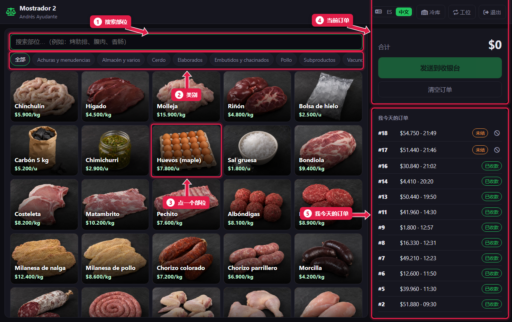
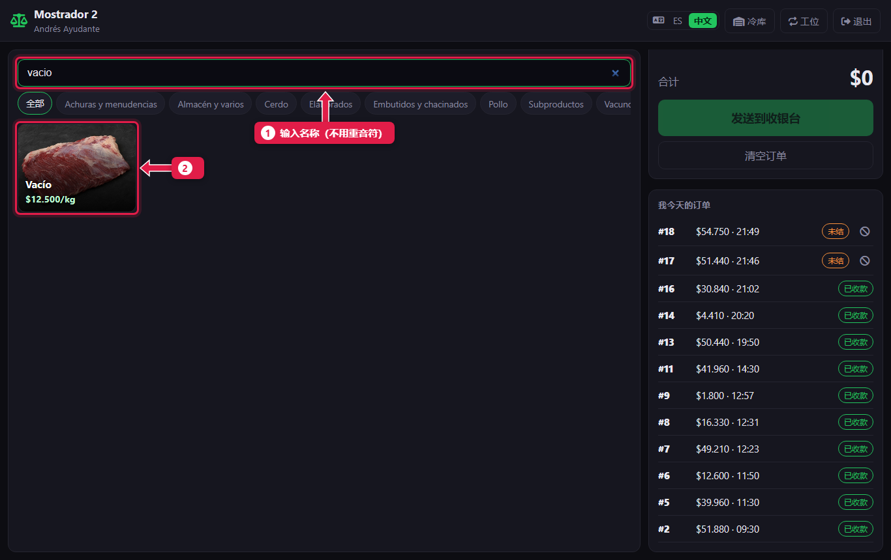
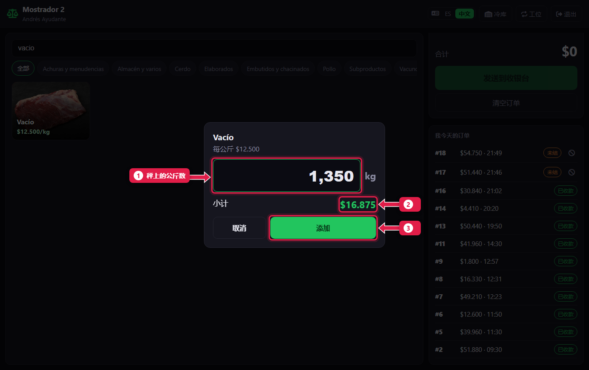
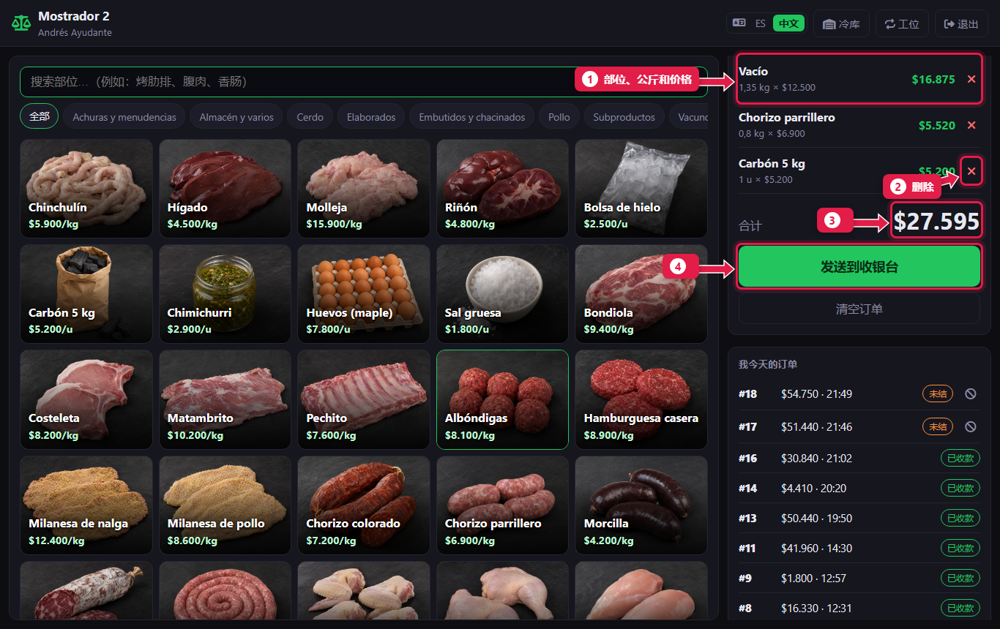
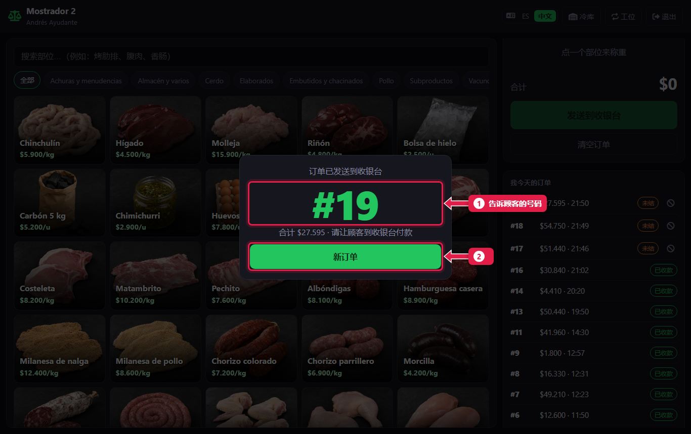

# 录入订单并发送到收银台

> **适合谁：** 助理屠宰工和正式屠宰工。  **时间：** 每位顾客 1 分钟。  **需要：** 柜台平板和秤。

在柜台给每个部位**称重**，加到**订单**里，点**发送到收银台**。系统给出一个**号码**：告诉顾客，让他去收银台付款。**柜台不收钱**。

## 有什么用
柜台和收银台分开，屠宰工不碰钱，每卖出一公斤都有记录。收银台拿到的是录好的订单，不用再输入任何东西。

## 开始之前
- 用你的账号在**柜台**工位登录（[教程 01](01-ingresar-y-elegir-puesto.md)）。
- 商品和价格由加工厂录入，柜台不能改。

## 操作步骤

### 1. 认识这个界面

1. **搜索框：** 输入部位名称。
2. **类别：** Vacuno（牛肉）、Cerdo（猪肉）、Pollo（鸡肉）、Achuras（内脏）……只显示该类。
3. **部位：** 每个按钮有照片、名称和每公斤（或每件）价格。
4. **当前订单：** 正在给这位顾客录入的内容。
5. **我今天的订单：** 已经发送的订单，以及是否已收款。

### 2. 搜索部位

1. 输入名称。不用输重音符号：输入“vacio”就能找到 **Vacío**（腹肉）。
2. 点这个部位。快捷键：按**回车**打开第一个结果。

### 3. 称重并输入公斤数

1. 把肉放在秤上，输入**公斤数**，用逗号：`1,350`。按件卖的（木炭、鸡蛋）输入**数量**。
2. 核对**小计**：公斤 × 单价。
3. 点**添加**（或按**回车**）。

每个商品重复第 2、3 步。

### 4. 检查订单

1. 每一行显示**部位**、**公斤数**和**价格**。
2. **✕：** 输错了就删除这一行。
3. 订单**合计**。
4. 点**发送到收银台**。

### 5. 把号码告诉顾客

1. 大大的**号码**就是顾客在收银台要报的号。
2. 点**新订单**接待下一位。

## 系统在后台做了什么
- 订单状态为**未结**，出现在收银台的**待处理订单**里。
- 库存**还没有扣**：收银台收款时才扣。
- 号码每天从头开始。

## 常见问题
| 遇到…… | 原因…… | 怎么办 |
|---|---|---|
| “与分店电脑失去连接” | Wi-Fi 断了或电脑关了 | 等恢复后再点**发送到收银台**。不会重复 |
| 找不到某个部位 | 已停用或不存在 | 告诉经理：商品由加工厂录入 |
| 价格不对 | 价格来自加工厂 | 告诉经理。柜台不能改 |
| 公斤数输错了 | — | 点 **✕** 删除这一行，重新录入 |

## 常见疑问

### 没有网络能发送订单吗？
能。柜台通过店里的 Wi-Fi 和肉店电脑通信，不需要外网。

### 顾客不要了怎么办？
在**我今天的订单**里作废它：见[我今天的订单以及如何作废](04-mis-comandas-y-anular.md)。

## 下一步
- [我今天的订单以及如何作废](04-mis-comandas-y-anular.md)。
- 收银台怎么处理你的订单：[收取订单的款项](06-cobrar-una-comanda.md)。
