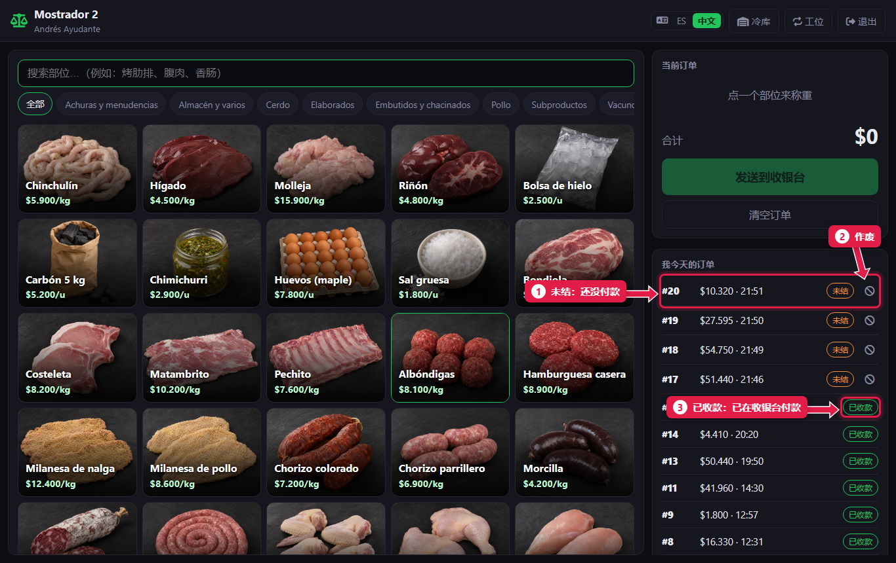
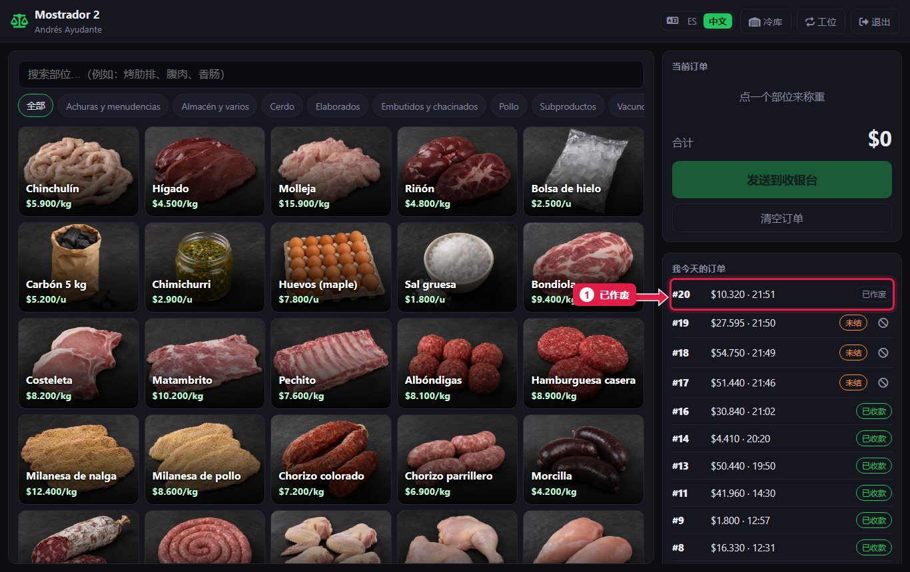

# 我今天的订单以及如何作废

> **适合谁：** 助理屠宰工和正式屠宰工。  **时间：** 30 秒。

柜台右侧显示**我今天的订单**及其状态。顾客不付款时，点该订单上的 **⊘**，写上原因，订单就**已作废**：收银台不会再显示它。

## 有什么用
没人付款的订单会一直挂在收银台，造成混乱。作废后它会从列表消失，并记录是谁作废的、为什么。

## 操作步骤

### 1. 查看订单状态

1. **未结：** 顾客还没付款。
2. **⊘ 作废：** 只在未结订单上出现。
3. **已收款：** 收银台已经收了钱。

列表会自动刷新。

### 2. 作废订单
1. 点订单上的 **⊘**。
2. 系统会问原因。写上（例如“顾客不要了”）并确认。

1. 订单变成**已作废**，从收银台消失。

## 谁可以作废
| 角色 | 自己的订单 | 别人的订单 |
|---|---|---|
| 助理屠宰工 | 可以 | 不可以 |
| 正式屠宰工 | 可以 | 可以 |
| 分店经理 | 可以 | 可以 |

**已收款**的订单不能在柜台作废。

## 系统在后台做了什么
- 记录作废人、时间和原因。经理在后台查看（[教程 22](22-controles-de-la-semana.md)）。
- 库存不变：未结订单本来就还没扣库存。

## 常见问题
| 遇到…… | 原因…… | 怎么办 |
|---|---|---|
| 没有 **⊘** | 订单已收款或已作废 | 如果已收款但有错误，告诉经理 |
| “只能作废自己的订单” | 你是助理，订单是别人录的 | 请正式屠宰工或经理作废 |
| “订单已不是未结状态” | 收银台刚刚收了款 | 已经收款了，不需要作废 |

## 常见疑问

### 必须写原因吗？
系统会要求填写。最好每次都写：经理每周都会检查作废的订单。

### 作废的订单能恢复吗？
不能。重新录入一张。

## 下一步
- [收取订单的款项](06-cobrar-una-comanda.md)（收银台的工作）。
- [每周检查](22-controles-de-la-semana.md)（经理怎么检查作废的订单）。
