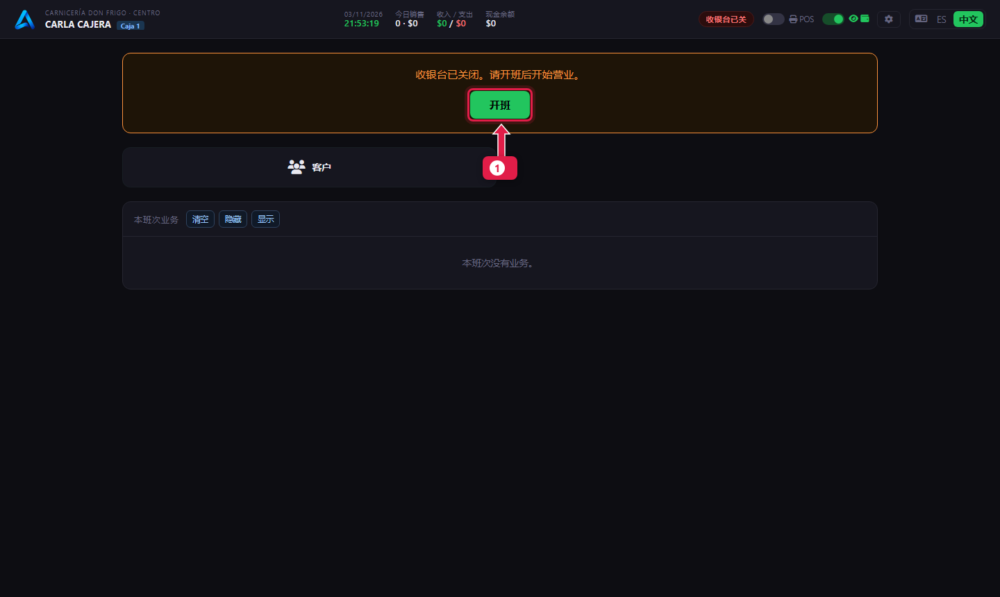
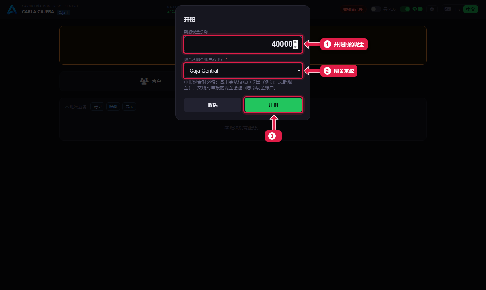
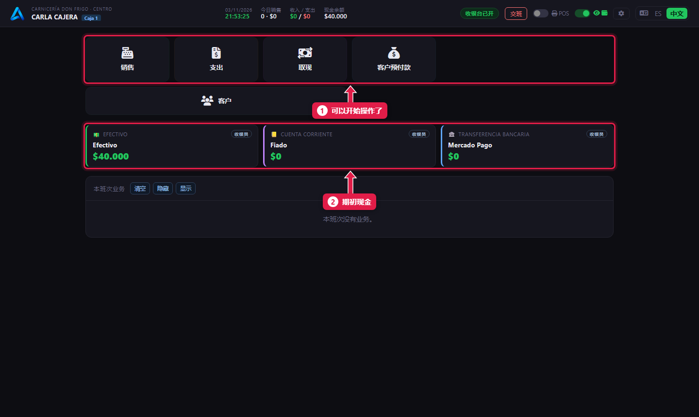

# 开班（打开收银台）

> **适合谁：** 收银员。  **时间：** 1 分钟。  **需要：** 点好的找零现金。

一天开始时点**开班**，输入**开班时的现金**（找零用的钱）以及这笔钱从哪个账户来（一般是 **Caja Central**（总钱箱））。开班后就可以收款了。

## 有什么用
开班标志**班次**的开始。交班时，系统会把实际的钱和从开班以来应有的钱做比较。

## 开始之前
- 用你的账号在 **Caja 1** 工位登录（[教程 01](01-ingresar-y-elegir-puesto.md)）。
- 开始前先点好零钱。

## 操作步骤

### 1. 点“开班”

1. 收银台关闭时会显示提示和**开班**按钮。

### 2. 输入期初现金

1. **期初现金余额：** 钱箱里的找零，例如 `40000`。
2. **现金从哪个账户来：** 选 **Caja Central**。只要填了现金，这一项就必填。
3. 点**开班**。

### 3. 可以收款了

1. 出现操作按钮：**销售**、**支出**、**取现**……
2. **现金**卡片从期初余额开始。Mercado Pago 和 Fiado（赊账）从 $0 开始。

## 系统在后台做了什么
- 以你的名字创建一个**收银班次**，记录日期和时间。
- 期初现金从 Caja Central 转到柜台的钱箱。

## 常见问题
| 遇到…… | 原因…… | 怎么办 |
|---|---|---|
| “有一个前一天的班次没有关闭” | 昨天没交班 | 点**关闭上一个班次**，交班（[教程 10](10-cerrar-la-caja.md)），然后再开今天的班 |
| 没有**开班**按钮 | 你没有开班/交班权限 | 请经理开通 |
| 要求选来源账户 | 你填了期初现金 | 选 **Caja Central** |

## 常见疑问

### 可以用 $0 开班吗？
可以。输入 `0`，这时不用选来源账户。

## 下一步
- [收取订单的款项](06-cobrar-una-comanda.md)。
