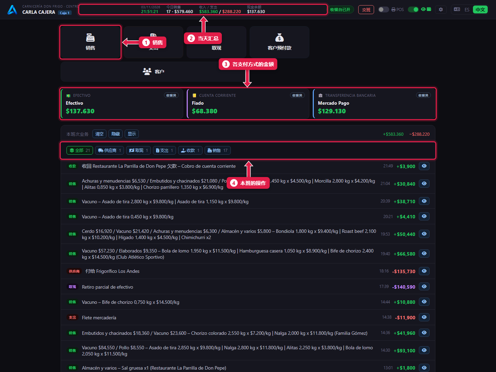
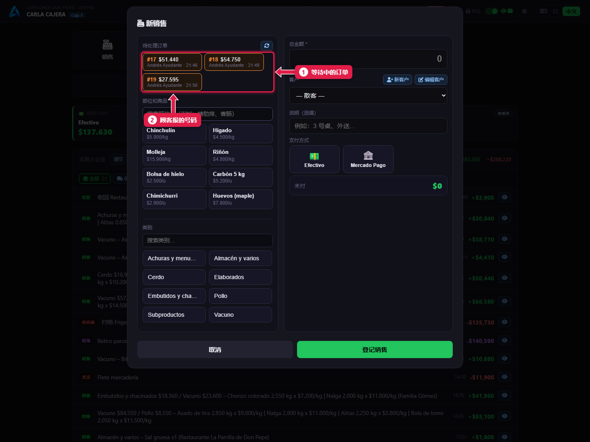
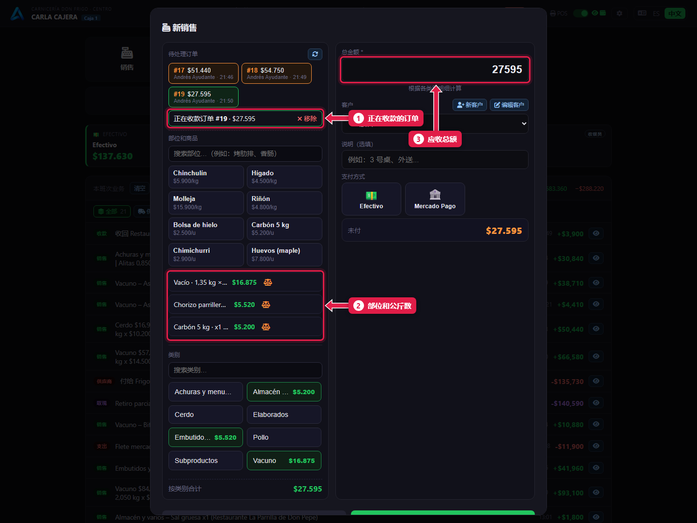
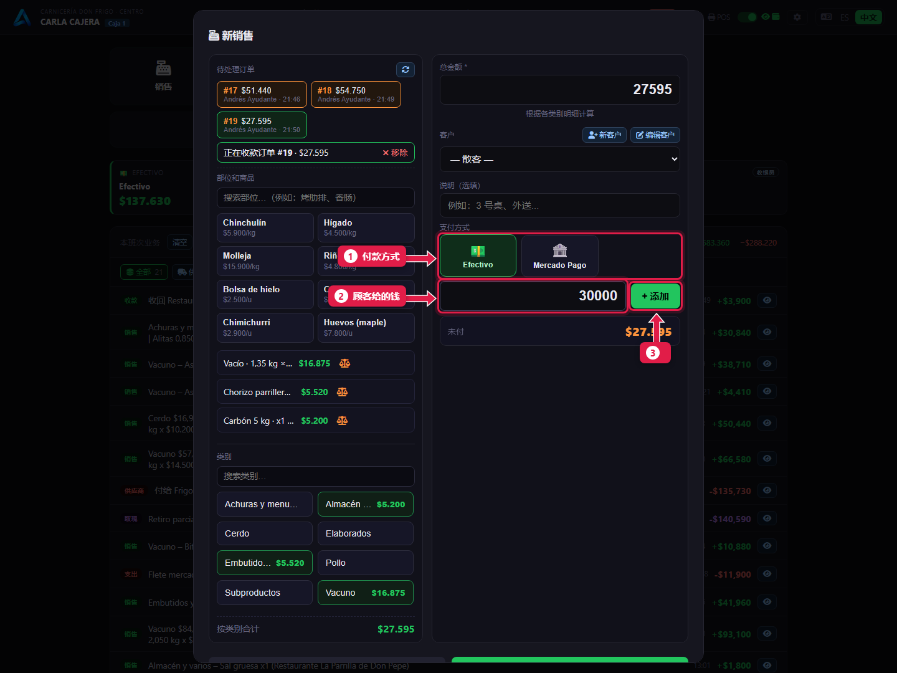
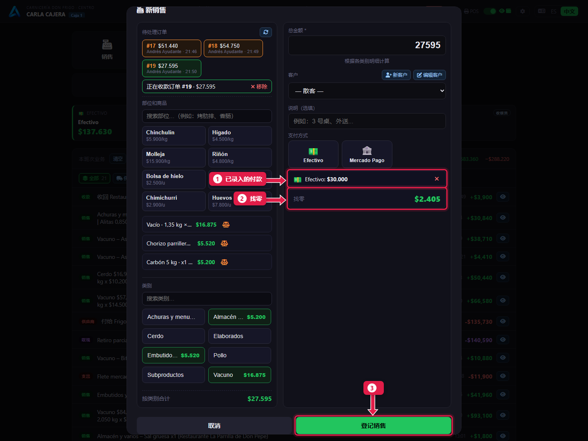
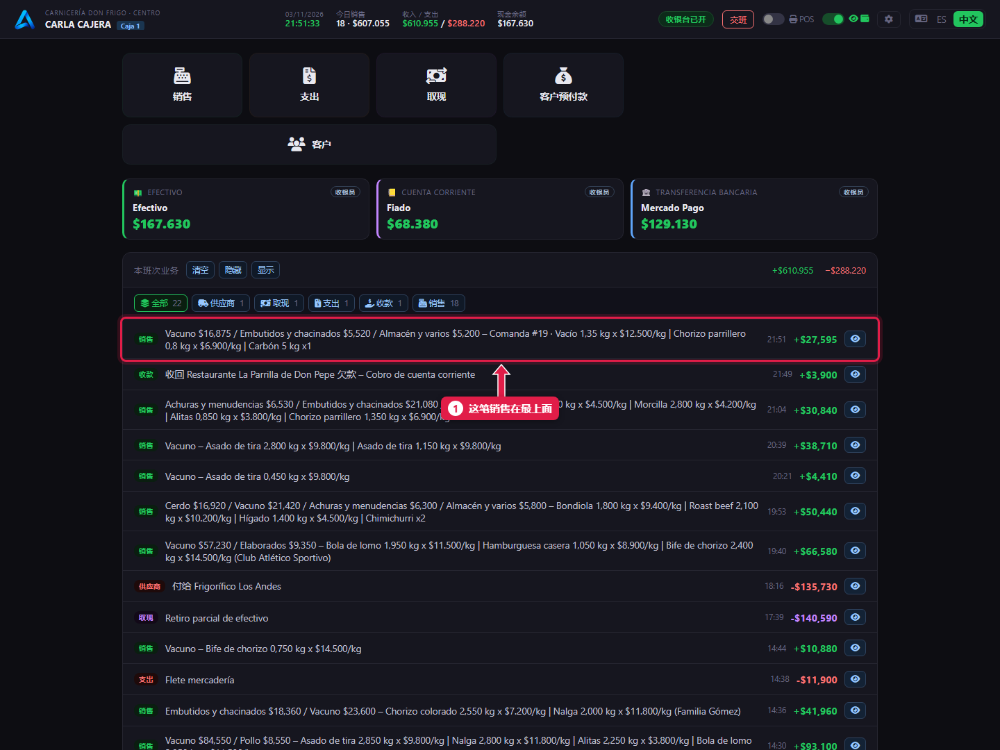

# 收取订单的款项

> **适合谁：** 收银员。  **时间：** 每位顾客 30 秒。  **需要：** 已开班（[教程 05](05-abrir-la-caja.md)）。

顾客带着号码来。点**销售**，在**待处理订单**里点**那张订单**，选**付款方式**，点**登记销售**。部位和合计已经从柜台带过来了。

## 有什么用
收银员不称重，也不输入价格：只收屠宰工录好的订单。这样不会输错，每卖出一公斤都有记录。

## 操作步骤

### 1. 认识收银界面

1. **销售：** 收款用。
2. **当天汇总：** 日期、销售、收入和支出、现金。
3. **各支付方式卡片：** 今天现金、赊账和 Mercado Pago 各收了多少。
4. **本班操作：** 每笔销售、支出或取现，最新的在最上面。

### 2. 点“销售”，选择订单

1. **待处理订单：** 柜台发来、还没人收款的所有订单，显示号码、合计、录入人和时间。
2. 点顾客说的那张。

### 3. 核对订单内容

1. **正在收款的订单 #…**：确认调出的是哪张。选错了就点**移除**，再选另一张。
2. 部位带着**秤**的图标进来：不能单独删除。
3. **总金额：** 自动计算。

如果顾客还要按件卖的东西（木炭、鸡蛋），也加进来：见[按件销售](07-venta-por-unidad-y-pago-dividido.md)。

### 4. 选择付款方式

1. 点**支付方式**：Efectivo（现金）、Mercado Pago……
2. 输入顾客**给的钱**。默认填好剩余未付金额。
3. 点 **+ 添加**。

### 5. 看找零并登记

1. 你录入的**付款**。
2. **找零：** 要找给顾客的钱。如果显示**未付**，说明钱不够。
3. 点**登记销售**（有打印机时是**打印小票**）。

### 6. 销售出现在列表里

1. 这笔销售在**最上面**，带着订单号和部位。

## 系统在后台做了什么
- 订单变成**已收款**：从待处理订单中消失，屠宰工那边显示已收款。
- 这些公斤数从各部位的**库存中扣除**。
- 现金付款且打印机接了钱箱的话，钱箱会自动打开。
- 两个收银台同时点同一张订单时，只有一个能收款：另一个会收到提示。

## 常见问题
| 遇到…… | 原因…… | 怎么办 |
|---|---|---|
| 找不到订单 | 没发送，或已收款/已作废 | 问屠宰工要号码 |
| 提示订单已经收过款 | 另一个收银台刚刚收了 | 关掉提示，继续下一张 |
| 显示**未付** | 付款少于合计 | 再加一笔付款或改金额 |
| 看不到 **Fiado**（赊账） | 选了客户才会出现赊账 | 见[赊账](08-fiado-y-cobro-de-deuda.md) |

## 常见疑问

### 两张订单能一起收吗？
一笔销售不行：先收一张，再收另一张。

### 能从订单里删掉一个部位吗？
收银台不行。如果有错，让屠宰工作废订单重新录入。

## 下一步
- [按件销售并用两种支付方式收款](07-venta-por-unidad-y-pago-dividido.md)。
- [赊账：记账销售](08-fiado-y-cobro-de-deuda.md)。
