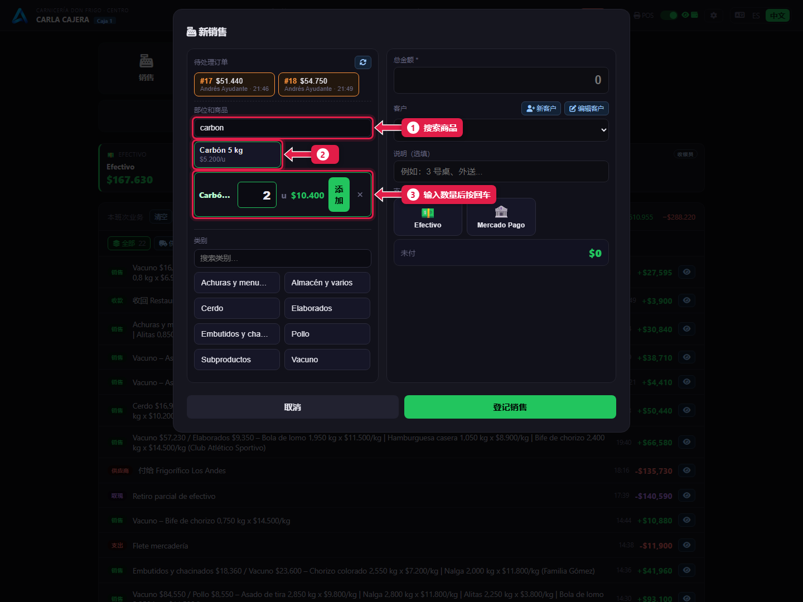
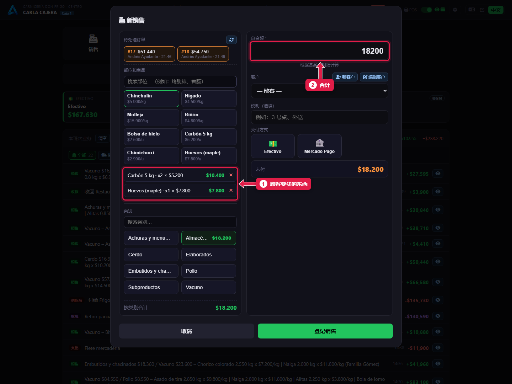
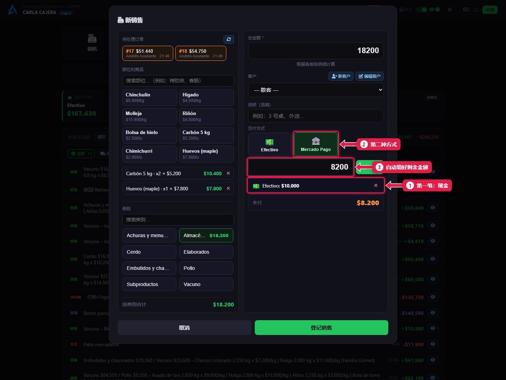
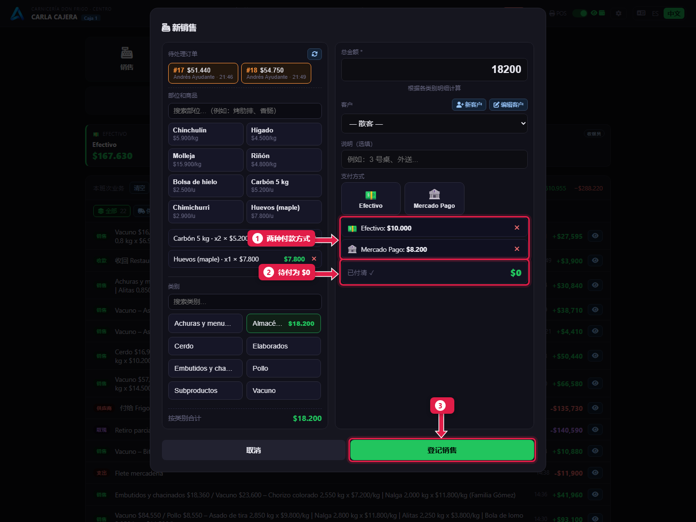

# 按件销售并用两种支付方式收款

> **适合谁：** 收银员。  **时间：** 1 分钟。

**按件**卖的东西（木炭、鸡蛋、盐、冰）直接在收银台加：搜索商品，输入数量，按**回车**。顾客**一部分付现金、一部分用 Mercado Pago** 时，在同一笔销售里录入两笔付款。

## 有什么用
只买木炭的顾客不用去柜台。分开付款也不用为一张小票做两笔销售。

## 操作步骤

### 1. 搜索商品并输入数量
点**销售**。在**部位和商品**里：

1. 在**搜索框**输入名称。
2. 点这个**商品**。
3. 输入**数量**，按**回车**。

### 2. 核对顾客要买的东西

1. 每个加入的商品，带数量和价格。这些可以用 **✕** 删除。
2. **总金额**自动计算。

### 3. 录入第一笔付款，再选第二种方式
1. 点 **Efectivo**（现金），输入现金部分（例如 `10000`），点 **+ 添加**。
2. 点 **Mercado Pago**。

1. **第一笔付款**已在列表中。
2. **第二种方式**被选中。
3. 金额**已自动填好剩余部分**。点 **+ 添加**。

### 4. 登记销售

1. **两种方式**及各自金额。
2. **未付**为 **$0**：已全部付清。
3. 点**登记销售**。

## 系统在后台做了什么
- 保存为一笔销售、两笔付款。每笔付款计入各自的支付方式卡片。
- 有一笔是现金，所以钱箱会打开。
- 件数从库存中扣除。

## 常见问题
| 遇到…… | 原因…… | 怎么办 |
|---|---|---|
| 按回车没加进去 | 数量为空或为 0 | 输入数量 |
| 付款录错了 | — | 在付款列表里点 **✕** 删除，重新录入 |
| 找不到商品 | 已停用 | 告诉经理 |

## 常见疑问

### 订单和按件商品能放在一起吗？
可以：先调出订单，再加商品。都在同一笔销售里。

### 能用三种方式付款吗？
可以，想加几笔付款都行，直到**未付**为 $0。

## 下一步
- [赊账：记账销售并收回欠款](08-fiado-y-cobro-de-deuda.md)。
