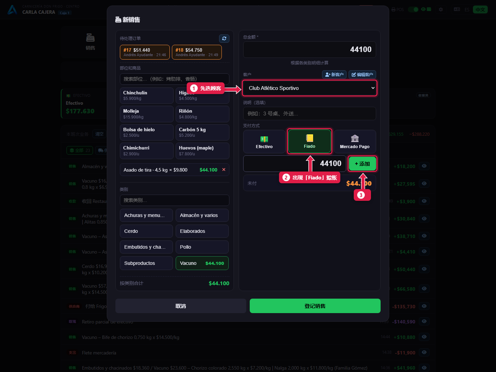
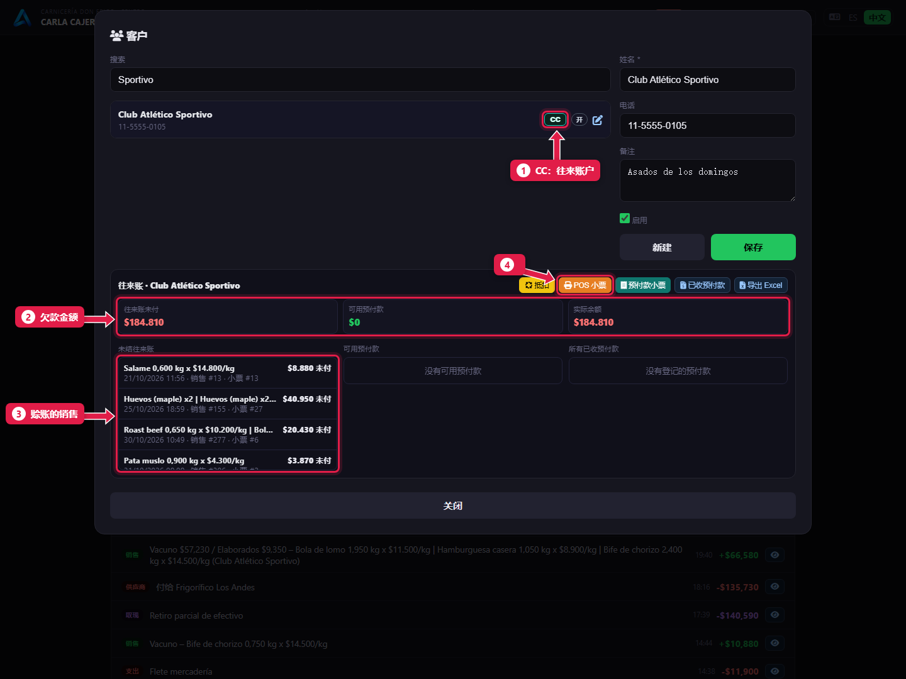
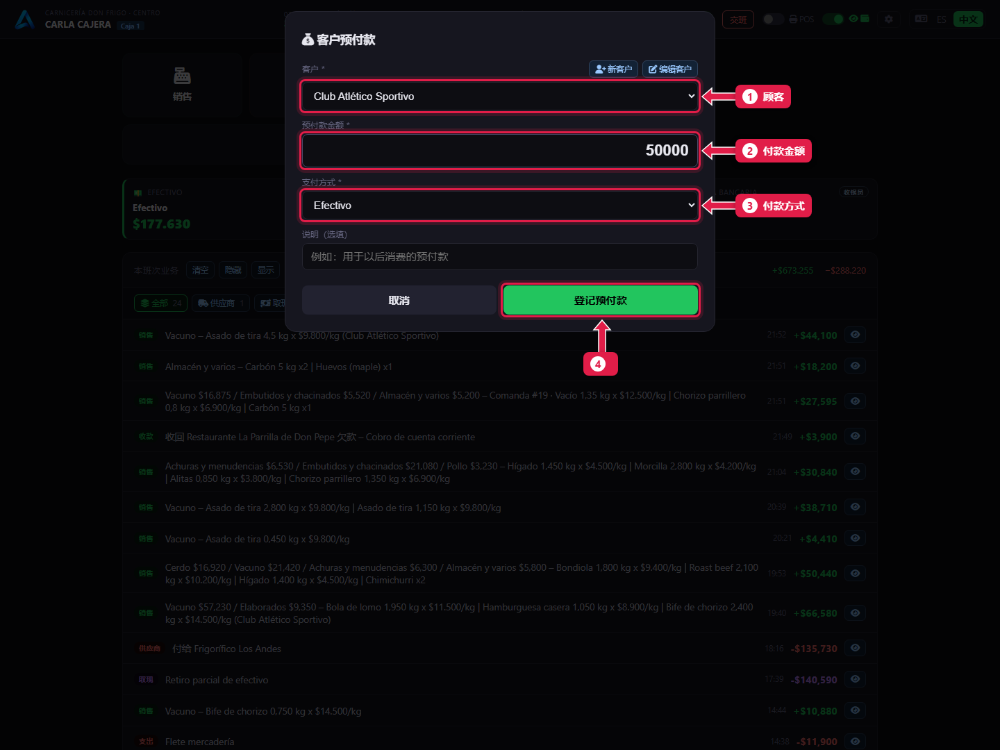
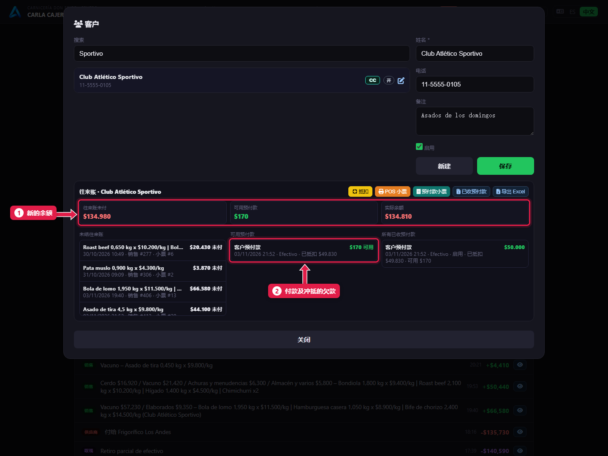

# 赊账：记账销售并收回欠款

> **适合谁：** 收银员。  **时间：** 1 分钟。  **需要：** 客户已经录入系统。

**赊账**时，在销售里选**客户**，用 **Fiado**（赊账）付款。顾客来还钱时，用**客户预付款**：系统先冲抵他**最早**的赊账销售。

## 有什么用
餐馆、熟食店或信得过的熟客先买，周末再结。往来账随时显示每个人欠多少。

## 开始之前
- 客户必须存在。用**客户 → 新建**，或在销售里点**新客户**创建。
- 自动收回欠款由经理在设置里开启（[教程 19](19-puestos-camaras-y-configuracion.md)）。

## 操作步骤

### 1. 赊账销售
点**销售**，录入要买的东西（或调出他的订单）。

1. 先选**客户**。
2. 这时才会出现 **Fiado**（赊账）。点它。
3. 点 **+ 添加**，再点**登记销售**。

### 2. 查看欠款
点**客户**，搜索客户，点 **CC**。

1. **CC：** 打开往来账。
2. **Pendiente CC（未付往来账）：** 总共欠多少。
3. **未付往来账明细：** 每一笔还没付的赊账销售。
4. **POS 小票：** 打印对账单给顾客。

### 3. 登记顾客的付款
关掉这个窗口，点**客户预付款**。

1. 付款的**客户**。
2. 他给的**金额**。
3. **支付方式：** 用什么付（这里没有 Fiado）。
4. 点**登记预付款**。

### 4. 确认欠款减少了

1. **新的余额**：减去了他付的钱。
2. **付款**、**已冲抵**多少、还剩多少**可用**。系统按**整笔赊账销售**冲抵：剩下的钱不够冲抵下一整笔时，这部分留作可用余额，下次付款时一起用。

## 系统在后台做了什么
- 赊账销售**不**增加收银台的现金：它是欠款，显示在 **Fiado** 卡片上。
- 顾客付的钱会进收银台，计入他使用的支付方式。
- 开启自动收回欠款时，系统从**最早**的开始，按整笔冲抵赊账销售，直到钱不够为止。列表里会出现一条 **Cobro deuda … automático por adelantos**（预付款自动收回欠款）。

## 常见问题
| 遇到…… | 原因…… | 怎么办 |
|---|---|---|
| 没有 **Fiado** | 没选客户 | 先选客户 |
| 没有**客户**按钮 | 你没有新建/编辑客户的权限 | 请经理开通 |
| 付款显示“可用”，欠款没减少 | 自动收回欠款没开 | 在往来账里点**抵扣**，或请经理开启 |
| 顾客还欠钱，却剩下一点“可用”余额 | 这点钱不够冲抵下一整笔销售 | 正常：下次付款时一起冲抵。也可以点**抵扣** |

## 常见疑问

### 能把欠款打印给顾客吗？
可以：在往来账里点 **POS 小票**。**Exportar Excel** 下载明细。

### 付款录错了能撤销吗？
由经理在后台撤销（*客户预付款 → Revertir y anular adelantos*），而且只能在这笔钱没有被用在别处时撤销。

## 下一步
- [支出和取现](09-gastos-y-retiros.md)。
