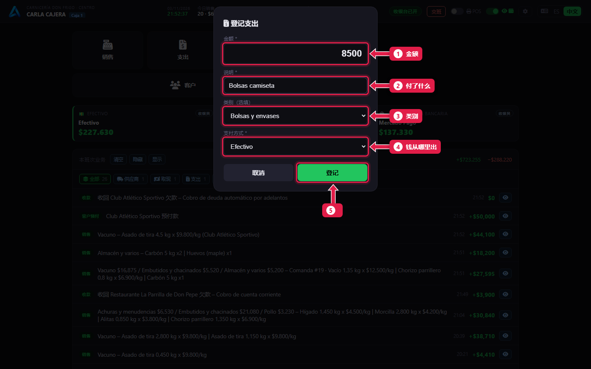
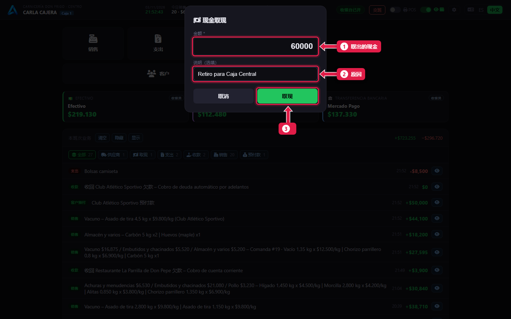
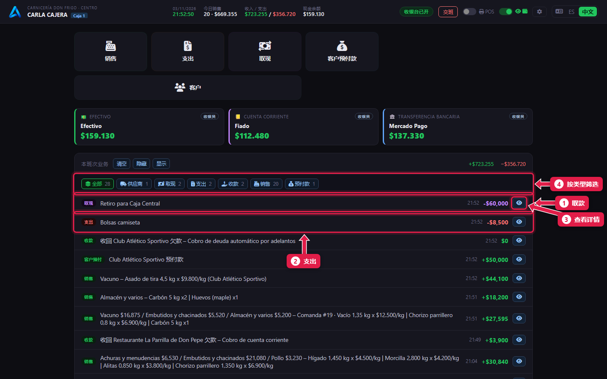

# 支出和取现

> **适合谁：** 收银员。  **时间：** 30 秒。

用收银台的钱付了东西（袋子、清洁用品、运费），点**支出**。从收银台拿现金去总钱箱，点**取现**。这两项都会减少交班时应有的现金。

## 有什么用
不记下来，交班时钱就少了，也不知道为什么。记下来，交班就能对上，经理也能看到钱花在哪。

## 操作步骤

### 1. 登记支出
点**支出**。

1. **金额：** 付了多少。
2. **说明：** 付了什么，例如“背心袋”。
3. **类别：** Bolsas y envases（袋子和包装）、Limpieza（清洁）、Flete（运费）……（可选）。
4. **支付方式：** 钱从哪里出（一般是现金）。
5. 点**登记**。

### 2. 登记取现
点**取现**。

1. **金额：** 拿走的现金。
2. **说明：** 原因（可选）。
3. 点**取现**。

### 3. 查看本班操作

1. **取现**。
2. **支出**。
3. **👁：** 打开详情（也可以重新打印）。
4. **筛选：** 只显示销售、支出、取现、收款……

## 系统在后台做了什么
- 支出记在班次里，也按类别出现在经理的报表里。
- 取现一定是**现金**。
- 两者都会减少交班时的**应有现金**。

## 常见问题
| 遇到…… | 原因…… | 怎么办 |
|---|---|---|
| 没有**支出**或**取现**按钮 | 你没有这个权限 | 请经理开通 |
| 没有**供应商付款** | 这个按钮是经理的 | 告诉经理 |
| 金额输错了 | — | 告诉经理：用账户调整更正（[教程 22](22-controles-de-la-semana.md)） |

## 常见疑问

### 付给供应商的货款算支出吗？
不算。那是**供应商付款**，经理才有这个按钮。记在供应商的账上。

## 下一步
- [交班](10-cerrar-la-caja.md)。
