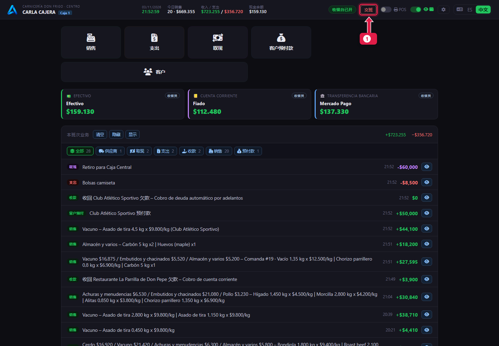
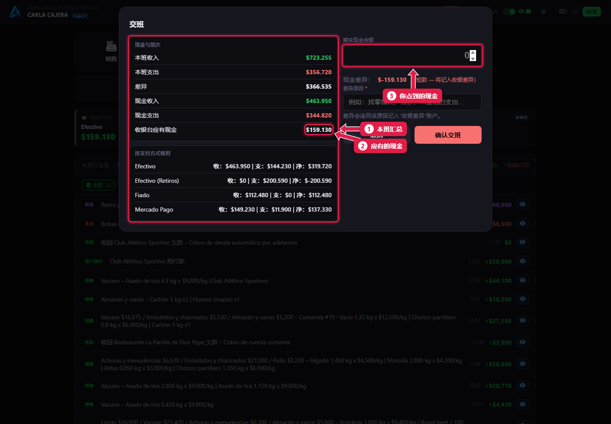
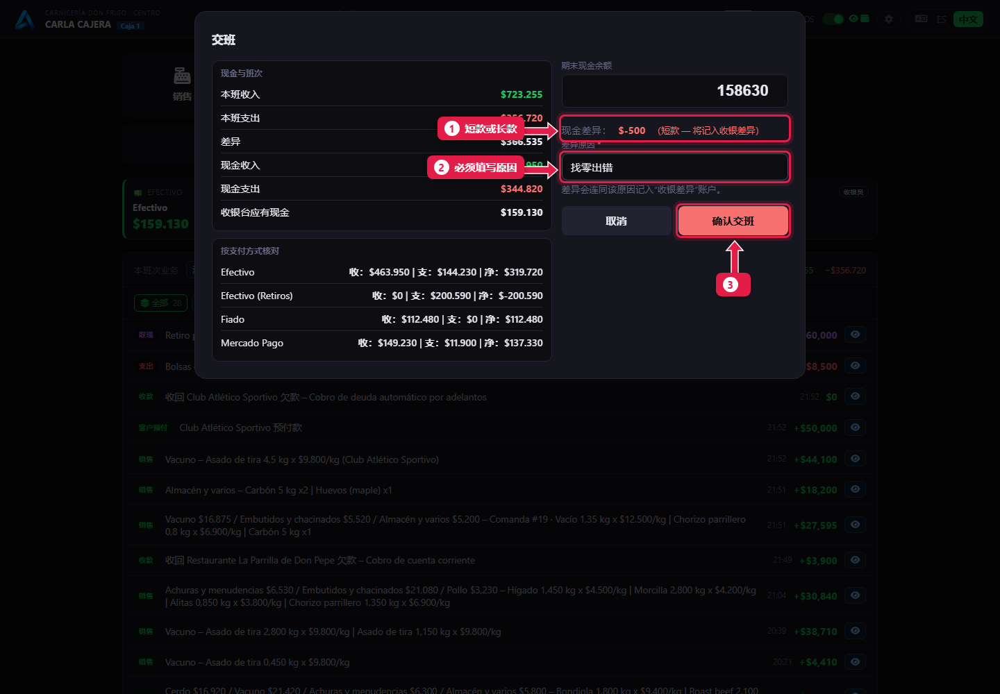
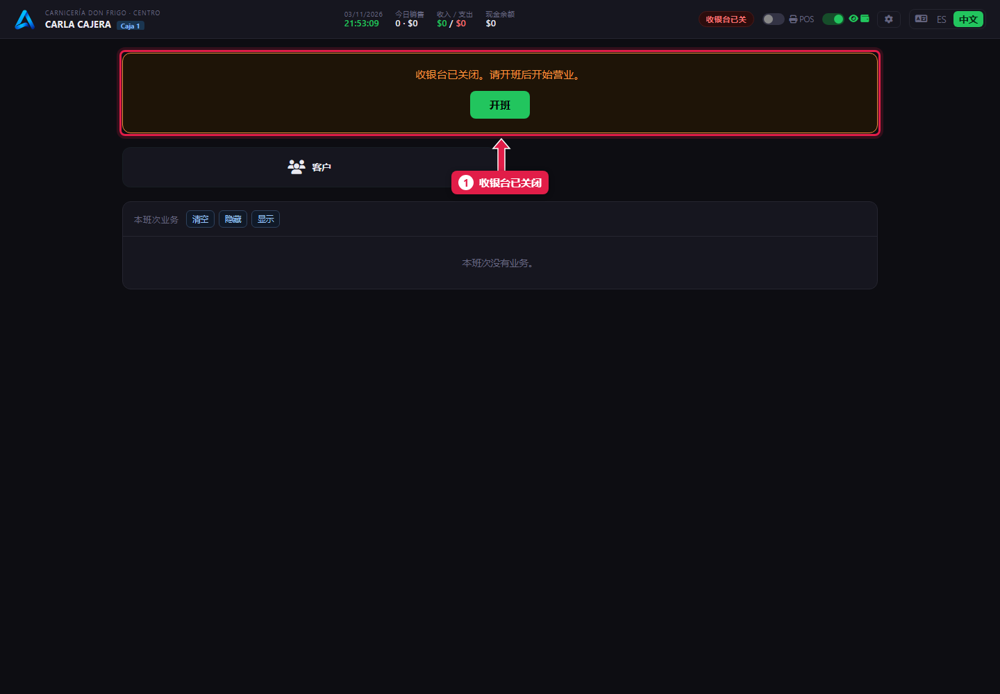

# 交班（关闭收银台）

> **适合谁：** 收银员。  **时间：** 5 分钟。  **需要：** 点好钱箱里的现金。

一天结束时点**交班**，输入**你点到的现金**，点**确认交班**。如果和应有金额不一致，系统会要求你写**差异原因**。

## 有什么用
交班检查收银台的钱是否和卖出、支出、取现的金额一致。每个差额都会和原因一起记录，供经理查看。

## 操作步骤

### 1. 点“交班”

1. 顶部的**交班**。

### 2. 看汇总，输入点到的现金

1. **本班汇总：** 收入、支出和各支付方式的变动。
2. **应有现金：** 钱箱里应该有的钱。
3. **期末现金余额：** 输入你**点到**的钱。

### 3. 对不上时，说明原因

1. **现金差额：** 少了（或多了）多少。
2. **差异原因：** 有差额就必填。例如“找零出错”。
3. 点**确认交班**。会打开交班 **PDF**，可以打印或保存。

### 4. 收银台已关闭

1. 再次[开班](05-abrir-la-caja.md)之前不能操作。

## 系统在后台做了什么
- 班次**已关闭**，不能再修改。
- 申报的现金回到 **Caja Central**（总钱箱）。
- 差额记入 **Diferencias de Caja**（收银差额）账户，附上你的原因。经理在*收银班次*里查看（[教程 22](22-controles-de-la-semana.md)）。

## 常见问题
| 遇到…… | 原因…… | 怎么办 |
|---|---|---|
| 不能交班 | 有差额但没写原因 | 写上原因 |
| 点到的金额输错了 | 班次已经关闭 | 告诉经理：用账户调整更正 |
| PDF 没打开 | 浏览器拦截了新窗口 | 允许弹出窗口。经理也可以在*收银班次*里下载 |

## 常见疑问

### Mercado Pago 要申报吗？
这个版本交班时只要求填现金。Mercado Pago 收的钱按支付方式显示在汇总里。

### 不点钱能交班吗？
不建议：点钞是及时发现短款的唯一办法。

## 下一步
- 明天：[开班](05-abrir-la-caja.md)。
- 给经理：[每周检查](22-controles-de-la-semana.md)。
