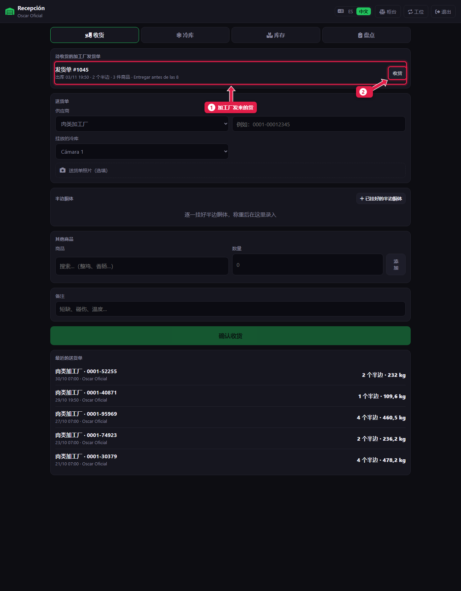
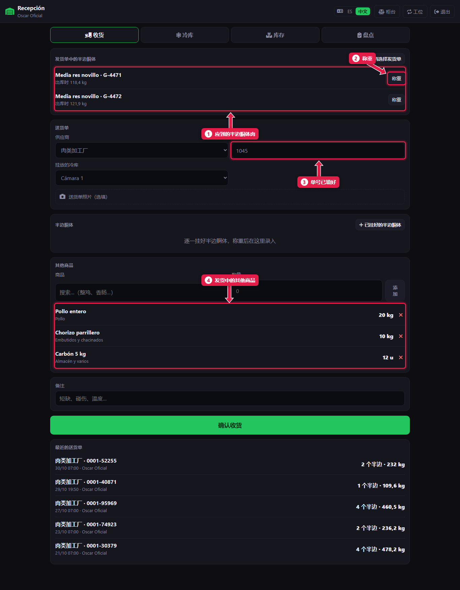
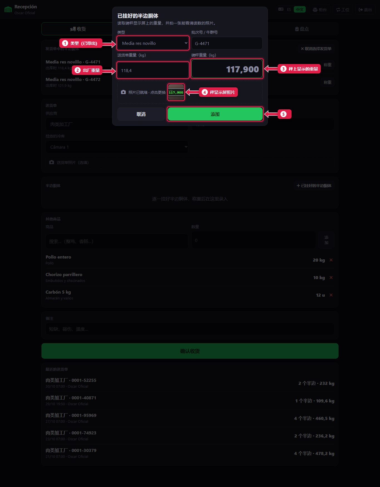
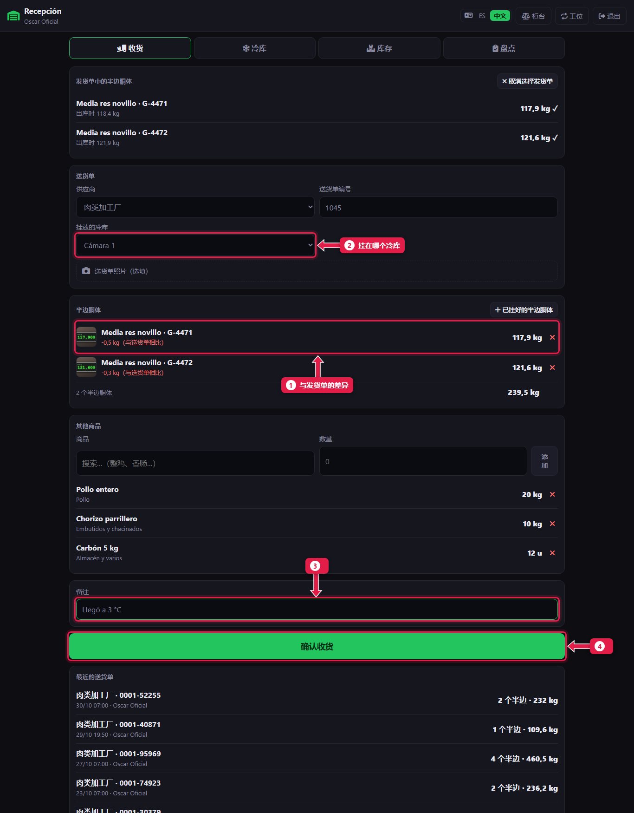
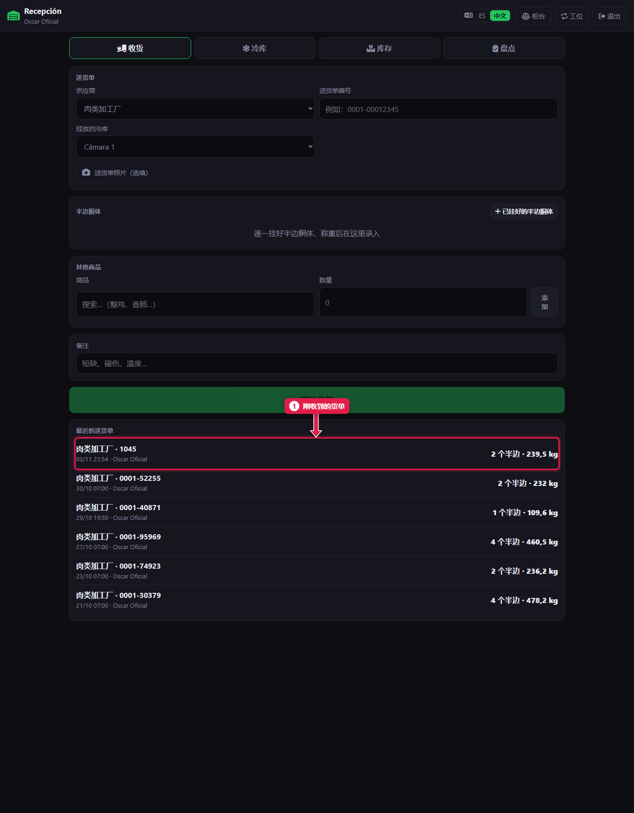

# 接收加工厂的发货单

> **适合谁：** 正式屠宰工、助理屠宰工和经理。  **时间：** 每个半边胴体 2 分钟。  **需要：** 吊秤，以及带相机的手机或平板。

加工厂发来的货会自动出现在**待收货的加工厂发货单**里。点**收货**，给每个半边胴体**称重**并拍**显示屏照片**，选**冷库**，点**确认收货**。

## 有什么用
半边胴体出厂时一个重量，到店时另一个重量。挂起来时称重并拍照，就留下了实际到货的证据。加工厂在总部面板上能看到差额。

## 开始之前
- 在**收货**工位，或在柜台点**冷库**按钮进入。
- 周二要**先做每周结算**，再接收新肉（[教程 15](15-liquidacion-semanal-contar.md)）。

## 操作步骤

### 1. 在到货的发货单上点“收货”

1. **发货单**：编号、出厂时间、有几个半边胴体和几种商品，以及加工厂的备注。
2. 点**收货**。

### 2. 看看应该到哪些货

1. **发货单中的半边胴体：** 每个都显示出厂重量。
2. **称重：** 半边胴体挂上吊秤后点它。
3. **送货单编号：** 已经自动填好。
4. **其他商品：** 鸡肉、香肠、木炭……按发货数量自动填好。

### 3. 给每个半边胴体称重

1. **类型：** 从发货单带出（例如“Media res novillo”，阉牛半边胴体）。
2. **送货单重量：** 出厂时的重量。
3. **秤上重量：** 输入显示屏上的数字。
4. **显示屏照片：** 半边胴体挂着、数字清楚可见时拍照。这是重量的证据。
5. 点**添加**。

每个半边胴体都重复一遍。

### 4. 选冷库并确认

1. 每个半边胴体显示**与送货单的差额**。红色：到货少了。
2. **挂放的冷库：** 一般是 Cámara 1。
3. **备注：** 缺货、磕碰、温度。
4. 点**确认收货**。

其他商品数量不对时，点 **✕** 删除那一行，按实际到货重新录入。

### 5. 收货已确认

1. 送货单出现在**最近的送货单**第一行，显示半边胴体数量和公斤数。

## 系统在后台做了什么
- 半边胴体**进入冷库**，等待分割（[教程 13](13-camara-y-desposte.md)）。
- 其他商品**计入库存**。
- 发货单变成**已收货**，加工厂在总部面板上看到实际重量。

## 常见问题
| 遇到…… | 原因…… | 怎么办 |
|---|---|---|
| 看不到发货单 | 还没同步，或已经收过了 | 等一分钟。还没有就告诉经理 |
| “没有拍显示屏照片，仍要添加吗？” | 缺少照片 | 拍照。实在拍不了就确认，并在备注里写明 |
| 提示有半边胴体没称重 | 发货单里有没称的 | 去称。如果没到货，照样确认：会记为缺货 |
| 差额特别大 | 重量输错了 | 确认前点 **✕** 删除，重新称重 |

## 常见疑问

### 发货不全怎么办？
称到了的，在**备注**里写缺什么，然后确认。系统会记为缺货。

## 下一步
- [冷库：移动和分割半边胴体](13-camara-y-desposte.md)。
- [接收其他供应商的货](12-recibir-de-otro-proveedor.md)。
