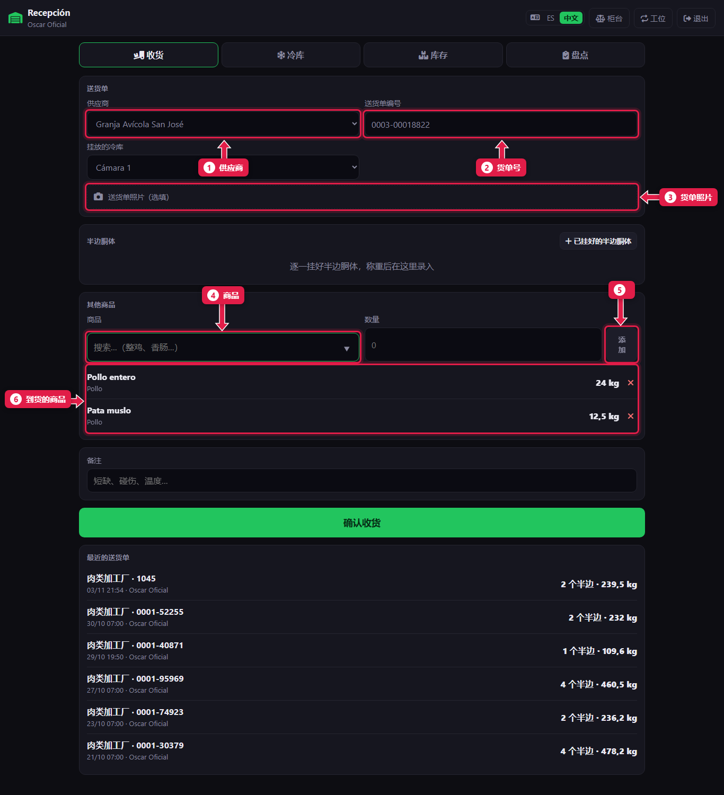
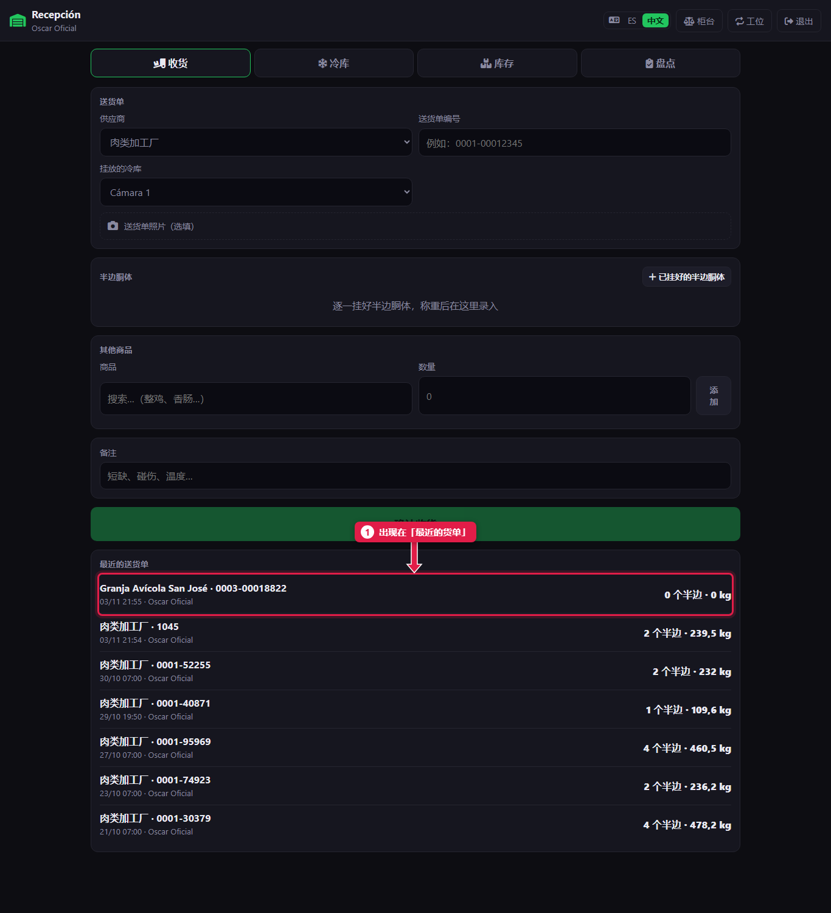

# 接收其他供应商的货

> **适合谁：** 正式屠宰工、助理屠宰工和经理。  **时间：** 2 分钟。

**其他供应商**（例如养鸡场）送货时，在**收货**页选择**供应商**，输入**送货单编号**，逐个录入**商品**和数量，点**确认收货**。

## 有什么用
所有进货都要计入库存。不录入的话，周二结算时会显得货“多出来”。

## 操作步骤

### 1. 录入送货单

1. **供应商：** 从列表中选。
2. **送货单编号：** 纸质单据上的号码。
3. **送货单照片：** 拍下纸质单据（可选，但建议拍）。
4. **商品：** 搜索并在旁边输入**数量**。
5. 点**添加**。每个商品都重复一遍。
6. **到货清单：** 核对。有错的用 **✕** 删除。

如果这个供应商也送半边胴体，点**已挂好的半边胴体**，按[教程 11](11-recibir-despacho-del-frigorifico.md)称重。

最后点**确认收货**。

### 2. 送货单已登记

1. 出现在**最近的送货单**第一行。

## 系统在后台做了什么
- 每个商品按数量计入**库存**。
- 送货单连同照片、收货人和时间一起保存。

## 常见问题
| 遇到…… | 原因…… | 怎么办 |
|---|---|---|
| “请从列表中选择商品” | 名称和任何商品都对不上 | 输入名称的一部分，从列表里选 |
| “请输入数量” | 数量为空或为 0 | 输入数量，需要时用逗号：`12,5` |
| 没有这个供应商 | 还没录入 | 经理在*采购 → 供应商*里添加 |
| **确认收货**是灰的 | 什么都没录 | 至少添加一个商品或一个半边胴体 |

## 常见疑问

### 在这里付供应商的钱吗？
不在。收货只登记货物。付款由经理在收银台用**供应商付款**完成。

## 下一步
- [查看各部位库存](14-ver-el-stock.md)。
