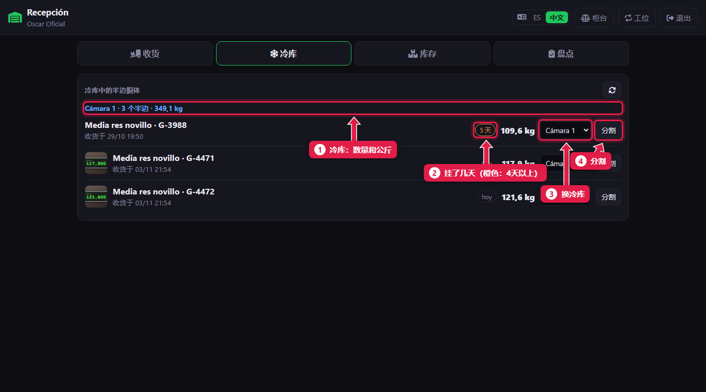
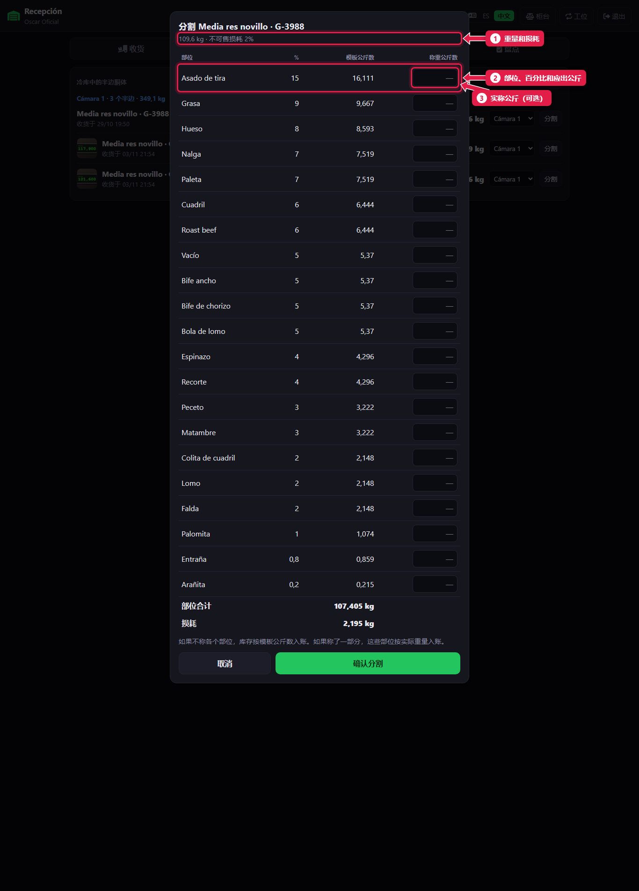
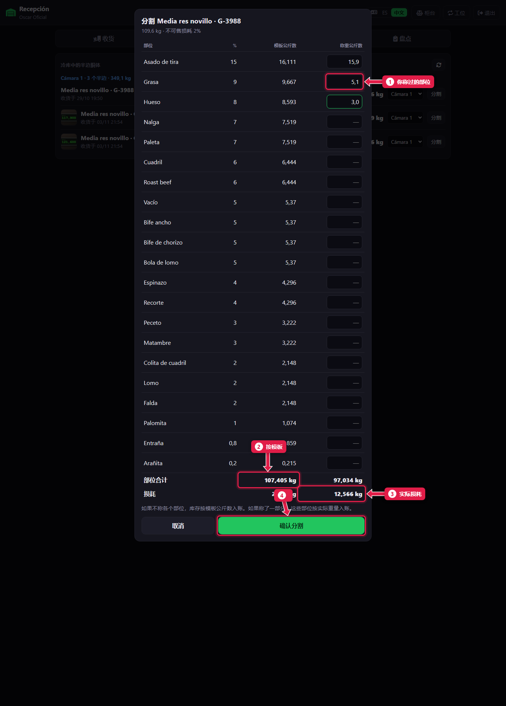
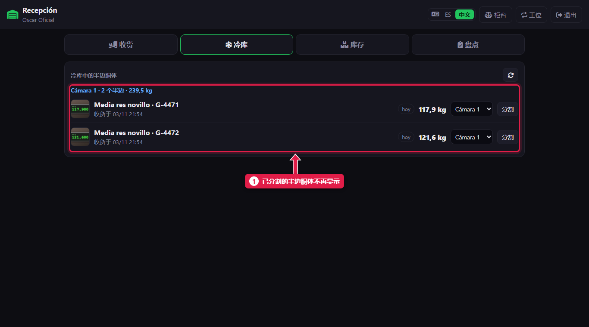

# 冷库：移动和分割半边胴体

> **适合谁：** 正式屠宰工和经理（助理可以查看和移动，不能分割）。  **时间：** 2 分钟。

在**冷库**页能看到每个挂着的半边胴体和它**挂了几天**。要切开时点**分割**：系统按**分割模板**显示每个部位应出多少公斤。如果称了某些部位，就输入那些公斤数。点**确认分割**，各部位计入库存。

## 有什么用
半边胴体不会整只卖：是按部位卖。在系统里分割，就把这些公斤数变成肋排、腹肉、后腿……的库存，并算出**损耗**（骨头、肥油和卖不掉的碎肉）。

## 操作步骤

### 1. 查看冷库中的半边胴体

1. **冷库：** 有几个半边胴体、多少公斤。
2. **挂的天数：** **4 天及以上**变成**橙色**。最好先分割这些。
3. **移动：** 在下拉框里选别的冷库，就会移过去。
4. **分割：** 打开分割表。

### 2. 查看模板

1. 上方是半边胴体的**重量**和模板的**不可售损耗**。
2. 每一行：**部位**、**%** 和**应出公斤数**。
3. **称重公斤数：** 可选。不称就留空。

### 3. 称了某些部位，就输入公斤数

1. **你称过的部位**，填实际公斤数。其他部位用模板的数字。
2. 按模板的**部位合计**。
3. **实际损耗：** 半边胴体重量减去所有部位之和。
4. 点**确认分割**。

### 4. 半边胴体离开冷库

1. 分割过的半边胴体不在列表里了。

## 系统在后台做了什么
- 每个部位按公斤数**计入库存**（实称的或模板的）。
- 记录**分割损耗**。加工厂在总部面板上能看到：超过 4% 显示橙色。
- 记录谁分割的、什么时候。

## 常见问题
| 遇到…… | 原因…… | 怎么办 |
|---|---|---|
| 没有**分割**按钮 | 你是助理 | 由正式屠宰工或经理分割 |
| 没有移动下拉框 | 只有一个启用的冷库 | 经理可以添加冷库（[教程 19](19-puestos-camaras-y-configuracion.md)） |
| 损耗特别高 | 某个重量输错了 | 确认前检查公斤数。确认后不能撤销 |

## 常见疑问

### 要不要称部位？
时不时称一下比较好：这样能看出模板和实际出肉率是否接近。差得太多就告诉加工厂。

## 下一步
- [查看各部位库存](14-ver-el-stock.md)。
