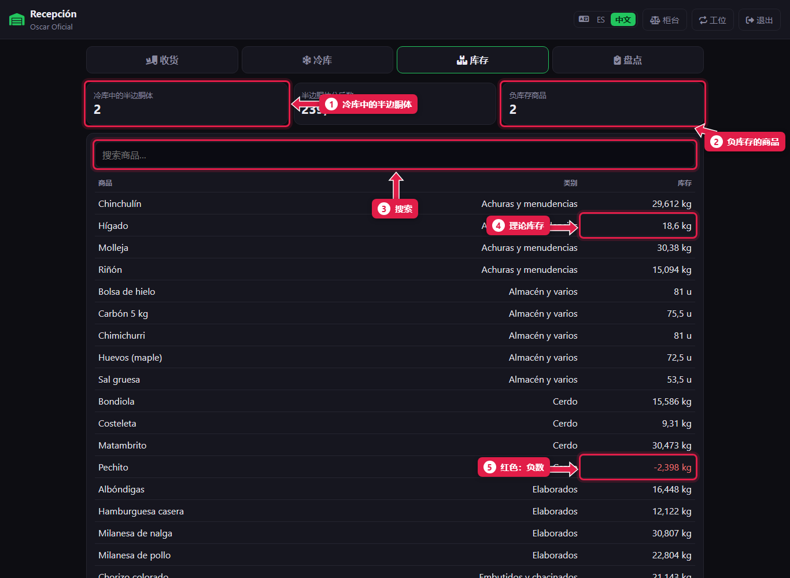
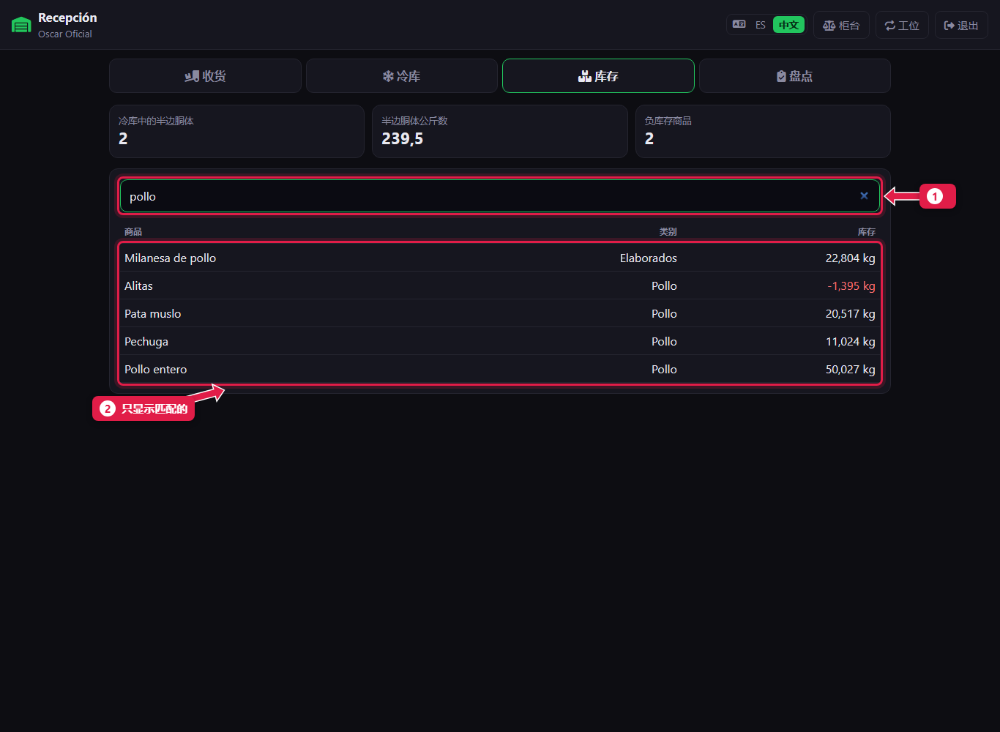

# 查看各部位库存

> **适合谁：** 正式屠宰工、助理屠宰工和经理（收银员看不到）。  **时间：** 1 分钟。

**库存**页显示系统认为每种商品**应该**有多少：收货和分割的，减去卖出和丢弃的。上方是冷库里的半边胴体，以及有几种商品是负数。

## 有什么用
开门前知道还剩哪些部位，并发现错误：**负库存**说明卖出的比进来的多。

## 操作步骤

### 1. 看汇总和列表

1. **冷库中的半边胴体**（旁边是公斤数）。
2. **负库存商品：** 有几种。
3. **搜索商品。**
4. **库存：** 应有数量，按公斤或件。
5. **红色：** 负库存。

### 2. 搜索商品

1. 输入名称或类别的一部分。
2. 列表**只显示匹配的**。

## 负数意味着什么
最常见的原因：
- **分割没录入**：某个半边胴体的肋排已经卖了，但系统里它还挂着。
- 柜台**用别的部位名称卖了**。
- **到货没在收货页录入**。

用**盘点**来更正：[抽查盘点](17-conteo-de-control.md)或[每周结算](15-liquidacion-semanal-contar.md)会让库存等于实际数量。

## 常见疑问

### 库存就是冷库里实际有的吗？
是**应该**有的。实际有多少要靠盘点。

### 为什么收银员看不到库存？
因为她的角色没有**查看库存**权限。经理可以开通。

## 下一步
- [每周结算：盘点](15-liquidacion-semanal-contar.md)。
