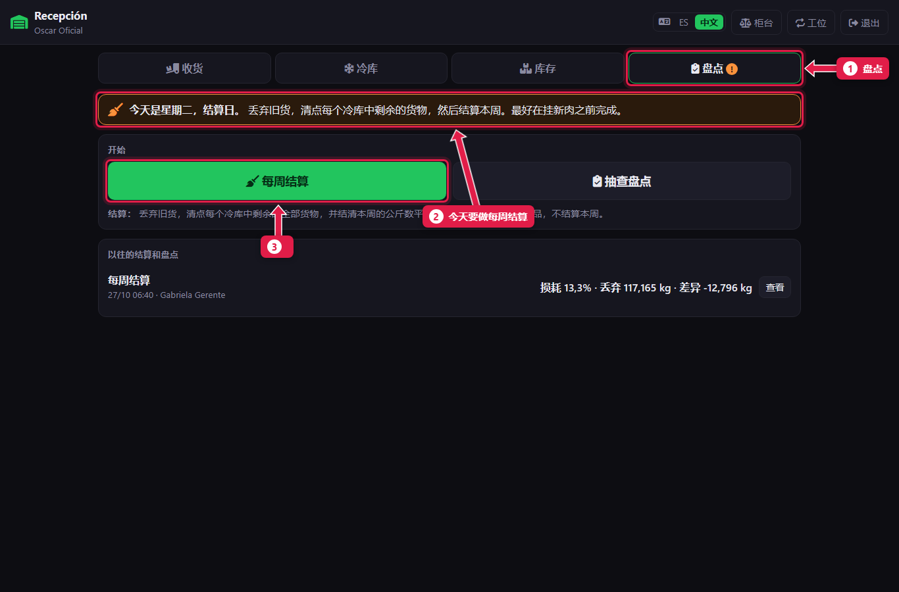
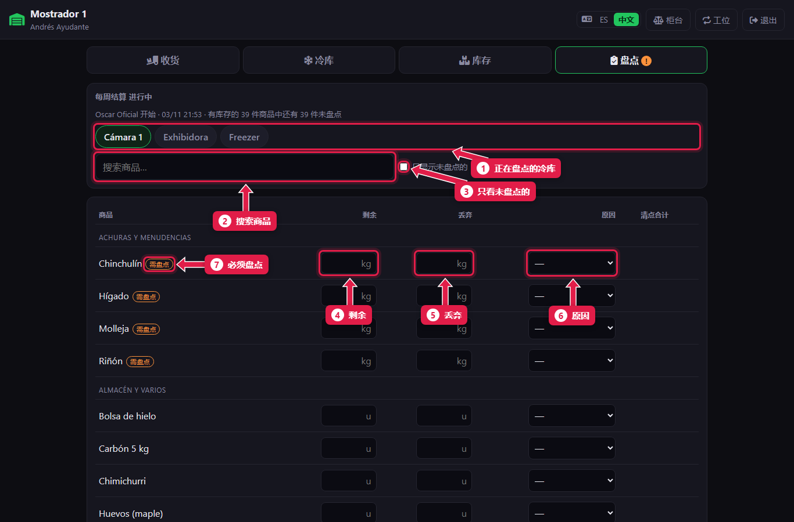
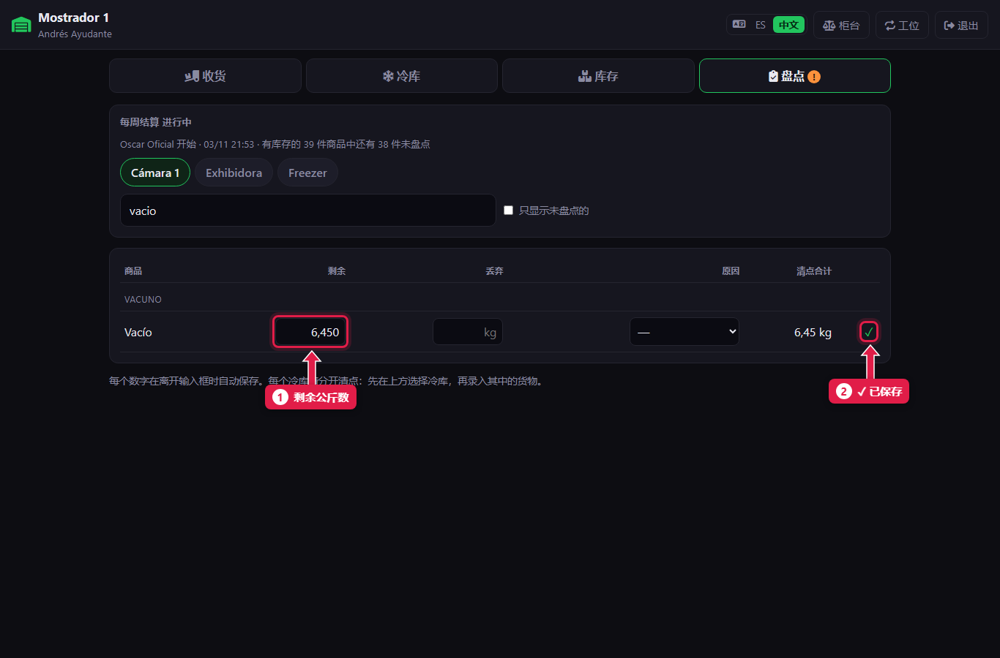
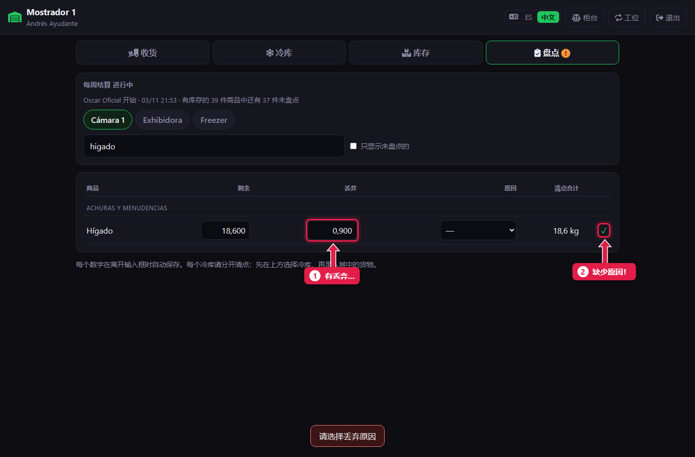
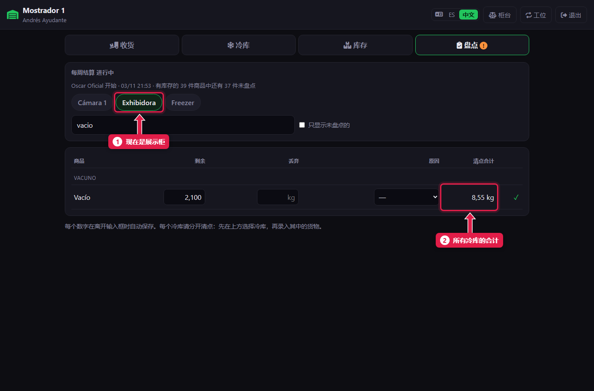
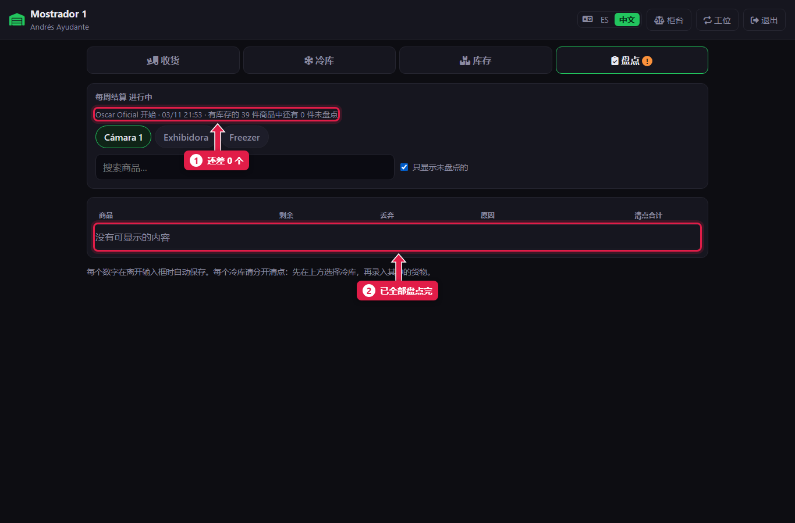

# 每周结算：盘点剩余和丢弃的货

> **适合谁：** 助理屠宰工和正式屠宰工负责清点；正式屠宰工或经理负责开始。  **时间：** 30 到 60 分钟。  **什么时候：** 结算日（周二），**开门前**、**新肉到货前**。

每周一次，逐个冷库**盘点**所有按公斤卖的货：**剩余**的好货和要**丢弃**的货（写明原因）。系统据此结出本周的**公斤数平衡**。

## 有什么用
这是肉店最重要的检查：显示本周损失了多少公斤、损失在哪（分割损耗、丢弃和短少）。清点的人**看不到**应有数量：这样盘点才真实。

## 开始之前
- 今天是周二（或本店的结算日）。**盘点**页会有提示。
- 同一时间**只能有一个盘点**在进行。
- 新肉还没到更好：要数的少。

## 操作步骤

### 1. 开始每周结算（正式屠宰工或经理）
进入**收货 → 盘点**。

1. **盘点**页（结算日有橙色 **!**）。
2. 提示：今天要结算。
3. 点**每周结算**。

### 2. 认识盘点表

1. 正在盘点的**冷库**：Cámara 1、Exhibidora（展示柜）、Freezer（冷冻柜）。
2. **搜索商品。**
3. **只显示未盘点的：** 只留下还没数的。
4. **剩余：** 状态好、继续卖的货，按公斤或件。
5. **丢弃：** 要扔掉的货。
6. **原因：** 有丢弃就必填。
7. **需盘点：** 有库存、必须盘点的商品。

### 3. 逐个录入

1. 输入**剩余公斤数**。按**回车**跳到下一格。
2. 离开输入框就自动保存，显示 **✓**。

### 4. 有丢弃时，选原因

1. 在**丢弃**里填了公斤数……
2. ……出现 **!**：缺少**原因**。选一个：过期、气味或颜色；磕碰或冻伤；修整或碎肉卖不掉；没收；其他。选好后显示 **✓**。

### 5. 换到另一个冷库

1. 点另一个**冷库**，盘点那里的货。
2. 同一商品放在两个冷库，就在每个冷库各录一次：**合计**会自动相加。

可以两个人同时盘点，用两台平板，各负责一个冷库。

### 6. 确认没有遗漏

1. 上方显示还差几个**未盘点**。
2. 勾选**只显示未盘点的**，全部数完后列表为空。

必须盘点的商品如果一点不剩，就录入 **0**。

## 系统在后台做了什么
- 每个数字立即保存，并记录录入人。
- 关闭结算前库存**不变**（[教程 16](16-liquidacion-cerrar.md)）。

## 常见问题
| 遇到…… | 原因…… | 怎么办 |
|---|---|---|
| 某行有 **!** | 缺原因或有错误 | 选原因或改数字 |
| “已有一个进行中的盘点” | 还有别的盘点没结束 | 把它做完，或请正式屠宰工作废 |
| 某行录错了 | — | 把两个框（**剩余**和**丢弃**）都清空：这一行就删除了 |
| 看不到**每周结算**按钮 | 你是助理 | 由正式屠宰工或经理开始；开始后你来数 |

## 常见疑问

### 为什么看不到应有数量？
故意的：清点的人不应受影响。差异由正式屠宰工或经理在关闭时查看。

### 按件卖的也要数吗？
每周结算要求盘点所有有库存且按公斤卖的货。其他的想数也可以数。

## 下一步
- [查看差异并关闭每周结算](16-liquidacion-cerrar.md)。
