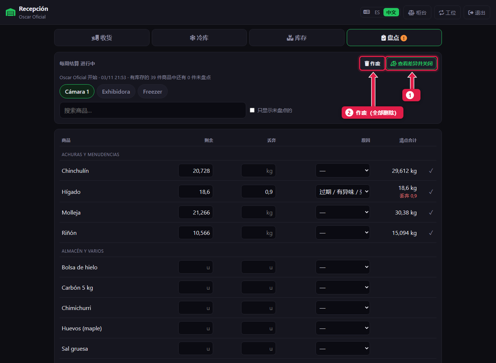
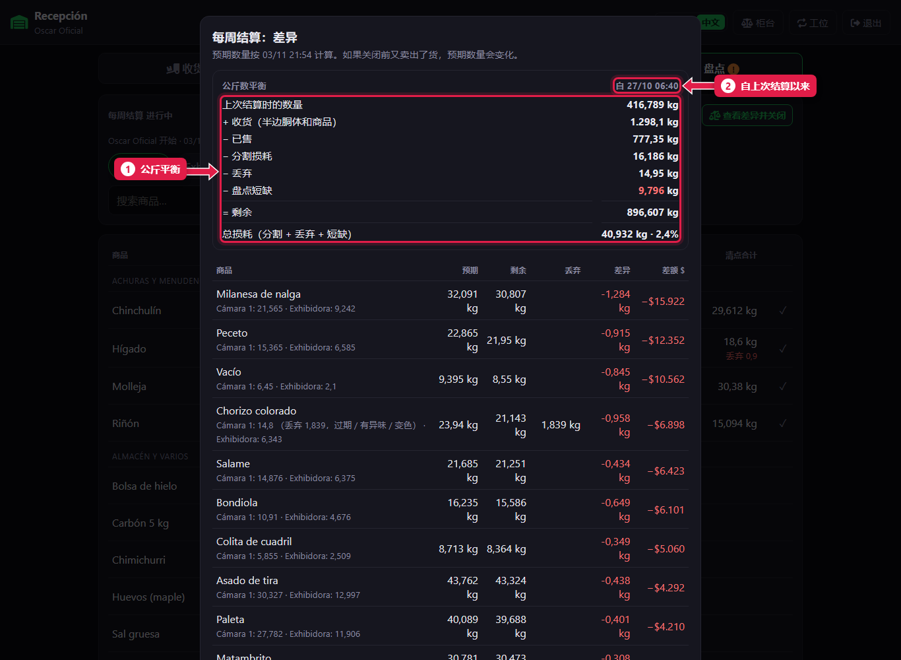
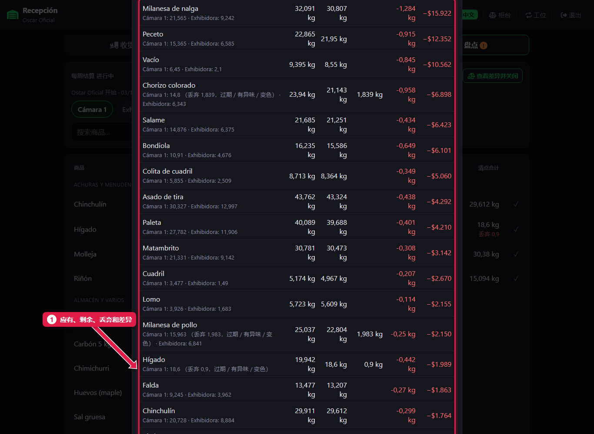
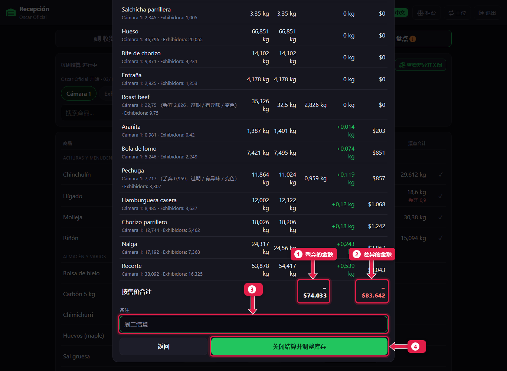
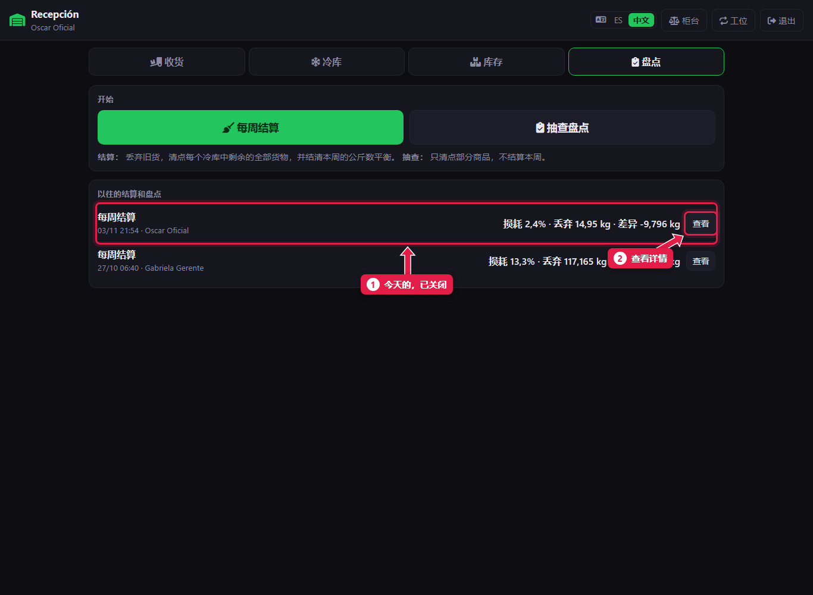

# 查看差异并关闭每周结算

> **适合谁：** 正式屠宰工和经理。  **时间：** 10 分钟。  **需要：** 全部盘点完（[教程 15](15-liquidacion-semanal-contar.md)）。

全部数完后点**查看差异并关闭**。系统显示本周的**公斤数平衡**、**总损耗**，以及每种商品的公斤差额和金额差额。核对后写备注，点**关闭结算并调整库存**。

## 有什么用
这是一周的快照：进了多少公斤、卖了多少、损失多少、为什么。关闭后，系统库存**等于盘点数**。

## 公斤数平衡
```
  上次结算时的库存
+ 收货（半边胴体和商品）
− 卖出
− 分割损耗
− 丢弃
± 盘点短少或多出
= 剩余
```
**总损耗** = 分割损耗 + 丢弃 + 短少。显示公斤数和占本周总量的百分比。**超过 6% 显示红色**。

## 操作步骤

### 1. 点“查看差异并关闭”


1. **查看差异并关闭。**
2. **作废：** 删除整个盘点，不动库存。只有需要重来时才用。

### 2. 核对公斤数平衡


1. 本周的**公斤数平衡**。
2. **起始：** 上次结算的日期。

如果有必须盘点的商品没数，上方会列出来，不能关闭。

### 3. 核对各商品的差异


1. 每种商品：**应有**、**剩余**、**丢弃**和**差额**（公斤和金额）。**金额损失最大的短少排在最上面。** 商品名下面是各冷库的明细。

### 4. 关闭


1. **丢弃的**金额。
2. **差额**金额（负数 = 短少）。
3. **备注：** 需要说明的情况。
4. 点**关闭结算并调整库存**。

### 5. 结算进入历史记录


1. 今天的结算，显示损耗、丢弃和差额。
2. **查看：** 打开完整明细。

## 系统在后台做了什么
- 库存**等于盘点数**：丢弃的记为**损耗**，差额记为**调整**。
- **不能撤销。**
- 平衡数据在下次同步时上传到加工厂。

## 常见问题
| 遇到…… | 原因…… | 怎么办 |
|---|---|---|
| 不能关闭：有未盘点商品列表 | 缺必须盘点的商品 | 去数（一点没有就录 0） |
| 损耗是红色 | 超过 6% | 看金额最大的短少：订单公斤数输错、分割没录入或肉放太久 |
| 应有数量前后不一样 | 中间又卖了东西 | 所以最好**开门前**结算 |

## 常见疑问

### 某个短少特别大怎么办？
关闭前重新数一下这个商品。关闭后才发现错误的话，用[抽查盘点](17-conteo-de-control.md)更正。

## 下一步
- 现在可以[接收新到的肉](11-recibir-despacho-del-frigorifico.md)了。
- [抽查盘点和历史记录](17-conteo-de-control.md)。
