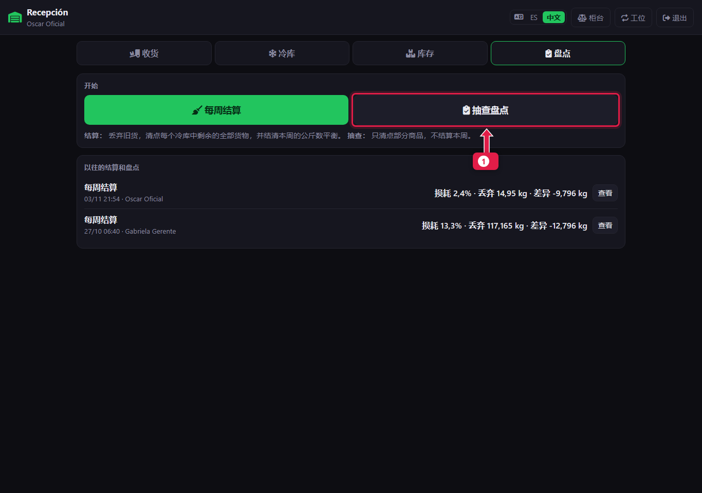
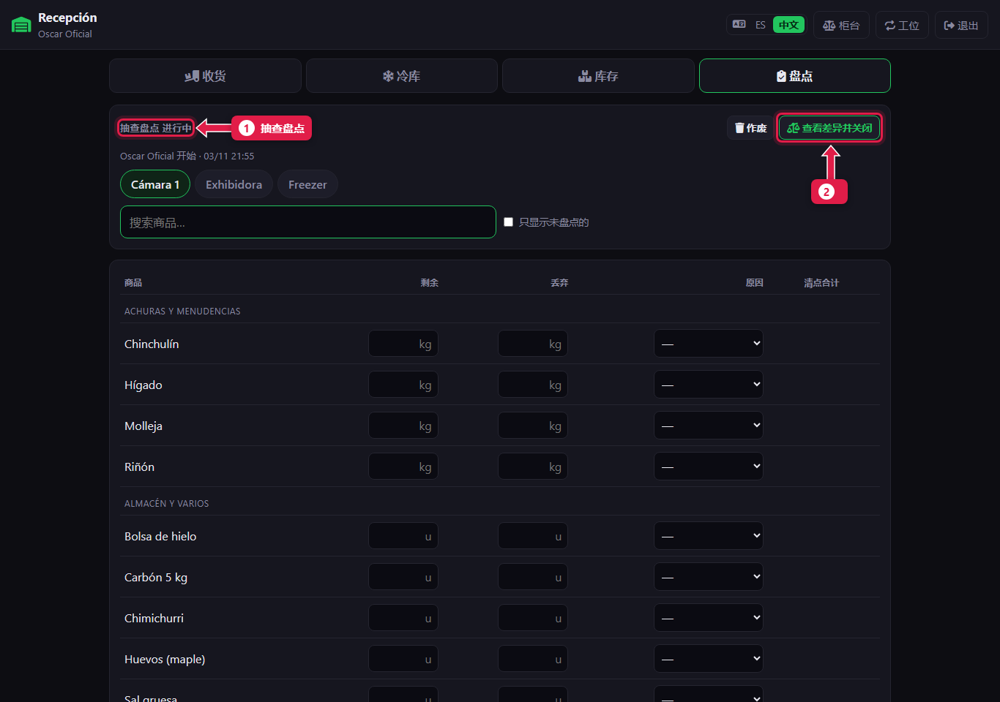
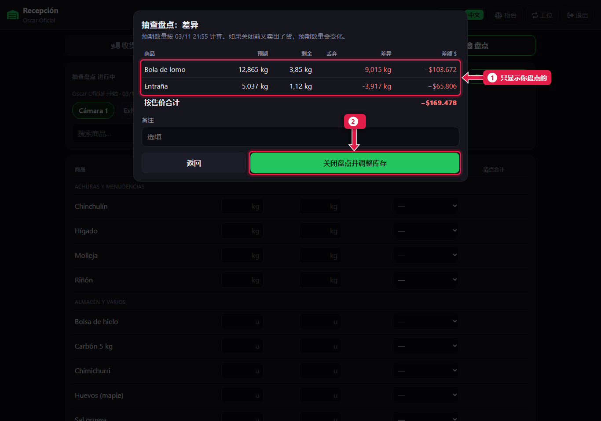
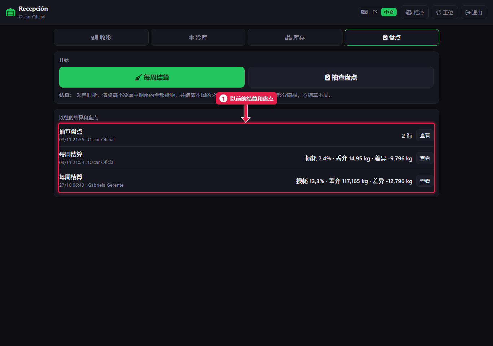
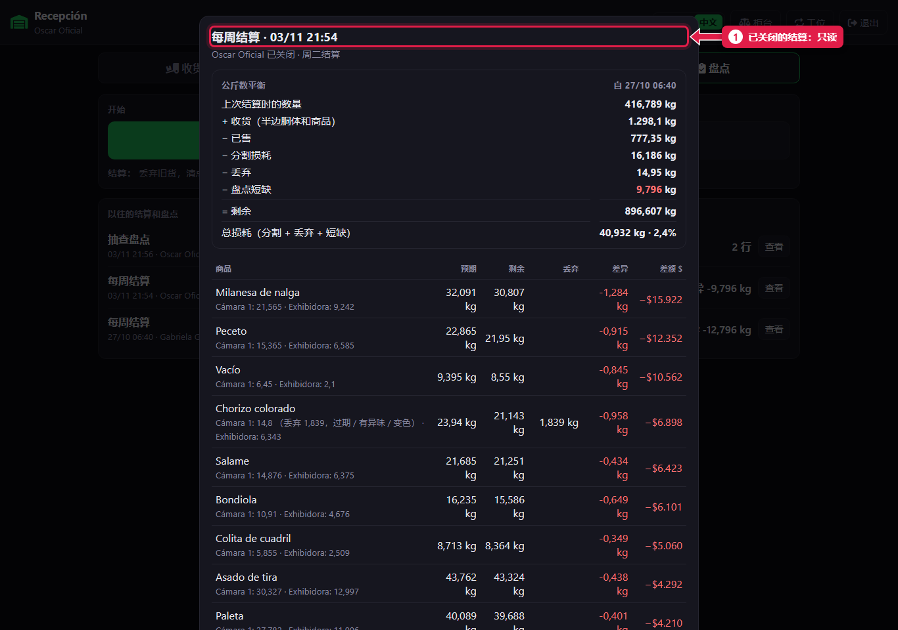

# 抽查盘点和历史记录

> **适合谁：** 正式屠宰工和经理。  **时间：** 5 分钟。

**抽查盘点**随时可以检查**某几种商品**，不用结算整周。数你想查的，看差异，然后关闭：这些商品的库存就等于盘点数。

## 有什么用
某个贵的部位出现负数，或者感觉少了，不用等到周二：数一下就能更正。

## 每周结算还是抽查盘点
| | 每周结算 | 抽查盘点 |
|---|---|---|
| 什么时候 | 结算日 | 需要时 |
| 数什么 | 所有有库存、按公斤卖的货 | 只数你想查的 |
| 结出什么 | 本周的公斤数平衡 | 不结算：只调整数过的 |

## 操作步骤

### 1. 开始抽查盘点

1. 点**抽查盘点**。

### 2. 数你要查的商品
搜索每个商品，录入**剩余**（需要时也录**丢弃**），和[每周结算](15-liquidacion-semanal-contar.md)一样。

1. 标题显示**抽查盘点进行中**。
2. 数完后点**查看差异并关闭**。

### 3. 核对并关闭

1. **只显示你数过的商品**及其差额。
2. 写备注，点**关闭**来调整库存。

### 4. 查看历史记录

1. **以前的结算和盘点**，显示损耗、丢弃和差额。点**查看**打开某一次。

1. 已关闭结算的明细：平衡、差异和各冷库的盘点数。**只读。**

## 系统在后台做了什么
- 只改变数过的商品的库存。
- 保存在历史记录里，并记录操作人。

## 常见疑问

### 结算当天能做抽查吗？
能，但不能同时：同一时间只能有一个盘点。做完一个再开始另一个。

## 下一步
- 给经理：[每周检查](22-controles-de-la-semana.md)。
