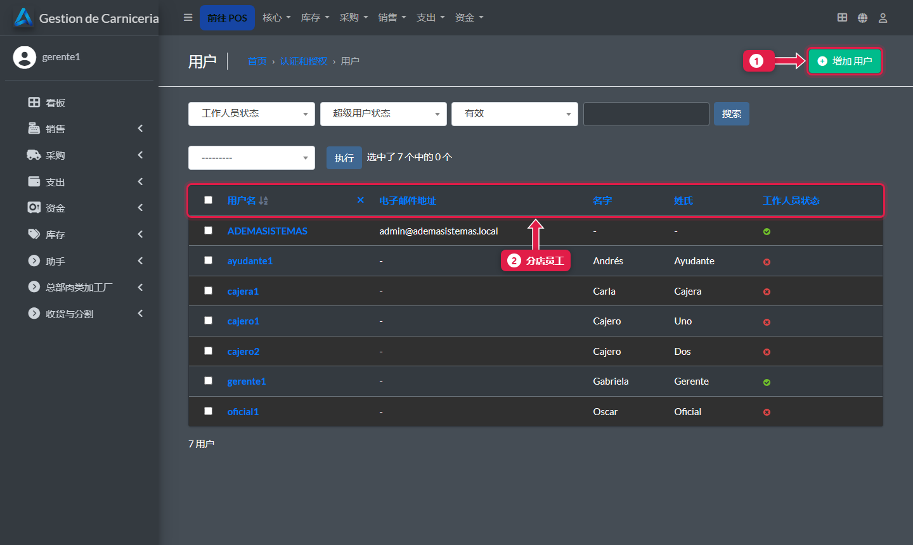
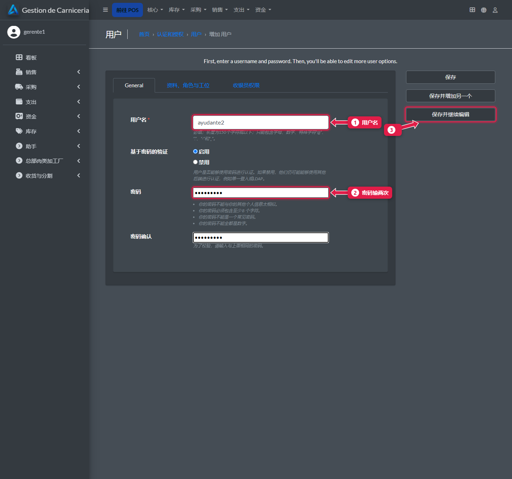
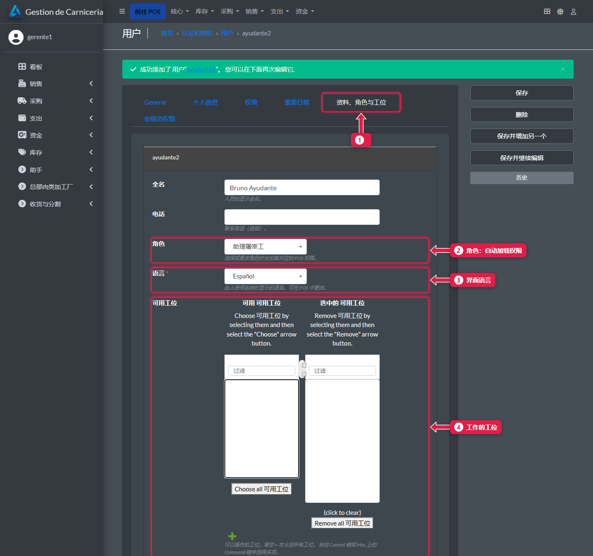
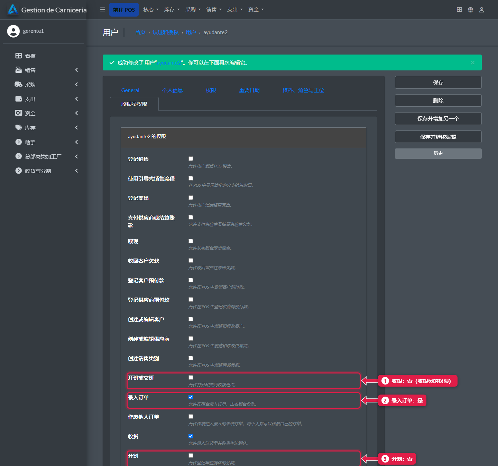
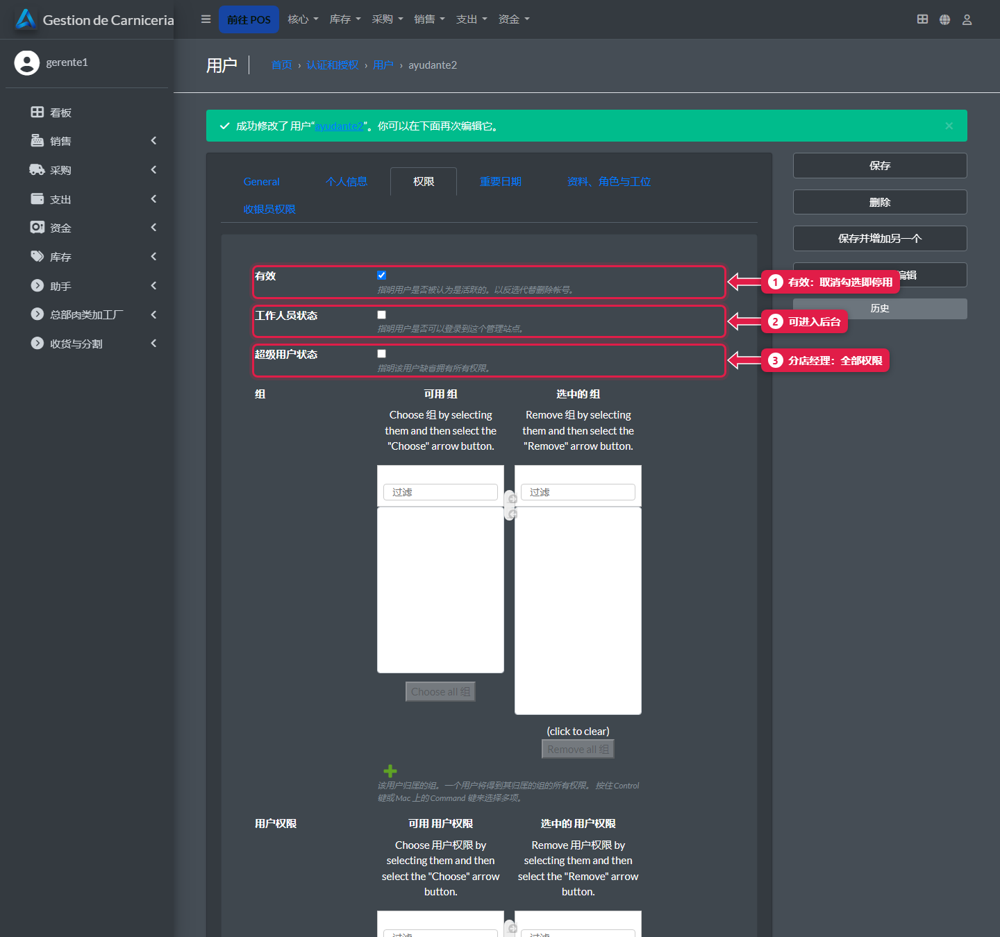

# 新增员工：用户、角色和工位

> **适合谁：** 分店经理。  **时间：** 3 分钟。  **在哪里：** 分店电脑的后台（`http://<电脑>:8250/admin/`）。

在**用户 → 添加**里输入用户名和密码。然后在**资料、角色与工位**里选**角色**（自动加载权限）、他工作的**工位**和**语言**。

## 有什么用
每个人登录后只看到自己该看的：屠宰工看不到收银台，收银员看不到库存。

## 角色
| 角色 | 开通的功能 |
|---|---|
| **助理屠宰工** | 录入和作废自己的订单，收货，查看库存，盘点 |
| **正式屠宰工** | 助理的全部 + 分割、作废别人的订单、关闭盘点和结算 |
| **收银员** | 开班和交班、收款、支出、取现、预付款和客户 |
| **分店经理** | 全部 |

## 操作步骤

### 1. 打开用户列表
在后台：**认证和授权 → 用户**。

1. **添加用户。**
2. 分店员工。

### 2. 输入用户名和密码

1. **用户名：** 简短、不带空格，例如 `ayudante2`。
2. **密码**，输两次。
3. 点**保存并继续编辑**。

### 3. 选择角色、语言和工位
打开**资料、角色与工位**标签页。

1. **资料、角色与工位**标签页。也填上**全名**。
2. **角色：** 保存时加载该角色的权限。
3. **语言：** 西班牙语或中文（[教程 02](02-cambiar-idioma.md)）。
4. **可用工位：** 把他工作的工位移到“已选”（双击每个工位）。一个都不选的话，可以用所有工位。

点**保存并继续编辑**。

### 4. 核对角色加载的权限
**收银员权限**标签页。

1. **开班或交班：** 否（这是收银员的）。
2. **录入订单：** 是。
3. **分割：** 否（这是正式屠宰工的）。

可以手动调整，比如让某个助理也能分割。之后如果改了角色，权限会恢复成新角色的。

### 5. 停用账号：取消“有效”
**权限**标签页。

1. **有效：** 取消勾选，这个人就不能再登录。**不要删除**：他的销售和订单还记在他名下。
2. **工作人员状态：** 允许进入后台。
3. **超级用户状态：** 访问全部，包括财务看板。只给经理。

## 如果是收银员：给她分配支付方式
见[每位收银员能用哪些支付方式](20-medios-de-pago-de-la-cajera.md)。没有分配时，她会看到所有账户，包括内部账户。

## 常见问题
| 遇到…… | 原因…… | 怎么办 |
|---|---|---|
| 员工看不到自己的工位 | 不在*可用工位*里 | 给他加上 |
| 工位列表看起来是空的 | 后台深色主题下选项文字是白底白字 | 照样双击每个工位：它会移到“已选”。保存后就记在资料里 |
| 经理进不了后台 | 没勾**工作人员状态**（和**超级用户状态**） | 在权限标签页勾上 |
| 调好的权限没了 | 之后改了角色 | 重新调整 |

## 常见疑问

### “分店经理”角色就能进后台吗？
不能。角色只加载 POS 的权限。进后台要勾**工作人员状态**和**超级用户状态**。

## 下一步
- [工位、冷库和分店资料](19-puestos-camaras-y-configuracion.md)。
