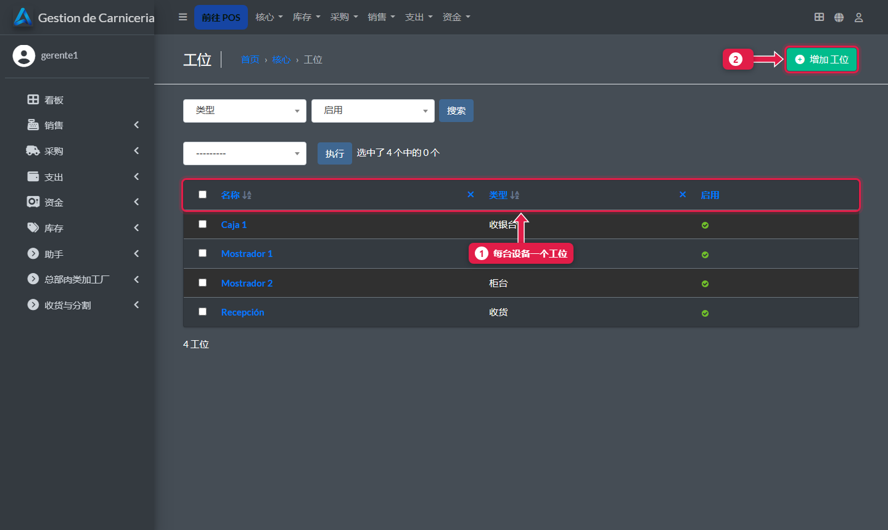
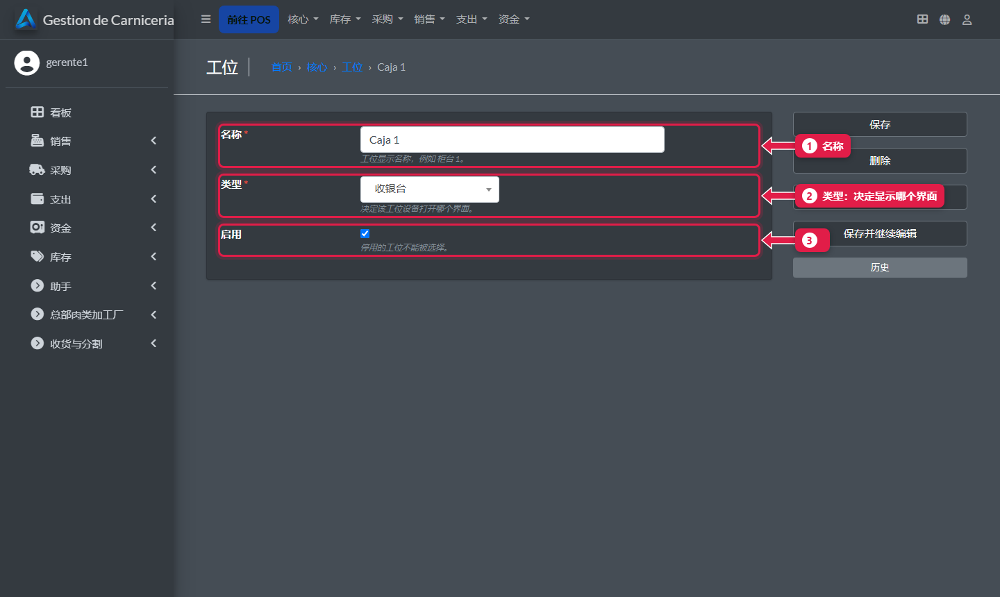
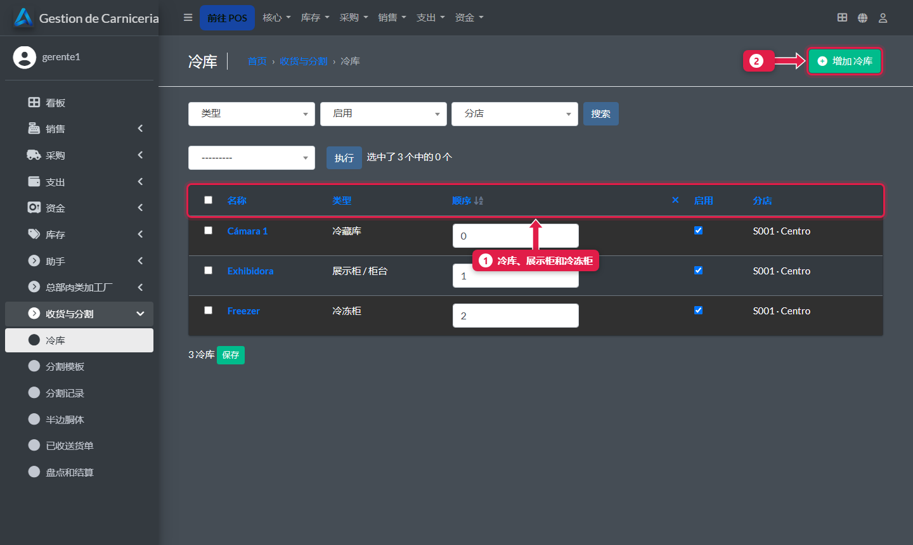
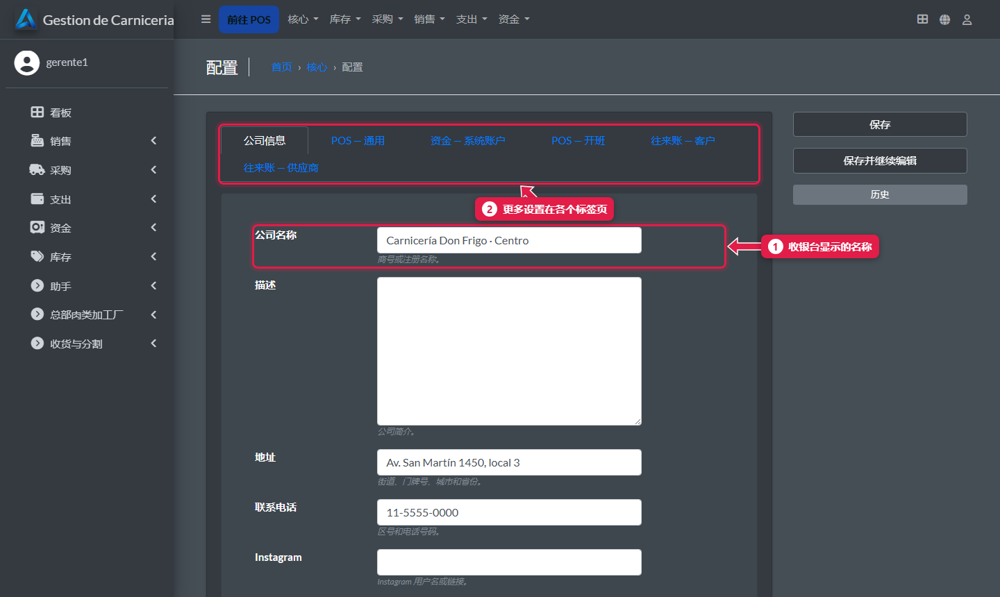
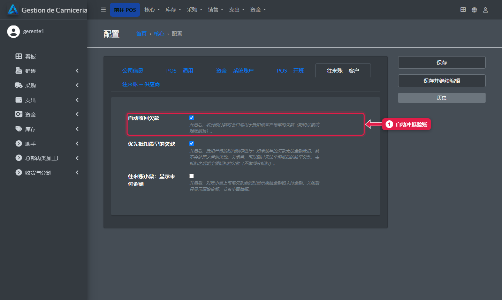

# 工位、冷库和分店资料

> **适合谁：** 分店经理。  **时间：** 5 分钟。  **在哪里：** 分店电脑的后台。

在后台给每台设备（收银台、柜台、收货）录一个**工位**，录入**冷库**和**店铺资料**。

## 有什么用
工位决定每台设备打开哪个界面。冷库会出现在收货、移动半边胴体和盘点时。

## 操作步骤

### 1. 工位
**核心 → 工位**。

1. **每台设备一个工位**：Caja 1、Mostrador 1、Mostrador 2、Recepción。
2. 新平板就**添加工位**。

1. **名称：** 员工认得的名字。
2. **类型：** **收银台**、**柜台**或**收货**。决定打开哪个界面。
3. **启用：** 不用的工位就停用。

### 2. 冷库
**收货与分割 → 冷库**。

1. 每个冷库的**类型**（冷藏库、展示柜或冷冻柜）和**顺序**。收半边胴体时默认用第一个启用的“冷藏库”类型。
2. **添加冷库。** 不用的冷库**停用**，不要删除。

### 3. 店铺资料
**核心 → 设置（Configuración）**。

1. **名称：** 显示在收银台和财务看板顶部。
2. 更多设置在各个**标签页**里：打印机、资金账户、开班和往来账。

### 4. 赊账自动收回
**往来账 — 客户**标签页。

1. **自动收回欠款：** 勾选后，客户付款时系统会自动冲抵他最早的欠款（[教程 08](08-fiado-y-cobro-de-deuda.md)）。

## 这个界面没有的内容
- **结算日：** 系统保存着（默认周二），但这个版本在设置里**看不到**。要改需找技术支持。
- **同步状态：** 最近一次同步和最后的错误也不在这里显示。加工厂在总部面板上可以看到（[教程 23](23-panel-central.md)）。

## 常见问题
| 遇到…… | 原因…… | 怎么办 |
|---|---|---|
| 平板打开了错误的界面 | 工位的类型不对 | 改工位的**类型**，或在平板上点**工位** |
| 盘点时看不到某个冷库 | 它被停用了 | 启用它 |

## 常见疑问

### 商品和价格在这里改吗？
不在。由加工厂录入并自动下发（[教程 26](26-catalogo-precios-y-plantillas.md)）。在分店改的话，修改会丢失。

## 下一步
- [每位收银员能用哪些支付方式](20-medios-de-pago-de-la-cajera.md)。
