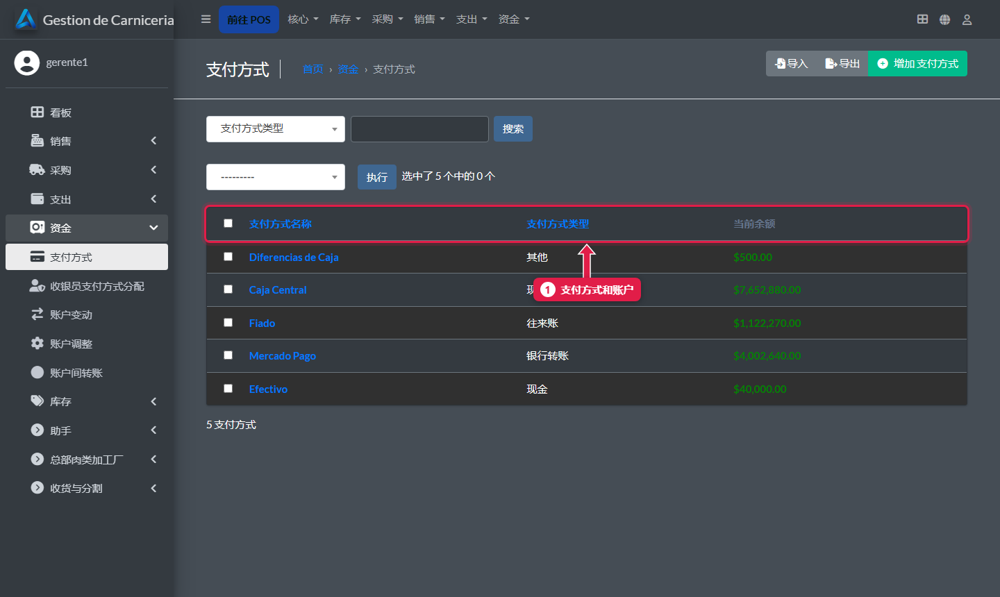
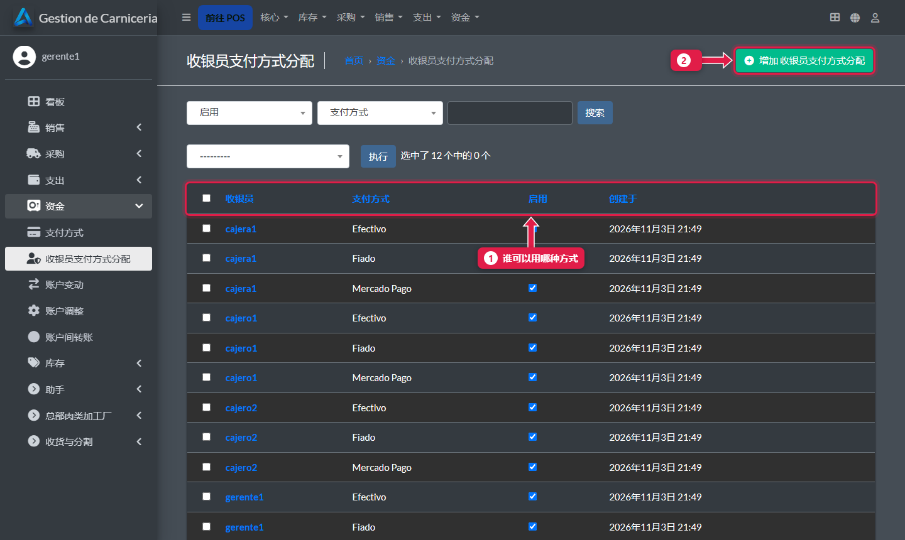
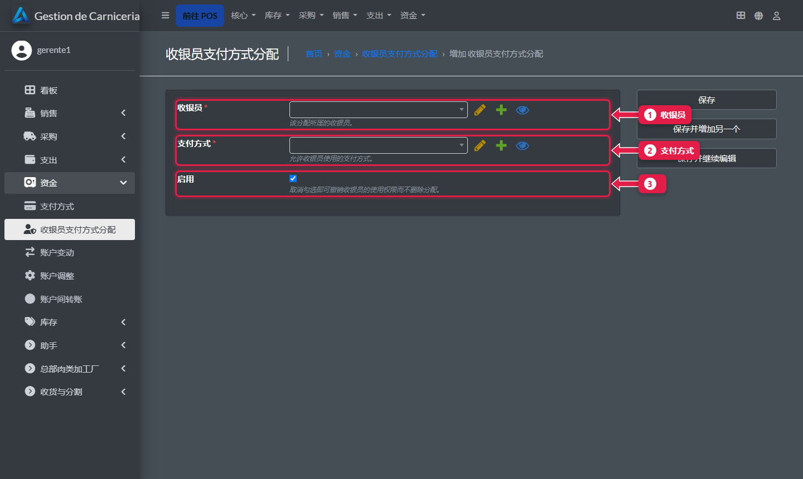

# 每位收银员能用哪些支付方式

> **适合谁：** 分店经理。  **时间：** 2 分钟。

在**资金（Tesorería）→ 收银员支付方式分配**里，选择每位收银员用哪些方式收款。一般是 **Efectivo**（现金）、**Mercado Pago** 和 **Fiado**（赊账）。

## 有什么用
资金管理里有内部账户（Caja Central 总钱箱、Diferencias de Caja 收银差额），不是用来收款的。收银员没有分配时，会看到**全部**账户，包括这些。

## 操作步骤

### 1. 支付方式
**资金 → 支付方式**。

1. **支付方式和账户**：现金、Mercado Pago、赊账和内部账户。

### 2. 分配
**资金 → 收银员支付方式分配**。

1. **谁可以用哪种方式。**
2. **添加**一条分配。

### 3. 分配一种方式

1. **用户：** 收银员。
2. **支付方式。**
3. **启用：** 勾上。取消勾选就能收回这种方式，而不用删除分配。

每种方式都重复一遍。

## 系统在后台做了什么
- 在收银台，收银员只看到分配给她且启用的方式。用别的方式会被系统拒绝。
- 经理（超级用户）始终能看到全部。

## 常见疑问

### 怎么新增一种方式，比如借记卡？
在**支付方式 → 添加**里新增，选好**类别**（Tarjeta de Crédito/Débito，信用卡/借记卡）。然后分配给收银员。

## 下一步
- [财务看板和报表](21-dashboard-y-reportes.md)。
