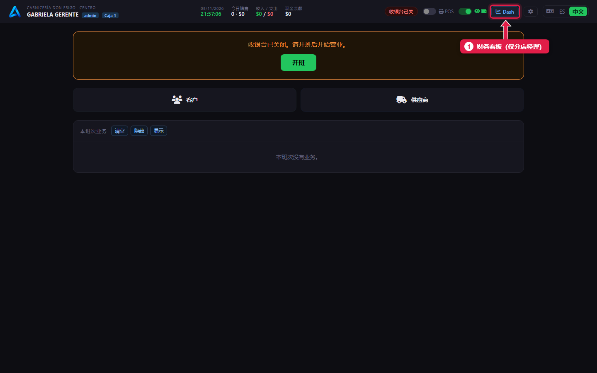
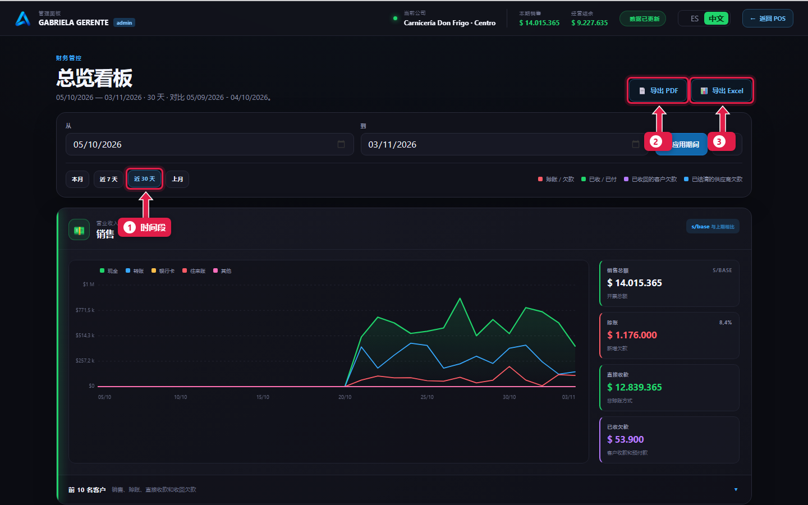
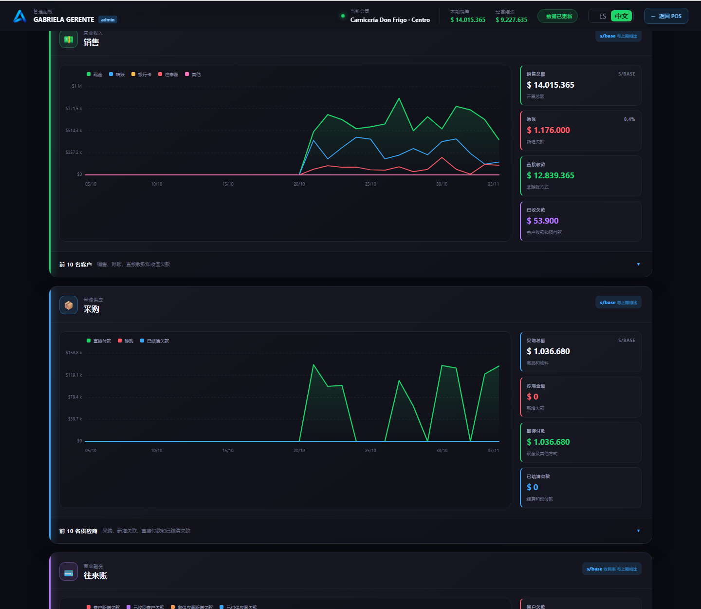
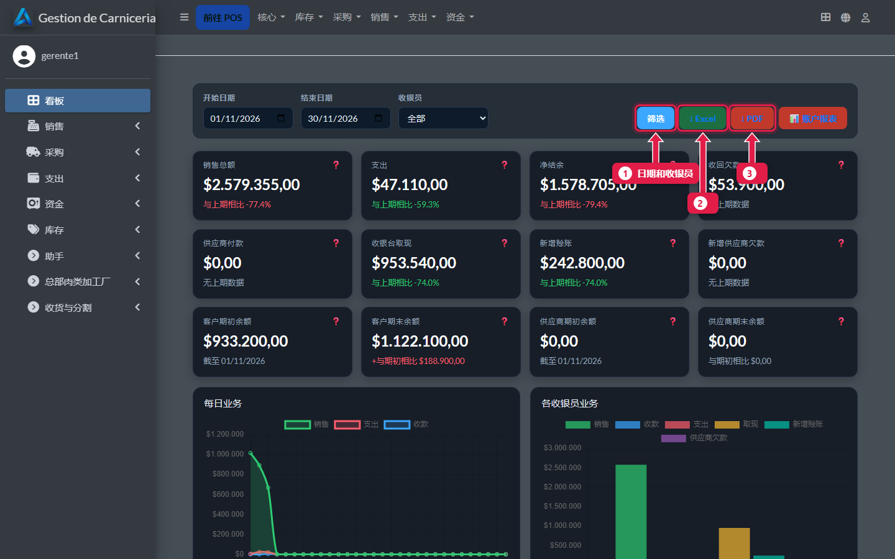

# 财务看板和报表

> **适合谁：** 分店经理（超级用户）。  **时间：** 5 分钟。

收银台的 **Dash** 按钮打开**财务看板**：所选期间的销售、采购、往来账和支出，并与上一期间比较。可导出 **PDF** 或 **Excel**。后台首页的**看板**有另一个汇总，可以按收银员筛选。

## 有什么用
一眼看清卖了多少、赊了多少、收回多少、钱花在哪，不用手动加小票。

## 操作步骤

### 1. 打开财务看板

1. **Dash**：只有超级用户能看到。

### 2. 选择期间并导出

1. **期间：** 本月、近 7 天、近 30 天、上月，或手动选日期后点**应用期间**。
2. **导出 PDF。**
3. **导出 Excel。**

### 3. 看懂每个面板

共有四个面板：**销售**、**采购**、**往来账**和**支出**。每个都有逐日走势，以及显示合计和与上一期间对比的卡片。每个面板下方是**前 10 名**（客户、供应商、余额或支出）。

### 4. 后台首页的看板
在后台点**看板**。

1. 按日期和收银员**筛选**。
2. **Excel。**
3. **PDF。**

## 系统在后台做了什么
- 两个看板用同一套计算：同一项数据不会显示不同的数字。
- 财务看板断网也能用。
- PDF 和 Excel 永远是西班牙语。

## 常见疑问

### 每次交班的 PDF 在哪？
在**销售 → 收银班次**，**Cierre PDF**（交班 PDF）一栏（[教程 22](22-controles-de-la-semana.md)）。

### 财务看板显示公斤数和损耗吗？
不显示：它是财务的。公斤数和损耗在[每周结算](16-liquidacion-cerrar.md)和[总部面板](23-panel-central.md)里。

## 下一步
- [每周检查](22-controles-de-la-semana.md)。
